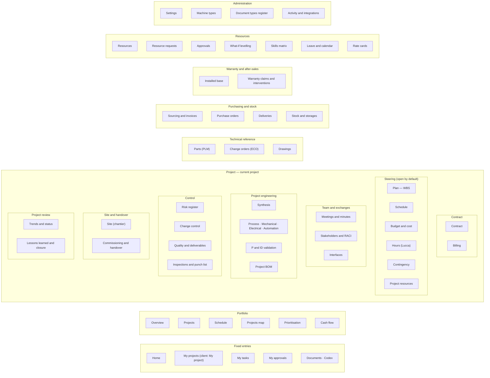
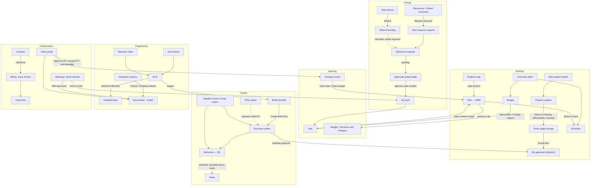

# 00 — Keystone PM: overview, screen inventory, architecture and build plan

This is the entry point of the Keystone PM rebuild specification. It summarises the product, lists every screen, maps navigation, describes the concerns that span all modules, recommends a target architecture, and proposes a phased build plan. It ends with the consolidated list of open questions for the product owner.

Field-level detail lives in the module specs (01–10). The consolidated domain model is in [`11-data-model.md`](11-data-model.md).

**Sources.** Everything here is derived from the Claude Design prototype `design/Keystone PM v8.dc.html` (5 242 lines; template 17–3093, mock data 3095–3762, logic 3763–5242). The annotated template `design/_extracted/template-annotated.html` has the same line numbers. French labels come from the prototype's own dictionary (`FR_DICT`, line 3752 = `design/_extracted/fr_dict.json`). Line numbers below refer to the prototype. Behaviour that the prototype does not define is marked **OPEN QUESTION** and collected in §10.

---

## 0. The specification set

| File | Scope | Main template lines |
|---|---|---|
| `00-overview.md` (this file) | Product summary, screen inventory, navigation map, cross-cutting concerns, target architecture, build plan, consolidated open questions | — |
| `01-shell-navigation-i18n.md` | App shell (sidebar, header, project switcher, global search, notifications), personas and role gating, outside-workspace mode, zone bar, generic add-form dialog (38 forms), toast, New project wizard, Force stage change, New resource request, FR/EN layer, formatting helpers, full screen inventory | 17–161, 2972–3092 |
| `02-design-system.md` | Nocturne tokens and classes, semantic tones and status→tag mappings, typography, layout, z-index, proposed component library (C-01…C-31), charts (CH-1…CH-12), `support.js` runtime, `<image-slot>`, world-map page | styles.css, 17–3093, `Keystone PM map.html` |
| `03-portfolio-home.md` | Home (8 role variants), My projects, Projects map, Portfolio overview, Projects register and lifecycle, Prioritisation and capacity, Cash flow, Client portal | 163–285, 638–752, 2079–2236 |
| `04-cost-contract.md` | Budget and cost (EVM), Trends and status report, Contract, Billing and payments, Contingency register | 286–484, 814–869, 900–909, 1737–1770 |
| `05-planning-schedule.md` | Schedule (Gantt), Plan — WBS and activities (+ activity drawer), Portfolio schedule, What-if levelling, Meetings and minutes, Stakeholders and RACI | 485–572, 753–813, 870–879, 972–1166, 1504–1528 |
| `06-resources-hr.md` | Resources, Project resources, Rate cards, Skills matrix, Leave and calendar, Hours (Lucca reconciliation) | 573–637, 932–947, 1420–1503 |
| `07-risk-change-quality-ops.md` | Risks, Change control and baselines, Quality (NCR and deliverables), ITP and punch list, Interfaces, Commissioning and handover, REX and closure, Installed base, Warranty claims | 880–971, 1771–1971 |
| `08-supply-chain-approvals.md` | Sourcing, invoices and suppliers, Purchase orders, Deliveries, Stock, Resource requests, Approvals (department head), My approvals | 1598–1736, 1972–2078, 2615–2812 |
| `09-engineering-plm.md` | Project BOM, Part drawer, PLM, ECO, Drawings, P&ID, Engineering synthesis and discipline screens, Machine types | 1167–1419, 1529–1572, 2384–2613 |
| `10-site-docs-mywork-settings.md` | Settings, Activity and integrations, Site (chantier), Documents (Codex index, record drawer, deposit dialog), Document types, My work, Task detail | 1573–1597, 2237–2383, 2813–2969 |
| `11-data-model.md` | Consolidated domain model: entities, enums, ER diagrams, status machines, seed mapping, conflicts | 3095–3762 |
| `12-coverage-report.md` | Completeness audit of 01–10 against the prototype (all `isXxx` screen flags, overlay and drawer flags, 222 top-level declarations of the data block); addenda appended to 01, 03–09 | all |

Other inputs: `design/_ds/nocturne-…/styles.css` + `readme.md` (design system), `design/support.js` (x-dc runtime), `design/image-slot.js`, `design/Keystone PM map.html` (d3 world map), `design/screenshots/` (68 reference captures `NN-probe.jpg`, to be used for visual review only), `design/_extracted/tpl_keys.json` (1 059 UI strings) and `fr_dict.json` (2 786 FR entries).

---

## 1. Product summary

### 1.1 What Keystone PM is

Keystone PM is the project and portfolio management tool of **Keystone**, a French industrial company. Keystone designs, builds, installs and maintains machines and equipment such as port cranes, data-centre power and cooling, clinic fit-outs, solar arrays and metro signage, under EPC-style contracts.

- **Footprint.** Central warehouse and mechanical workshop in Lyon (`SETTINGS0.locations`), site stores such as Le Havre and Marseille, and projects in three zones: Europe & North America, Africa, Asia Pacific.
- **Quality system.** ISO 9001; clause references appear on NCRs, document types and the audit trail.
- **Product ranges.** Five machine types (EMP, MEMU, SPUR, AUTRE, R&D). Each one is a template for planning, cost structure, ITP and payment pattern.

The tool follows a project through its whole life. It uses a French stage-gate lifecycle (`STATUSES`, line 3136):

> Initiative → APS → APD → Etudes → Approvisionnements → Fabrication & Assemblage → FAT → Expédition → Chantier → Mise Service & SAT → Garantie → Clos (+ Annulé)

The tool is organised in six layers:

| Layer | What it covers |
|---|---|
| **Portfolio** | Steering, prioritisation, capacity, cash, world map |
| **Project control** | WBS and schedule, EVM cost control, contract and billing, change control, risks, contingency, weekly trend snapshots |
| **Engineering** | Discipline deliverables and cross-discipline consistency checks, P&ID validation, project BOM, parts catalogue (PLM), engineering change orders (ECO) with installed-base effectivity, drawings (PDM) |
| **Supply chain** | RFQs, purchase orders with approval, goods receipt and QC, stock, supplier invoices with 3-way match |
| **Execution and handover** | Site readiness ("Go chantier"), mobilisation, daily reports, ITP and punch list, interfaces, commissioning and handover dossier, lessons learned and closure |
| **After-sales** | Installed base and warranty claims |

Cross-cutting functions:

- **People and capacity.** Resource requests with approval by department heads, allocation heatmaps, skills, leave, rate cards, hours reconciliation.
- **Personal work.** Role-specific home, My tasks, My approvals.
- **Client portal.** Decisions, invoices, issues and shared documents.

Keystone PM is a **system of engagement on top of existing systems of record**. It reads from or writes to:

| System | Data |
|---|---|
| Lucca | Hours, leave |
| Sage X3 | Stock, purchase orders, accounts payable |
| SolidWorks PDM | Drawings |
| Codex | Documents, approval circuits, retention |
| Cursus | Individual site clearances |
| MS Project / Primavera P6 | Schedules |
| Outlook | Calendar |
| Teams and SMTP | Notifications |

See §7.12.

### 1.2 Prototype facts that shape the rebuild

| Fact | Value / source |
|---|---|
| Screens | 59 screen ids (58 navigable + `task`), selected by a single `state.screen` key — no URL routing (01 §1.3) |
| Personas | 8, switchable through "View as" (`PERSONAS` 3747) |
| Role gating | `ROLE_SCREENS` (3465–3466); it hides navigation only (01 §3.3) |
| Project-scoped screens | 30 (header project switcher, `showProjectPicker`) |
| Zone-filtered screens | 8 (`zoneBar`: overview, projects, pfplan, worldmap, portfolio, cash, fleet, sav) |
| Generic create/run forms | 38 (`AF` 3674–3700) |
| Drawers / dialogs | 16 right-side drawers, 4 wizards/dialogs, 2 centred modals over drawers |
| Languages | Authored in EN, rendered FR by default (`lang:'fr'`) through a translation layer (`TPL_KEYS` 1 059, `FR_DICT` 2 786, `FR_RULES` 284) |
| Data | ≈200 in-memory mock-data constants (222 top-level declarations including helpers, per `12-coverage-report.md`). 17 projects, of which 6 have planning/cost data (`DEFS`) and only HLT-026 "Harbor Line Terminal Expansion" is fully detailed. |
| Time | Frozen at **Friday 25 Sep 2026** (status date; `TODAY = 4` working days after Mon 21 Sep 2026); some screens use 30 Sep 2026 (`PG_NOW = 8.97`) |
| Persistence | None except the sidebar collapse state (`localStorage['keystone-nav-open']`). Edits are kept in per-screen override maps (`riskOv`, `poOverrides`, `engOv`…) and in `state.added.*`. |
| Visual system | Nocturne dark theme, Inter, Phosphor icons, mono-accent palette (no red/amber/green) |

---

## 2. Users and personas

The prototype's "View as" menu stands in for real authentication. In the rebuild each persona is a role held by an authenticated user.

The prototype also keeps two separate lists of people:

- **personas** (`PERSONAS`), the users who log in;
- **resources** (`PEOPLE`), the 8 staff whose load is planned.

Only Julien Wagner and Fabien Bertrand appear in both. The rebuild should unify them into one Person/User model (see 11 §3.1).

| Role key | Persona (prototype) | Title EN / FR | Job to be done in Keystone | Allowed screens (`ROLE_SCREENS`) | Home content (03 §1.2) | Notable rights in the prototype |
|---|---|---|---|---|---|---|
| `director` | Marie Lefebvre | Portfolio director / Directrice de portefeuille | Steer the portfolio, arbitrate approvals (CRs, POs, ECOs, forced stage changes), see costs and margins | all (null = no gating) | Portfolio KPIs, "Needs attention", portfolio approvals | Sees rates and margin; New project; CR step `director`; PO approval; forced-stage validation (informational) |
| `pm` | Romain Aubert | Project manager / Chef de projet | Plan, control cost/schedule, request resources, manage contract and billing, changes, risks, suppliers for own project | 53 | Current-project SPI/CPI/EAC/float, my resource requests, "Waiting for me" | Sees rates and margin; New project; CR step `pm`; ECO `pm` approval; "Validate release (PM)" of engineering deliverables; read-only on other PMs' projects |
| `depthead` | Marion Kerviel | Head of engineering / Responsable ingénierie | Approve/reject/reschedule resource requests for the department, balance team load | 16 | Awaiting my approval, team utilisation, approval queue, team load | Approvals queue (department chips are free for any role) |
| `member` | Julien Wagner | Structural engineer / Ingénieur structure | Execute assigned tasks, log time, see own load and skills | 9 | My tasks, hours logged (Lucca), load, skills | Task status, checklist, comments, time log |
| `englead` | Antoine Girard | Engineering lead / Référent ingénierie | Run discipline engineering, consistency checks, drawings, P&ID, ECO engineering approval | 26 | ECOs waiting for engineering, skill-gap and drawing watchlist | ECO `englead` approval; interchangeability; machine types edit |
| `quality` | Gabriel Comte | Quality manager / Responsable qualité | NCRs, deliverables, ITP, goods-receipt QC, ECO quality approval | 30 | ECOs awaiting quality, parts needing action | ECO `quality` approval; NCR verification; delivery QC inbox; machine types edit |
| `procurement` | Fabien Bertrand | Procurement & stock / Achats et stock | RFQs, POs, deliveries, stock, supplier invoices | 18 | POs to act on, still-to-order BOM shortfall | RFQ award; delivery QC inbox; invoice 3-way match |
| `client` | Nadia Bensaïd | Client — Port authority / Client — Autorité portuaire | Follow progress, decide on change requests, accept deliverables (PV), raise issues, acknowledge documents | 10 | Progress, milestones, decisions waiting, invoices | CR step `client`; deliverable acceptance; read-only on non-owned projects |

Department heads (`DEPTS`, line 3268), who receive resource requests:

| Department | Head |
|---|---|
| Engineering | Marion Kerviel |
| Site operations | Olivier Blanc |
| MEP | Sophie Renard |
| Quality | Gabriel Comte |
| Controls & planning | Ines Duarte |

Zone managers (`ZONES`, 3170):

| Zone | Manager |
|---|---|
| Europe & North America | Olivier Castel |
| Africa | Aïcha Diallo |
| Asia Pacific | Sophie Nguyen |

Approvers per Codex document circuit come from `DOC_WHO` (3617).

---

## 3. Functional modules

| # | Module | Screen ids | Spec | Core entities (see 11) | External systems |
|---|---|---|---|---|---|
| M0 | Shell and platform | (sidebar, header, search, notifications, dialogs, i18n) | 01, 02 | User, Role, Notification, Preference, AuditEntry | Teams, SMTP (notifications) |
| M1 | Home and personal work | home, myprojects, mywork, task, myapprovals | 03, 10, 08 | Task, ChecklistItem, TimeEntry, ApprovalItem (derived) | Lucca (hours) |
| M2 | Portfolio | overview, projects, pfplan, worldmap, portfolio, cash | 03, 05 | Project, LifecycleStage, StageTransition, PipelineStagePlan, PortfolioScore, Zone | — |
| M3 | Project planning and collaboration | plan, schedule, whatif, meetings, stakeholders | 05 | WbsNode, Activity, ActivityLink, Milestone, Baseline, Meeting, Stakeholder, RaciMatrix, WhatIfScenario | MS Project, P6, Outlook, Teams (transcripts) |
| M4 | Cost, contract and finance | budget, trends, contract, billing, contingency, hours | 04, 06 | CostCategory, WorkPackageBudget, EvmPeriod, StatusSnapshot, Contract, Amendment, Bond, PaymentMilestone, CustomerInvoice, ContingencyDraw, HoursImport | Lucca, Sage X3 (actuals) |
| M5 | Project control | risks, changes, quality, itp, interfaces | 07 | Risk, ChangeRequest, NCR, Deliverable, ItpInspection, PunchItem, Interface | Codex |
| M6 | Site and handover | site, commissioning, rex | 10, 07 | SiteSheet, CursusClearance, SiteEquipment, ClientPrerequisite, RotationEntry, DailyReport, HseItem, CommissioningStep, HandoverItem, LessonLearned, ClosureItem | Cursus, Codex |
| M7 | Project engineering | eng, eng-process, eng-meca, eng-elec, eng-auto, pid, bom (+ part drawer) | 09 | EngInput, ConsistencyCheck, EngOutput, PidTag, ProjectBomLine, SpareListLine | AutoCAD P&ID, SolidWorks 3DX, SeeElectrical, TIA Portal (file imports) |
| M8 | Technical reference | plm, eco, drawings | 09 | Part, Eco, EcoDisposition, Drawing, MachineConfiguration | SolidWorks PDM |
| M9 | Purchasing and stock | procurement, orders, deliveries, stock | 08 | Supplier, Rfq, Quote, PurchaseOrder, GoodsReceipt, SupplierInvoice, StockPosition, StockMovement, StorageLocation | Sage X3 |
| M10 | Warranty and after-sales | fleet, sav | 07 | Machine, WarrantyClaim, Intervention | — |
| M11 | Resources | resources, presources, requests, approvals, whatif, skills, leave, rates | 06, 08 | Person, Department, ResourceRequest, Allocation, Skill, PersonSkill, LeaveEntry, RateRole, RateMultiplier | Lucca |
| M12 | Documents | docs (+ record drawer, deposit dialog), doctypes | 10 | Document, DocumentRevision, DocumentApproval, DocumentType | Codex |
| M13 | Administration | settings, mtypes, doctypes, plumbing | 10, 09 | ReferenceList, MachineType, Connector, ImportFormat, ActivityEvent, AuditEntry | all connectors |
| M14 | Client portal | client | 03 | (views over ChangeRequest, Deliverable, CustomerInvoice, ClientIssue, Document) | Codex |

---

## 4. Complete screen inventory

Legend:

- **Cx** — complexity from the module readers: S / M / L / XL.
- **Scope**:
  - *global* — not tied to a project;
  - *project* — uses the header project switcher (30 screens);
  - *zone* — zone bar shown;
  - *person* — depends on the selected person.
- **Roles** — roles other than `director` that may open the screen (`director` sees everything).
- **Route** — a *proposal* (§8.3); the prototype has none.

Roles: PM, DH (depthead), MEM (member), EL (englead), QM (quality), PRO (procurement), CLI (client).

| # | Screen id | Title EN / FR (page `<h2>`) | Module | Spec | Cx | Proposed route | Scope | Roles | Header primary action (EN) |
|---|---|---|---|---|---|---|---|---|---|
| 1 | `home` | Home / Accueil | M1 | 03 §1 | L | `/` | global | all | New project (director, pm) |
| 2 | `myprojects` | My projects / Mes projets | M1 | 03 §2 | M | `/my/projects` | global | all but CLI | — |
| 3 | `mywork` | My work / Mon travail (nav "My tasks / Mes tâches") | M1 | 10 §6 | L | `/my/tasks` | person | MEM | Log time |
| 4 | `task` | *task title* (e.g. "Survey verticality — Bay 3 columns") | M1 | 10 §7 | M | `/my/tasks/[taskId]` | person | MEM | Mark done |
| 5 | `myapprovals` | My approvals / Mes approbations | M1 | 08 §7 | M | `/my/approvals` | role | all but MEM | — |
| 6 | `overview` | Portfolio overview / Vue d’ensemble du portefeuille | M2 | 03 §4 | M | `/portfolio/overview` | zone | PM, DH | New project |
| 7 | `projects` | Projects / Projets | M2 | 03 §5 | XL | `/portfolio/projects` | zone | PM | New project |
| 8 | `pfplan` | Portfolio schedule — projects in progress & pipeline / Planning du portefeuille — projets en cours & pipe | M2 | 05 §3 | L | `/portfolio/schedule` | zone | PM | — |
| 9 | `worldmap` | Projects map / Mappemonde des projets | M2 | 03 §3, 02 SCR-WORLDMAP-FRAME | XL | `/portfolio/map` | zone | PM, DH | — |
| 10 | `portfolio` | Portfolio — prioritisation & capacity / Portefeuille — priorisation & capacité | M2 | 03 §6 | L | `/portfolio/prioritisation` | zone | PM | Score a proposal |
| 11 | `cash` | Cash flow & billing — next 6 months / Trésorerie & facturation — 6 prochains mois | M2 | 03 §7 | M | `/portfolio/cash` | zone | PM | — |
| 12 | `contract` | Contract / Contrat | M4 | 04 §3 | L | `/projects/[code]/contract` | project | PM, PRO | Add amendment |
| 13 | `billing` | Billing & payments / Facturation & encaissements | M4 | 04 §4 | L | `/projects/[code]/billing` | project | PM | Issue invoice |
| 14 | `plan` | Plan — WBS & activities / Plan — WBS et activités | M3 | 05 §2 | XL | `/projects/[code]/plan` | project | PM, EL, QM | Update progress / Add activity |
| 15 | `schedule` | Schedule / Planning | M3 | 05 §1 | L | `/projects/[code]/schedule` | project | PM | Re-baseline |
| 16 | `budget` | Budget & cost / Budget et coûts | M4 | 04 §1 | XL | `/projects/[code]/budget` | project | PM | Change request |
| 17 | `hours` | Hours — Lucca reconciliation / Heures — rapprochement Lucca | M4 | 06 §5 | L | `/projects/[code]/hours` | project | PM, DH | Import Lucca |
| 18 | `contingency` | Contingency register / Registre de la provision pour aléas | M4 | 04 §5 | S | `/projects/[code]/contingency` | project | PM | Draw-down |
| 19 | `presources` | Project resources / Ressources du projet | M11 | 06 §1 | M | `/projects/[code]/resources` | project | PM | Request resource |
| 20 | `meetings` | Meetings & minutes / Réunions & CR | M3 | 05 §5 | XL | `/projects/[code]/meetings` | project | all | New meeting |
| 21 | `stakeholders` | Stakeholders & RACI / Parties prenantes & RACI | M3 | 05 §6 | S | `/projects/[code]/stakeholders` | project | PM | Add stakeholder |
| 22 | `interfaces` | Interface register / Registre des interfaces | M5 | 07 §2.5 | M | `/projects/[code]/interfaces` | project | PM, EL | New interface |
| 23 | `eng` | Engineering synthesis / Synthèse ingénierie | M7 | 09 §7 | L | `/projects/[code]/engineering` | project | PM, EL, QM | Import a list |
| 24 | `eng-process` | Process engineering / Ingénierie process | M7 | 09 §8 | XL (24–27 share one template) | `/projects/[code]/engineering/process` | project | PM, EL, QM | Import a list |
| 25 | `eng-meca` | Mechanical engineering / Ingénierie mécanique | M7 | 09 §8 | ↑ | `/projects/[code]/engineering/mechanical` | project | PM, EL, QM | Import a list |
| 26 | `eng-elec` | Electrical engineering / Ingénierie électrique | M7 | 09 §8 | ↑ | `/projects/[code]/engineering/electrical` | project | PM, EL, QM | Import a list |
| 27 | `eng-auto` | Automation engineering / Ingénierie automatisme | M7 | 09 §8 | ↑ | `/projects/[code]/engineering/automation` | project | PM, EL, QM | Import a list |
| 28 | `pid` | P&ID — tags, overlay & process validation / PID — tags, surcouche et validation du process | M7 | 09 §6 | L | `/projects/[code]/pid` | project | EL, QM | Import P&ID tags |
| 29 | `bom` | Project BOM — equipment & parts / Nomenclature projet — équipements et articles | M7 | 09 §1 | XL | `/projects/[code]/bom` | project | PM, EL, QM, PRO | Add article |
| 30 | `risks` | Risk register / Registre des risques | M5 | 07 §2.1 | L | `/projects/[code]/risks` | project | PM, QM | New risk |
| 31 | `changes` | Change control & baselines / Contrôle des modifications et références | M5 | 07 §2.2 | L | `/projects/[code]/changes` | project | PM, CLI | New change request |
| 32 | `quality` | Quality — NCR & deliverables / Qualité — NCR et livrables | M5 | 07 §2.3 | XL | `/projects/[code]/quality` | project | PM, EL, QM, CLI | New NCR |
| 33 | `itp` | Inspection & test plan · punch list / Plan d’inspection et d’essais · réserves | M5 | 07 §2.4 | M | `/projects/[code]/itp` | project | PM, EL, QM, CLI | Add inspection / Add punch item |
| 34 | `site` | Site — readiness, mobilisation & execution / Chantier — préparation, mobilisation et exécution | M6 | 10 §3 | L | `/projects/[code]/site` | project | PM, DH, MEM | Daily report |
| 35 | `commissioning` | Commissioning & handover dossier / Mise en service & dossier de transfert | M6 | 07 §2.6 | M | `/projects/[code]/commissioning` | project | PM, EL, QM, CLI | Plan SAT |
| 36 | `trends` | Trends & status report / Tendances et rapport d’état | M4 | 04 §2 | M | `/projects/[code]/trends` | project | PM, CLI | Generate status report |
| 37 | `rex` | Lessons learned & project closure / Retours d’expérience & clôture du projet | M6 | 07 §2.7 | M | `/projects/[code]/closure` | project | PM, EL, QM | Add lesson |
| 38 | `docs` | Documents — Codex index / Documents — index Codex | M12 | 10 §4 | XL | `/projects/[code]/documents` (`?scope=all` for the whole vault) | project | all | Deposit in Codex |
| 39 | `orders` | Purchase orders / Commandes d’achat | M9 | 08 §2 | L | `/projects/[code]/orders` | project | PM, PRO | New purchase order (only when a BOM shortfall exists) |
| 40 | `deliveries` | Deliveries & goods receipt / Livraisons et réceptions | M9 | 08 §3 | L | `/projects/[code]/deliveries` | project | PM, QM, PRO | Announce a delivery |
| 41 | `client` | My project — client view / Mon projet — vue client | M14 | 03 §8 | L | `/client/[code]` | project | CLI (director allowed, no nav entry) | Download status report |
| 42 | `plm` | PLM — parts catalogue / PLM — catalogue articles | M8 | 09 §3 | M | `/reference/parts` | global | PM, EL, QM, PRO | New part |
| 43 | `eco` | Engineering change orders / Ordres de modification (ECO) | M8 | 09 §4 | XL | `/reference/eco` | global | PM, EL, QM, PRO | New ECO |
| 44 | `drawings` | Drawings — PDM vault / Plans — coffre PDM | M8 | 09 §5 | M | `/reference/drawings` | global | PM, EL, QM | Sync vault |
| 45 | `procurement` | Sourcing, invoices & suppliers / Consultations, factures et fournisseurs | M9 | 08 §1 | XL | `/purchasing/sourcing` | global | PM, PRO | New RFQ |
| 46 | `stock` | Stock & storages / Stock et magasins | M9 | 08 §4 | L | `/purchasing/stock` | global | PM, QM, PRO | Import from X3 |
| 47 | `fleet` | Installed base / Parc installé | M10 | 07 §2.8 | M | `/after-sales/fleet` | zone | PM, QM, PRO | Add machine |
| 48 | `sav` | Warranty claims & interventions / Réclamations & interventions | M10 | 07 §2.9 | M | `/after-sales/claims` | zone | PM, QM, PRO | New claim |
| 49 | `resources` | Resources / Ressources | M11 | 06 §1 | L | `/resources` | global | DH, PRO | Request resource |
| 50 | `requests` | Resource requests / Demandes de ressources | M11 | 08 §5 | M | `/resources/requests` | global (prototype: R. Aubert) | PM, DH, EL | New request |
| 51 | `approvals` | Approvals — *department* / Approbations — *département* | M11 | 08 §6 | L | `/resources/approvals/[dept]` | department | DH, QM | Team capacity |
| 52 | `whatif` | What-if levelling / Lissage what-if | M11 | 05 §4 | M | `/resources/what-if` | global (HLT data) | PM, DH | New scenario |
| 53 | `skills` | Skills matrix / Matrice de compétences | M11 | 06 §3 | M | `/resources/skills` | global | PM, DH, MEM, EL | Add skill |
| 54 | `leave` | Leave & working calendar / Congés et calendrier de travail | M11 | 06 §4 | M | `/resources/leave` | global | all but CLI | Sync Lucca |
| 55 | `rates` | Rate cards / Grilles de taux | M11 | 06 §2 | M | `/resources/rates` | global | PM | Add role |
| 56 | `settings` | Settings — personalisable lists / Paramètres — listes personnalisables | M13 | 10 §1 | M | `/admin/settings` | global | PM, DH, EL, QM, PRO | Reset to defaults |
| 57 | `mtypes` | Standard machine types / Types de machines standard | M13 | 09 §9 | L | `/admin/machine-types` | global | PM, EL, QM | New machine type |
| 58 | `doctypes` | Document types register (Codex) / Registre des types de documents (Codex) | M12 | 10 §5 | S | `/admin/document-types` | global | PM, QM | — |
| 59 | `plumbing` | Activity, integrations & audit / Activité, intégrations et audit | M13 | 10 §2 | M | `/admin/integrations` | global | PM | Add connector |

Global overlays and shared components (not screen ids):

| Element | Spec | Cx | Opened from |
|---|---|---|---|
| Sidebar: brand, page search (⌘K / Ctrl+K), fixed entries, 7 collapsible sections with groups, "View as" | 01 §4 | L | always |
| Header: breadcrumb, project switcher, title + health / Read-only tags, global search (10 kinds), notifications, status date, FR/EN, Export, primary action | 01 §5 | XL | always |
| Outside-my-workspace banner; zone bar | 01 §7 | S + S | gated screens; 8 zone screens |
| Generic add-form dialog (38 `AF` definitions) + toast | 01 §8–9 | L + S | header primary actions, some row buttons |
| New project wizard (4 steps) | 01 §10, 03 §5.8 | L | home, overview, projects |
| Force stage change dialog | 01 §11, 03 §5.7 | M | projects status menu |
| New resource request dialog | 01 §12, 08 §5.5 | M | resources, presources, requests |
| Activity drawer | 05 §2.4.5 | (in plan) | plan, search, notifications, risk/NCR/PO/task links |
| Part record drawer (shared BOM / PLM / P&ID / stock / NCR…) | 09 §2 | L | many |
| Document record drawer + Deposit in Codex dialog | 10 §4.5–4.6 | L + M | docs, contract, meetings, ITP, commissioning, part drawer |
| Engineering import wizard (3 steps) | 09 §8.9 | (in eng-*) | eng, eng-* |
| Projects map page (`Keystone PM map.html`, iframe + `postMessage`) | 02 SCR-WORLDMAP-FRAME | (in worldmap) | worldmap |

`startScreen` prop: 34 of the screen ids may be the initial screen (01 §1.2). It is a design-tool property. In the rebuild, a user's landing page is `/`.

---

## 5. Navigation map

### 5.1 Sidebar structure (role-gated; sections collapse, state persisted)



Notes (01 §4):

- `orders` and `deliveries` sit in "Purchasing & stock" but are project-scoped.
- The engineering items `eng*`, `pid` and `bom` belong to the Project section, group "Project engineering".
- Default open state: only the Project section and the Steering group are open.
- Sidebar badges are computed counts, for example open critical NCRs, CRs "In review", "NO GO" on Site, "!" when a connector is in Warning (01 §4.4).
- When the current screen is outside the role's list, an extra section "Outside my workspace / Hors de mon périmètre" is prepended.

### 5.2 Header-level entry points (available on every screen)

| Entry point | Goes to | Spec |
|---|---|---|
| Page search (⌘K) | any allowed screen (max 8 hits, EN or FR label match) | 01 §4.2 |
| Project switcher (30 project-scoped screens) | same screen, other project; pool = projects with data; scope "My projects / Whole portfolio" for pm/client | 01 §5.2 |
| Global search (≥ 2 chars) | Project → plan · Activity → plan + activity drawer · Part → plm · Person → resources · Purchase order → orders · ECO → eco · Change request → changes · NCR → quality · Risk → risks · Drawing → drawings | 01 §5.4 |
| Notifications (role-filtered) | changes (CR-008), trends, quality (NCR-029), deliveries (BL-2026-0533), eco (ECO-2026-015), plan (A1250), requests, procurement (INV-HC-7781), mywork, leave | 01 §5.5 |
| Primary action | AF dialog, New project wizard, NR dialog, Codex deposit, engineering import, budget tab, navigation | 01 §5.9 |
| "View as" | home (role switch) — prototype only | 01 §4.7 |

### 5.3 Main cross-module journeys



Dotted arrows are journeys the prototype announces but does not implement (OPEN QUESTIONS SC-1, S-7, SC-3).

---

## 6. Domain glossary (for developers)

| Term | Meaning in Keystone |
|---|---|
| **Project code / number / analytic code** | Code `HLT-026` (3 client-ish letters + number) is the internal key. `#026` is the auto-incremented project number (`PROJ_ID.id`). `HAV004` is the analytic code = 3-letter client code (`CLIENT_CODES`) + counter; it is the key used by Lucca hours and Sage X3. |
| **DAS** | *Domaine d’activité stratégique*, business area 1–4 (`DAS_LIST`) |
| **Machine type** | Product range / template: EMP, MEMU, SPUR, AUTRE, R&D (`MACHINE_TYPES`). Drives the planning template, cost categories, ITP systems and REX payment pattern. |
| **Lifecycle stages** | Initiative (initiative sheet), **APS** (*avant-projet sommaire*, preliminary design + budgetary quote), **APD** (*avant-projet détaillé*, detailed design, BL1 + BAC approved), Etudes (engineering), Approvisionnements (procurement), Fabrication & Assemblage, **FAT** (factory acceptance test), Expédition (shipping), Chantier (site), Mise Service & SAT (commissioning + site acceptance test), Garantie (warranty), Clos (closed), Annulé (cancelled). Pipeline = Initiative/APS/APD; execution = Etudes…Mise Service & SAT. |
| **Group board** | Pipeline decision window between pipeline stages ("Board" in `PIPE_PLAN`) |
| **EVM** | Earned value: PV (planned value, built from the commercial offer's payment terms + cost streams), EV (earned), AC (actual cost), BAC (budget at completion), CPI = EV/AC, SPI = EV/PV, EAC = BAC/CPI, VAC = BAC−EAC, TCPI = (BAC−EV)/(BAC−AC) |
| **Health** | On track / At risk / Off track from m = min(CPI-like ratio, SPI) with thresholds 0.97 / 0.90 |
| **BL0 / BL1 / BL2** | Baselines: proposal estimate / approved baseline / proposed re-baseline |
| **CR, CCB** | Change request; change control board (4th approval step) |
| **Contingency (provision pour aléas)** | Reserve budget drawn down against CRs, risks or NCRs |
| **EMV** | Expected monetary value of a risk (k€) |
| **NCR** | Non-conformity report, ISO 9001 §8.7 flow (Open → Containment → Root cause → Corrective action → Verification → Closed) |
| **8D** | Supplier problem-solving report (only referenced) |
| **Deliverable, RACI-B** | Contractual deliverable with Responsible / Accountable / Consulted / Informed / **B**ackup (`raci.B`) |
| **PV de réception** | Signed acceptance minutes (client acceptance of a deliverable, FAT, SAT) |
| **ITP** | Inspection & test plan: Hold / Witness / Review / Surveillance points per system and stage (Workshop, FAT, Site, SAT) |
| **Punch list (réserves)** | Defects to clear, category A (blocking), B (before SAT), C (cosmetic) |
| **Interface** | Data owed by the client or a third party to Keystone, with a need date |
| **Go chantier** | Site mobilisation GO / NO GO checklist (prerequisites, Cursus clearances, equipment, collisions, HSE permits) |
| **Cursus** | External system giving each person's individual site go/no-go (visa, vaccination, clearances/badges) without exposing personal data |
| **Codex** | External document management system (numbering `TYPE-PROJ-SEQ`, revisions, approval circuits, retention); Keystone holds an index and deep links |
| **BPE** | *Bon pour exécution*: released-for-construction dossier (a saved view of the vault) |
| **PU / PR** | *Pièce d’usure* (wear part) / *pièce de rechange* (spare part) |
| **ECO** | Engineering change order (types: Part revision, BOM substitution, Assembly structure, Supplier / make-buy, Obsolescence notice) with interchangeability and per-target disposition (Update / Pin / Retrofit / N/A) |
| **As-maintained configuration** | Revision of each part actually fitted on an installed machine (`AS_MAINT`) |
| **3-way match** | Supplier invoice vs purchase order vs goods receipt |
| **X3** | Sage X3 ERP (stock positions, POs, accounts payable — the accounting reference) |
| **Lucca** | HRIS: declared hours on analytic codes, leave (CP = *congés payés*, RTT, sick, training) |
| **REX** | *Retour d’expérience*: lessons learned |
| **P&ID, overlay (surcouche)** | Piping & instrumentation diagram; tags in scope Keystone / Overlay (extra scope agreed with client) / Client |
| **Status date** | Weekly data date (Fridays) to which all KPIs refer; fixed at 25 Sep 2026 in the prototype |

---

## 7. Cross-cutting concerns

### 7.1 Roles, permissions and access modes

The prototype has three separate mechanisms (01 §3.3, §5.2):

1. **Screen gating.** `ROLE_SCREENS[role]` decides which navigation entries are visible. Screens stay reachable through search, notifications, cross-links and deep links.
2. **Outside mode.** When the current screen is not in the role's list, the app shows the banner "Outside my workspace · Read-only · ⟨role⟩" and an extra sidebar section, and hides the primary action. Inline controls stay active on most screens (status menus, deliverable ticks, approve buttons…).
3. **Project read-only.** For `pm` and `client` only, a project they do not own (`isMineP`: `p.pm` = "R. Aubert" / `p.client` = "Port authority") shows a "Read-only / Consultation" tag. The primary action is hidden on editable project screens.

Feature-level checks found in the logic:

| Capability | Prototype rule | Spec |
|---|---|---|
| Create project | Home: director, pm. Overview/Projects: anyone who can open the screen (depthead sees it on Overview). | 03 §0.2 |
| See cost rates (`canSeeRates`) and margin (`canSeeMargin`) | director, pm; others see "•••" | 06 §2, 03 §6 |
| Edit WBS | `planCanEdit = !planRO && !outside`, `planRO = role==='client'`. Owner, duration, budget and predecessor inputs are never gated. | 05 §2.5 |
| Edit contract | Fields disabled only when `projReadOnly`; add buttons use `ctrCanEdit = !projReadOnly && !outside` | 04 §3.6 |
| Edit machine types | `mtCanEdit`: director, pm, englead, quality (remove/edit buttons not gated) | 09 §9 |
| Decide a CR step | Chain key = role (`pm`, `director`, `client`); no actor for `ccb` | 07 §2.2 |
| Accept / reject a deliverable (PV) | `client` only | 07 §2.3 |
| Close an NCR from Verification | `quality` (My approvals); other steps: anyone | 07 §5 |
| Approve an ECO | `englead`, `quality`, `pm` (one key each). Interchangeability: englead/quality/director. Dispositions: pm/director for projects, quality/englead/director for machines. | 09 §4 |
| Validate release of an engineering deliverable | no check ("Validate release (PM)") | 09 §8 |
| Approve a Codex document step | no check (button names the next role/approver from `DOC_WHO`) | 10 §4.5 |
| Approve a PO | Orders screen: anyone. My approvals: pm, director. | 08 §2, §7 |
| Delivery QC | Deliveries screen: anyone. My approvals: quality, procurement. | 08 §3 |
| Award an RFQ | pm, procurement, director | 08 §1 |
| Approve / reject a supplier invoice | no check (inbox: procurement, director) | 08 §1 |
| Decide a resource request | Approvals screen with free department chips (any role that can open it) | 08 §6 |
| Validate a forced stage change | director (informational item only) | 03 §5.7 |

**Recommendation.**

- Model permissions as **role → screen access** plus **role × action × scope** (own project, own department, own record, any). Add **project membership** (PM, team, client organisation).
- Enforce them server-side in the data-access layer. Hide or disable the corresponding UI controls; never rely on hiding alone.
- Treat "outside workspace" either as a full read-only render or as a 403 (OPEN QUESTION P-1).

### 7.2 Internationalisation (FR / EN)

The prototype works in three steps (01 §13):

1. Everything is computed in English (`renderValsEN`).
2. In French, every string value is deep-translated (`deepTr` → `trFR`: exact `FR_DICT` match, else `FR_RULES` regexes, else per-segment translation on ` · `, ` — `, ` → `, ` / ` and month/day names).
3. Static template strings are `T.kN` keys (`TPL_KEYS`).

Default language: **French**. The choice is not persisted.

Consequences for the rebuild:

- Use **message ids** (seeded from `tpl_keys.json` / `fr_dict.json`) and ICU-style parameters instead of regex rules. The 284 `FR_RULES` show which messages carry parameters (counts, plurals, dates).
- **Never translate data values.** In FR the prototype stores translated select values (an amendment created as "Signé" is not counted as Signed; `critical==='Yes'` breaks). Every enum needs a stable code plus EN/FR labels (11 §2).
- **Domain vocabulary is French in both languages.** This covers lifecycle stages, gates, stage deliverables, NP templates, "Forcé/Auto", Codex type labels on some screens and site data. Keep French as the domain language or add EN labels (OPEN QUESTION X-12).
- **Known gaps.** Untranslated strings (e.g. "Pending review", "Withdrawn", "Team capacity", "Log time", many toasts and My work labels) and mistranslations ("Start"→"Démarrer", "Time"→"Temps", "Location"→"Emplacement", "Complete"→"Avancement", "Issue"→"Sortie", "Register"→"Registre", "1 week"→"1 semaines", "Reserve"→"Réservation", "Handover"→"Livraison", "Passed"→"Conforme") are listed in 01 §13.4, 05 OQ 23, 06 OQ 12–13, 08 OQ 26 and 10 OQ 19.
- **Locale formatting.** Use `Intl` with `fr-FR` / `en-*`. Week labels must follow French order ("28 sept.", not "sept. 28").

### 7.3 Currency, numbers and dates

- **Amounts.** Almost all amounts are stored in **thousands of euros (k€)**. `money(k, signed)` (3775) renders "€4.80M" / "€123k" in EN and "4,80 M€" / "123 k€" in FR. The sign is U+2212. "+" is added when `signed`.
- **Full-euro amounts.** Part prices, PO values, supplier invoices and stock values are in **euros** and use `money$` (4177). It always shows €, whatever the currency prop. The Task screen cost note shows "$" (bug).
- **Currency prop.** `currency` ('EUR' | 'USD') swaps only the symbol. Real multi-currency (e.g. the Halvorsen EUR/USD exposure in R-15) is OPEN QUESTION C-9.
- **Ratios and percentages.** CPI/SPI use 2 decimals (not localised in FR). Percentages are rounded integers. `pct()` gives 1 decimal and is used for CSS widths.
- **Dates.** The prototype holds dates as display strings ("14 Jan ’27", "25 Sep", "Fri 25 Sep") or as month offsets from Jan 2026 (`dateOf`, `mIdx`) and working-day offsets from Mon 21 Sep 2026 (`dayDate`). Store **ISO dates** (and datetimes with time zone for events). Compute working days from calendars (§S-2).
- **Recommendation.** Use one formatting module with `formatMoneyK`, `formatMoney`, `formatRatio`, `formatPercent`, `formatDate` (short / long / relative) and `formatWeek`, all locale-aware and unit-tested against the prototype examples (01 §14).

### 7.4 Project context, scope and zones

- **Current project.** `state.project` (default `HLT-026`) drives 30 project-scoped screens and the "Project" sidebar section, whose sub-line reads "#026 · Harbor Line Terminal Expansion".
- **Project switcher.** It lists only projects with planning data (6) and offers a "My projects / Whole portfolio" scope only to pm and client. Selecting a project keeps the current screen.
- **Rebuild.** The project becomes a **route segment** (`/projects/[code]/…`). The last project used is remembered per user.
- **Zones.** A zone filter (`pfZone`: euna / afr / apac / all) is shared by portfolio screens and installed-base/after-sales screens. A project's zone comes from its site (`GEO` → `COUNTRY_ZONE`, default euna). Each zone has a manager. Rebuild: a `?zone=` search param kept across portfolio routes, or a user preference.
- **Projects without data.** 11 of the 17 portfolio projects (`EXTRA`) and every wizard-created project have no planning data. `projectData()` silently returns Harbor Line data for them (OPEN QUESTION A-2).

### 7.5 Time model: status date and "now"

The prototype mixes several frozen clocks:

| Clock | Value | Used by |
|---|---|---|
| status date | "25 Sep 2026" | header, greeting, history stamps |
| `TODAY` | working day 4 = Fri 25 Sep 2026 | My work, requests |
| `tNow` | 8.8 months | EVM, Gantt |
| `PG_NOW` | 8.97 ≈ 30 Sep | portfolio Gantt, meetings, overdue |
| `NOWD` / literal "30 Sep" | 30 Sep 2026 | invoices, payments, draws, created records |
| `SNAP_DATES` | 13 Fridays W27–W39 | trends |

The rebuild needs two notions:

- **Data date per project.** A weekly Friday freeze that produces a `StatusSnapshot`. EVM, float and slip are computed at this date.
- **The real clock.** It drives "overdue", "due today", timestamps and audit.

Which screens show which date is OPEN QUESTION S-4.

### 7.6 Search

- **Page search (sidebar, ⌘K).** Substring match on EN or FR labels of accessible pages; the first hit opens on Enter.
- **Global search (header).** 10 entity kinds with per-kind limits. Projects, parts, people, ECOs and drawings are portfolio-wide. POs, CRs, NCRs and risks are **current project only**. A "Project" hit for a project without data opens the current project's Plan.
- **Rebuild.** A server search endpoint (permission-filtered, portfolio-wide by default, OPEN QUESTION X-5) that returns typed hits with their target route.

### 7.7 Notifications

- **Data.** `NOTIFS` (3545) has 10 kinds: approval, alert, quality, delivery, eco, mention, request, invoice, task, sync. Each has an icon (`NOTIF_ICON`), a title/sub/when, a target screen plus selection, and an **audience by role**.
- **Behaviour.** An unread dot and a badge count are shown. "Mark all read" is available. Read state lasts for the session only.
- **Channels.** The footer says notifications are also sent "by e-mail digest and to the project Teams channel · preferences in Settings". Neither channels nor preferences are modelled.

Rebuild recommendations:

- **Recipients.** Store a `Notification` per **recipient user**, generated from domain events (CR submitted, NCR raised, delivery partially rejected, ECO awaiting approval, @mention, request rescheduled, invoice blocked, task assigned, connector sync finished, KPI alert such as a float drop).
- **Deep links.** Each notification carries a route.
- **Channels.** In-app, Teams (connector "Microsoft Teams"), e-mail digest (connector "E-mail (SMTP)"), with per-user preferences.

OPEN QUESTION X-6.

### 7.8 Approvals (unified inbox "My approvals")

Every module that needs a decision exposes items to one inbox (08 §7.5). Routing in the prototype:

| Kind | Decided by | Inline decision | Opens |
|---|---|---|---|
| Resource request | depthead (selected department) | — (decided on Approvals: approve, reject with reason, propose +1/+2/+3 weeks) | approvals |
| Purchase order (Awaiting approval) | pm, director | Approve → Ordered · Reject → Cancelled | orders |
| ECO (In approval, my key pending) | englead, quality, pm | ok / rejected on own key | eco |
| Delivery — quality check (QC pending) | quality, procurement | Accept → stock · Reject → quarantine (broken inline in the prototype) | deliveries |
| Forced stage change | director | — (informational) | projects |
| Change request (In review, my step pending) | pm, director, client | ok / rejected on own step | changes |
| Deliverable acceptance (Submitted) | client | Accept (PV) / Reject | quality |
| RFQ award (Comparing) | pm, procurement | — | procurement |
| Invoice — 3-way match (Blocked / No PO) | procurement, director | — | procurement |
| NCR verification (Verification) | quality | Close / back to Corrective action | quality |
| Codex document circuit (Release proposed) | named approver per step (`DOC_WHO`) | on the document drawer only | docs |

**Recommendation.**

- Build an **approval-item provider** interface. Each module registers its kinds and the server computes the inbox per user (not per role).
- Apply the same server actions as the module screens.
- Record every decision in the audit trail, with comments.

Approval *rules* (sequential vs parallel, thresholds, delegation) are OPEN QUESTIONS P-6, P-5, P-7.

### 7.9 Generic create/run forms and feedback

- **Registry.** 38 `AF` definitions (01 §8.4) give title, kind (`create` | `run`), submit label and fields (`text`, `number`, `textarea`, `select` with static options or dynamic tokens `WP`, `TEAM`, `ACT`, `ACTOPEN`, `PIPE`, `RCAT`, `ITPSYS`, `FLEET`, `MSPLAN`). Required fields are marked `*`.
- **Validation.** The prototype only checks for non-blank values.
- **Feedback.** A toast is shown for 4 s.

Only these forms persist something:

- `risks`, `changes`, `quality` (NCR);
- `meetings`, `milestone`, `amendment`, `bond`, `stakeholders`, `itp`, `punch`, `interfaces`, `contingency`, `rex`, `fleet`, `sav`;
- `billing`, `plan`, `wp`, `progress`, `mtype`, and `hours` (flag only).

All the others are **toast-only**: `schedule`, `pid`, `commissioning`, `bom`, `plm`, `eco`, `rates`, `trends`, `plumbing`, `client`, `portfolio`, `site`, `procurement`, `skills`, `leave`, `whatif`, `drawings`.

**Recommendation.**

- Keep the registry idea: typed field schemas shared by client and server, with stable option codes and server validation.
- Each toast-only form needs a defined effect before it is built (OPEN QUESTIONS per module).
- The dialog sub-line shows the current project even on portfolio-level forms (OPEN QUESTION X-10).

### 7.10 Audit trail and activity feed

- **Audit trail.** `AUDIT` (3572, 8 rows) is an immutable, append-only list `[when, who, object, change, area]`, e.g. "CR-008 · status: Draft → In review · Change control", with an "ISO 9001" export. The areas seen are Change control, Approvals, Settings, Purchase orders, Deliveries, Stock, ECO and Deliverables.
- **Activity feed.** `ACTIVITY` (3557, 12 rows) is a cross-project feed. Its kinds are sync, stock, comment, change, snapshot, quality, request, delivery, invoice, eco and client.
- **Recommendation.** Write an audit row **in the same transaction** as every state-changing command (who, when, entity, id, field-level before/after, reason/comment). Derive the activity feed from audit events plus connector sync events. The audit export (CSV/PDF) supports ISO 9001 audits.

### 7.11 Imports, exports and reports

| Direction | Format / function | Prototype touchpoint | Status |
|---|---|---|---|
| Import | MS Project XML (MSPDI) — WBS, activities, links, calendars, baselines | Activity & integrations › Imports (`IMPORTS`) | drop zone, no handler |
| Import | Primavera P6 XER — activities, codes, resources | idem | no handler |
| Import | Excel / CSV — budget lines, BOM, parts catalogue, resource assignments | idem | no handler |
| Import | Engineering lists — AutoCAD P&ID tag list, SolidWorks 3DX BOM, SeeElectrical device & I/O list, TIA Portal / EcoStruxure PLC tag table (column mapping `ENG_MAP`, deltas `ENG_DELTAS`) | Engineering import wizard (09 §8.9) | simulated |
| Import | P&ID tags (xlsx, Add & update / Replace all) | AF `pid` | toast only |
| Import | Lucca hours on analytic code | AF `hours` | flag only |
| Import | Sage X3 stock positions | Stock › "Import from X3" | resets to seed |
| Export | MS Project XML with baseline | `IMPORTS` card | no handler |
| Export | Excel — any table, filtered view; vault register xlsx; BOM / spares lists; overlay list | `IMPORTS`, docs, bom, pid | no handler |
| Export | PDF — status report, PO, goods receipt, 8D, PV de réception | `IMPORTS`; AF `trends` ("Generate PDF"); AF `client` (PDF / PowerPoint) | toast only |
| Export | Engineering outputs generated as xlsx | eng-* "Generate" | stamps text only |
| Export | Header **Export** button on every screen | header | **no handler** (OPEN QUESTION X-3) |
| Export | Vault "Download zip" | docs multi-select | no handler |

### 7.12 External connectors

| System | Data (from `CONNECTORS`, 3570) | Frequency / mode | Direction | Used by screens | Prototype status |
|---|---|---|---|---|---|
| **Cursus** | Individual go / no go: visa, vaccination, clearances and badges — approvals only, no personal data | Real time (webhooks) | in (+ reminder out) | site | static rows; "Remind in Cursus" sets a flag |
| **Codex** | Document records, revisions, approval circuits, retention; deep links from every object | Real time (webhooks) | in + out (deposit hand-off, approvals?) | docs, doctypes, contract, meetings, itp, commissioning, part drawer, eng-*, client | index only; approvals simulated |
| **Lucca** | Hours, leave, RTT, sick leave (+ certification expiry referenced on Site) | Daily 06:30 + manual "Sync Lucca" | in | leave, hours, mywork, site collisions, member home | seed data; toasts |
| **Sage X3** | Stock positions, purchase orders, supplier invoices, accounts payable | Every 2 h; "Import from X3", "Push to X3" | in + out | stock, procurement (invoices → AP), orders | reset to seed; push no handler |
| **SolidWorks PDM** (form also says "SolidWorks 3DX vault") | Drawings, revisions, released states; previews | Hourly; "Sync vault" | in | drawings, part drawer, ECO | seed + image slots |
| **MS Project** | Schedule import / export (XML) | On demand | in + out | plan, schedule | no handler |
| **Outlook / Exchange** | Calendar sync for milestones and approvals; meeting invitations ("Synced from Outlook") | Every 15 min | in + out | meetings, (milestones, approvals) | label only; status Warning "Token expires in 3 days" |
| **Microsoft Teams** | Notifications to project channels; meeting transcripts (implied by Meetings analysis) | Real time | out (+ in for transcripts) | notifications, meetings | not modelled |
| **E-mail (SMTP)** | Digest and approval e-mails | Real time | out | notifications, approvals | not modelled |
| Primavera P6 | XER import | on demand | in | plan | no handler |
| SharePoint, SeeElectrical, SolidWorks 3DX, TIA Portal | Options in "Add connector" (`AF.plumbing`) | — | — | plumbing, eng-* | toast only |

**Recommendation.** Use one **connector framework**:

- connector definition and credentials;
- schedule;
- sync runs with status, volume and errors, feeding the Connectors table and the activity feed;
- idempotent upserts keyed by external ids;
- a "Local change pending push" flag (pattern from Stock);
- webhook endpoints for Codex and Cursus;
- an outbound queue for Teams, SMTP and X3 pushes.

Each connector is built in the phase of its first consumer (§9), behind an interface with a mock implementation seeded from the prototype data.

### 7.13 Persistence, identifiers and numbering

- **Overrides.** The prototype keeps edits in override maps keyed by record id (sometimes by row index) **without the project**: `riskOv`, `crOv`, `ncrOv`, `dlvOv`, `punchOv`, `ifcOv`, `lessonOv`, `closureOv`, `poOverrides`, `delivOverrides`, `ecoOverrides`, `engOv`, `siteOv`…
  - Because generated projects reuse ids, edits leak between projects.
  - In the rebuild every record is a row with a surrogate key, a business id and a `projectId`.
- **Numbering schemes** observed (to be confirmed per entity, OPEN QUESTION Q-7):

| Object | Pattern |
|---|---|
| Project | `XXX-nnn` and `#nnn` |
| Analytic code | `HAV004` |
| Activity | `A1250` |
| Task | `T-2314` |
| Resource request | `RQ-045` |
| Risk | `R-21` |
| Change request | `CR-011` |
| NCR | `NCR-031` |
| Deliverable | `D-021` |
| Inspection | `I-03` |
| Punch item | `P-04` |
| Interface | `IF-02` |
| Meeting | `MTG-118` |
| Minutes | `MIN-HLT-025` |
| Purchase order | `PO-1082` |
| Goods receipt | `BL-2026-0533` |
| RFQ | `RFQ-2026-031` |
| Supplier invoice | `INV-HC-7781` |
| Customer invoice | `INV-2026-004` |
| ECO | `ECO-2026-015` |
| Drawing | `DWG-AS-9000` |
| Codex document | `TYPE-PROJ-SEQ` (e.g. `PID-HLT-026`) |
| Machine | `MCH-041` |
| Warranty claim | `WC-013` |
| Intervention | `IV-082` |
| Client issue | `CI-07` |
| Lesson learned | `LL-01` |

  The prototype numbers risks, CRs and NCRs **globally** and other records per project.
- **Recommendation.** A numbering service, one sequence per (entity type, scope), formatted server-side and unique per scope.

### 7.14 Status tones (visual semantics)

Nocturne is mono-accent: there is no red, amber or green (02 DS-TONES).

- **Text colours.** Attention values use `LO = var(--color-accent-300)`; normal values use `OK = var(--color-text)`.
- **Tag classes.** Status tags use three classes:

| Class | Meaning |
|---|---|
| `tag-accent` | alert / execution |
| `tag-outline` | watch / pending |
| `tag-neutral` | calm / done |

The exhaustive status→tag table per object is in 02 §DS-TONES and must be reused verbatim. Accessibility of this palette is OPEN QUESTION X-13.

### 7.15 Accessibility, responsiveness and theming

- **Theme.** Dark theme only; no `prefers-color-scheme` handling.
- **Layout.** There are no media queries. The sidebar is a fixed 232 px. Wide tables scroll horizontally inside cards.
- **Keyboard and focus.** Focus is visible as a 2 px accent outline. There is no Esc handling and no focus trap in drawers and dialogs. The project and role popovers do not close on outside click.
- **Recommendation.** Target WCAG 2.1 AA: focus management in dialogs and drawers, Esc to close, aria roles for tabs, segmented controls and menus, and contrast checks of accent-300 on surface. The target devices (desktop only vs tablet and site use) are OPEN QUESTION X-4.

### 7.16 Prototype defects that must not be reproduced

| Defect | Spec |
|---|---|
| Procurement home KPI `poKpis[4]` is undefined (empty tile) | 03 OQ1, 08 OQ25 |
| Client Documents tab ID header uses key "Column mapping" (k747) | 03 OQ2 |
| Lead-time columns titled "Discipline lead" (k239) in quotes, PLM and PU/PR lists | 08 OQ2, 09 OQ2 |
| `SCORES` keyed by obsolete codes (EWA-041, RBR-038, CER-045); ranking filter uses legacy statuses | 03 OQ3 |
| CR status stuck "In review" after submit (`crOv.status` overrides the derived status); CCB step has no actor | 07 OQ1–2 |
| Inline delivery QC from My approvals throws (event-less handler) | 08 OQ28 |
| `STOCK_BY_REF` reads tuple indexes on objects → PU/PR stock always 0 | 09 OQ1 |
| `ecoNew` set by "Raise ECO" is never consumed | 09 OQ4 |
| "Announce a delivery" stores an entry that is never listed | 08 OQ8 |
| Invoice due date uses ms arithmetic (DST shift: 9 Nov instead of 10 Nov) | 04 Q12 |
| Client issue id becomes "CI-010" (string concatenation) | 03 OQ16 |
| Interventions column "Project" shows the type; Decisions register "Project"/"Status" headers show agenda point/type; Rotation plan "Issued by"/"Recipients" show dates; What-if "Baseline finish" shows the forecast | 07 OQ7, 05 OQ13, 10 OQ8, 05 OQ12 |
| Flat BOM value double-counts assemblies and components | 09 OQ6 |
| KPI "Obsolete revisions withdrawn" sums revision letters | 10 OQ16 |
| "Oldest" in My approvals = last pushed item | 08 OQ22 |
| My work always shows Hélène Sauvage; comment author always Marie Lefebvre; requests always from R. Aubert | 10 OQ17, 10 OQ20, 08 OQ18 |
| `projectData()` returns Harbor Line data for any project without `DEFS` | 04 Q5 |
| FR mode stores translated enum values | 01 §13.4 |

---

## 8. Recommended target architecture

### 8.1 Starting point already in the repository

The repository root (`/Users/gga/Systeme EPC2i/Keystone`) already holds an empty application scaffold. The architecture below builds on it.

| Item | Current state |
|---|---|
| Framework | **Next.js 16.4** (App Router, `src/app/`), **React 19.3**, TypeScript `strict`, ESLint (`eslint-config-next`, ignores `design/**` and `.data/**`) |
| Data | **Drizzle ORM 0.45** + **drizzle-kit**, **PGlite 0.5** (embedded Postgres; `serverExternalPackages: ['@electric-sql/pglite']`; local database folder `/.data` git-ignored), `server-only` |
| Icons | `@phosphor-icons/react` 2.1 (React components for the Phosphor set used by the prototype) |
| UI | Default `create-next-app` page and Geist fonts. The Nocturne tokens and Inter font are not yet wired in. |
| Agent note | `AGENTS.md`: this Next.js version has breaking changes (e.g. *Middleware is now called Proxy*, `proxy.ts`). Read `node_modules/next/dist/docs/` before writing code. |

The scaffold shows a lean towards a **Next.js full-stack TypeScript monolith on Postgres**. Where a choice is still open, the options are listed neutrally below.

### 8.2 Principles

1. **Server is the source of truth.** Every edit that the prototype keeps in an override map (`*Ov`, `added.*`) becomes a persisted command with validation, authorisation and an audit row.
2. **Domain logic lives in pure, tested TypeScript modules.** These cover EVM, health, lifecycle, CPM, ECO derivation, 3-way match, Go chantier and so on (§8.8). UI and API both call them.
3. **Stable codes everywhere.** Enums are codes, labels come from i18n, and ids follow the numbering service.
4. **URLs carry navigation state.** Screen, project, tab, filters and the open drawer are in the URL, so notifications, search hits and cross-links are deep links.
5. **Pixel fidelity through a token-based component library.** It is extracted from Nocturne plus the prototype's inline patterns (02 DS-COMPONENTS C-01…C-31, DS-CHARTS CH-1…CH-12).
6. **Integrations sit behind interfaces.** Each connector has a mock implementation seeded from the prototype constants, so every phase can ship before the real connector is ready.

### 8.3 Routing and URL state

Routes are proposed in the inventory (§4).

- **Shells.**
  - The main `(app)` shell holds the sidebar and header.
  - `/projects/[code]/…` adds a project layout. It loads the project, resolves membership and read-only state, and renders the project switcher and health tag.
  - The client portal (`/client/[code]`) either reuses the shell with a reduced navigation or gets its own lighter shell (OPEN QUESTION P-10).
- **Selection and view state go into search params.**

| Prototype state key(s) | URL param (proposal) | Screens |
|---|---|---|
| `budgetTab` (`perf`/`setup`/`cash`), `qTab` (`ncr`/`dlv`), `pTab` (`rfq`/`inv`/`sup`), `cpTab`, `pfTab`, `itpView`, `savView`, `hoursView`, `bomView`, `projView`, `planView`, `mtg.view`, site tab | `?tab=` / `?view=` | budget, quality, procurement, client, portfolio, itp, sav, hours, bom, projects, plan, meetings, site |
| `sel` + `selOpen` (activity), `risk`, `cr`, `ncr`, `dlv`, `po`, `deliv`, `rfq`, `inv`, `part`, `eco`, `dwg`, `dv.open` (document), PID tag, `mtg.sel`, stock line | `?act=A1250`, `?risk=`, `?cr=`, `?ncr=`, `?dlv=`, `?po=`, `?receipt=`, `?rfq=`, `?inv=`, `?part=`, `?eco=`, `?dwg=`, `?doc=`, `?tag=`, `?meeting=`, `?stock=` | drawers and master/detail panes |
| `pfZone` | `?zone=euna\|afr\|apac` | 8 zone screens |
| `statusFilter`, `riskFilter`, `crFilter`, `ncrFilter`, `dlvFilter`, `reqFilter`, `apprFilter`, `skillFilter`, `dv.fam`/`dv.st`/`dv.view`, `q`, `dwgQ` | `?status=`, `?filter=`, `?q=`, `?view=` | lists |
| `person` (My work), `task`, `dept` (Approvals) | path segments `/my/tasks/[taskId]`, `/resources/approvals/[dept]`, `?person=` for managers | mywork, task, approvals |

- **Project selection keeps the current page.** Switching project re-uses the current path with the new `[code]`; a screen that does not exist for that project shows an empty state, never another project's data.
- **Proxy.** `proxy.ts` (the Next 16 name for middleware) may run optimistic redirects, for example unauthenticated → login. Authorisation itself happens in the data layer (Next docs: *Authentication › Optimistic checks with Proxy*).

### 8.4 State management

| Kind of state | Where | Notes |
|---|---|---|
| Domain data (projects, activities, POs…) | Server: Server Components read through the DAL; mutations via **Server Functions** (forms and buttons) with revalidation | Matches the scaffold; a client cache library (e.g. TanStack Query) stays optional for highly interactive grids (WBS editor, heatmaps) |
| Navigation and view state | URL (§8.3) | Shareable, back-button friendly |
| User preferences | DB `UserPreference` (language, sidebar sections open, last project, project scope mine/all, zone, My work person for managers) | Replaces `localStorage['keystone-nav-open']` and in-memory `lang` |
| Transient UI | React state in client components (popovers, dialog drafts, wizard steps, inline edit buffers) | Dialog drafts may be kept per session (the prototype keeps NP wizard values after close) |
| Optimistic updates | `useOptimistic` (React 19) for toggles: checklist, deliverable ticks, task status, notification read | Reconciled with server response |

### 8.5 Front-end structure (proposal)

```
src/
  app/
    layout.tsx                      # <html lang>, Inter font, tokens.css, providers
    (auth)/login/…
    (app)/layout.tsx                # AppShell: Sidebar + PageHeader (server) with client islands
    (app)/page.tsx                  # Home (role variants)
    (app)/my/{projects,tasks,tasks/[taskId],approvals}/page.tsx
    (app)/portfolio/{overview,projects,schedule,map,prioritisation,cash}/page.tsx
    (app)/projects/[code]/layout.tsx
    (app)/projects/[code]/{plan,schedule,budget,…}/page.tsx
    (app)/reference/{parts,eco,drawings}/page.tsx
    (app)/purchasing/{sourcing,stock}/page.tsx
    (app)/after-sales/{fleet,claims}/page.tsx
    (app)/resources/{page.tsx,requests,approvals/[dept],what-if,skills,leave,rates}
    (app)/admin/{settings,machine-types,document-types,integrations}/page.tsx
    client/[code]/…                 # client portal
    api/webhooks/{codex,cursus}/route.ts
    api/exports/[kind]/route.ts     # xlsx / pdf / xml downloads
  components/
    ds/                             # Nocturne primitives: Button, IconButton, Tag, Card, Field, Input, Select, Segmented, Table, Dialog
    app/                            # C-01…C-31: AppSidebar, PageHeader, ProjectSwitcher, ZoneBar, KpiTile/KpiGrid, SectionCard, StatusTag,
                                    # FilterChips, DataTable, Drawer, Popover, FormDialog, Wizard, Toast, Callout, EmptyState, Stepper, StageSlider…
    charts/                         # CH-1…CH-12: EvmSCurve, CashRecoveryChart, TrendLineChart, Sparkline, ColumnPairChart, DivergingBars,
                                    # CashFlowBars, Gantt, PortfolioGantt, AllocationHeatmap, RiskMatrix, DotRating, RaciGrid, CommissioningMatrix
    map/                            # ProjectsMap (d3-geo) if the iframe is replaced
  features/<module>/                # per module: components, queries.ts, actions.ts, schemas.ts, approval-provider.ts, search-provider.ts
  domain/                           # pure TS (see §8.8) + unit tests
  server/
    db/schema/<domain>.ts           # Drizzle tables (11-data-model)
    db/client.ts                    # driver selection (PGlite in dev/test, Postgres in prod)
    db/seed/                        # loaders converting prototype constants (design/…dc.html 3095–3750) into rows
    dal/                            # data access + authorisation (server-only)
    authz/                          # permission matrix (role × action × scope)
    numbering/                      # id sequences
    audit/                          # audit writer
    notifications/                  # event → notification fan-out, channels
    integrations/<system>/          # connector interface + mock + real client
    jobs/                           # schedules: Lucca 06:30, X3 2 h, PDM hourly, Outlook 15 min, weekly snapshot (Fri)
  i18n/messages/{en,fr}.json
  styles/{tokens.css,ds.css,globals.css}
```

### 8.6 Component library from the design system

- **Tokens.** Copy `--color-*`, `--space-*`, `--radius-*`, `--font-*` and `--shadow-*` from `design/_ds/…/styles.css` into `styles/tokens.css`. Dark theme only. Load Inter 400/500 (OPEN QUESTION X-14: drop the unused 600/700).
- **DS classes.** `.btn*`, `.tag*`, `.card`, `.elev-*`, `.field`, `.input`, `.seg`, `.table`, `.dialog*` are plain CSS. They can be kept as global CSS wrapped by React components, or re-expressed with CSS Modules or a utility framework. **Option to decide:**

| Option | Pros | Cons |
|---|---|---|
| Plain CSS (global DS + CSS Modules for app components) | Closest to the source; no translation step | Raw px values from the prototype must be managed by hand |
| Tailwind (theme mapped to tokens) | Fast inline-style migration, since the prototype is inline-style heavy | Second styling vocabulary next to the DS classes |
| CSS-in-JS | Dynamic styling | Runtime cost; RSC constraints |

- **Components.** Build C-01…C-31 and CH-1…CH-12 exactly as specified in 02, with props derived from the prototype's render-value objects. Charts are hand-made SVG with fixed geometry (EVM 760×290, trend 760×220, sparkline 120×32…). Custom SVG components give pixel fidelity; d3 can be used for scales and shapes only.
- **Icons.** `@phosphor-icons/react` (installed) replaces the `ph ph-*` web font. 144 distinct icons are used, mostly regular weight, with `ph-fill` variants.
- **Map.** Either keep `Keystone PM map.html` as an iframe with the `postMessage` contract (02 SCR-WORLDMAP-FRAME), restricted to same origin, or rebuild it as an in-app d3-geo component with self-hosted geometry. The second option is recommended (OPEN QUESTION L-7).
- **Image slots.** `<image-slot>` stands in for previews (PDM drawing, receipt photo, deliverable PDF, P&ID sheet). Replace it with a `DocumentPreview` component that reads from the document store or connector (OPEN QUESTION X-15).

### 8.7 Internationalisation implementation

- **Catalogues.** Message catalogues `en.json` / `fr.json` with stable ids. Generate a first draft from `tpl_keys.json` (1 059 strings) and `fr_dict.json` (2 786 pairs), then curate the gaps and errors listed in §7.2.
- **Enum labels.** Kept in the same catalogues (`enum.poStatus.awaiting_approval`). Data stores codes only.
- **Locale selection.** A user preference, with the FR default (OPEN QUESTION X-1). A `[locale]` URL segment is optional; the application is behind login, so SEO-oriented sub-path routing is not required.
- **Library.** next-intl, FormatJS/react-intl, Lingui, or a thin in-house `t()` over JSON. All four support ICU plurals and RSC; choose by team preference.

### 8.8 Domain logic modules (pure TypeScript, unit-tested against prototype values)

| Module | Responsibility | Prototype reference |
|---|---|---|
| `format` | money (k€ / €), ratio, percent, dates, weeks, FR/EN | `money` 3775, `money$` 4177, `pct` 3133, `dateOf` 3134, `fmtD/fmtDY` 3304–3305, `dayDate/dayLabel` 3266–3267 |
| `health` | project health from CPI/SPI and thresholds (Settings) | `healthOf` 3916, Overview 3793 |
| `lifecycle` | allowed transitions, gate texts, deliverable checklist, auto/forced advance | `TRANS` 3146, `GATES` 3147, `STAGE_DELIVS` 3140, `advance` 3922, `toggleDeliv` 3923 |
| `evm` | PV from offer payment terms + cost streams, EV/AC, CPI/SPI/EAC/VAC/TCPI, reconciliation, cash recovery | `offerPoints` 3099, `projectData` 3310–3339, 3784–3845, 4904–4928 |
| `schedule` | milestone status, WBS roll-ups (budget-weighted progress), slip/float, portfolio Gantt geometry; **CPM engine** (to build, OPEN QUESTION S-1) | 3847–3864, 3993–4046, 4529–4548 |
| `portfolio` | prioritisation score `100 × Σ(s/5)(w/Σw)`, capacity what-if, cash projection | 4499–4512, 4515–4520 |
| `contract` | milestone amount, late flag, invoice due date (terms days), retention, contract value (+ signed amendments) | 4869–4903 |
| `contingency` | drawn vs remaining vs open-risk EMV exposure | 4959–4967 |
| `resources` | load bands, `shade()`, `loadAt`, availability from leave, hours variance | 3866–3886, 4118, 4398–4404, 5008–5018 |
| `risk` | score P×I, level, cost if occurs | 4570–4590 |
| `changeControl` | CR status derived from chain (pm/director/client/ccb) | 4593–4609 |
| `quality` | NCR flow, deliverable flow, ITP / punch / interface late rules | 4612–4644, 4938–4957 |
| `eco` | effective status, targets (open-BOM projects, machines via as-maintained config), default dispositions, release lock, installed-base part state | 4182–4199, 4339–4370 |
| `procurement` | BOM shortfall → draft POs per supplier, PO value, 3-way match, delivery QC effects, stock operations | 4306–4337, 4447–4492, 4646–4676 |
| `engineering` | input freshness, consistency checks, outputs state, gate "Plans & BOM frozen", P&ID tag status | 4762–4816 |
| `documents` | circuit steps, next approver, obsolete withdrawal, client acknowledgement | 5019–5060 |
| `site` | Go chantier rule (5 conditions), late prerequisites | 4739–4760 |
| `tasks` | status ⇄ percent coupling, due buckets (Overdue/Today/Next week/Later) | 4058–4107 |

**Golden values.** With the prototype seed, the rebuilt modules must reproduce the prototype's displayed figures. Examples:

- Director home: total budget "€13.23M", actual "€7.43M", EAC "€13.50M · −€270k vs budget", CPI "0.96".
- PM home: SPI 0.90, CPI 0.92, EAC "€5.24M", float "−27 days".
- Health: HLT-026 At risk, RCF-019 Off track.
- New project ID "#045".

Use these as acceptance tests.

### 8.9 Backend and API

**Option A — Next.js full-stack monolith (fits the scaffold).**

- Reads go through Server Components and the DAL.
- Writes go through Server Functions.
- Route Handlers serve webhooks (Codex, Cursus), file exports/imports and any external API.
- A separate **worker process** (same codebase) runs scheduled syncs and the weekly snapshot.

Option A gives the simplest deployment and a single language.

**Option B — Next.js front end (BFF) + separate API service** (e.g. Node/NestJS, .NET or Java). Prefer it if:

- an IT team must own the integrations and ERP links;
- other clients are planned (mobile site app, Power BI);
- or the company's standards impose a given backend stack.

It costs more (two deployables, API contracts) but isolates the integrations.

Under either option:

- Commands are explicit (e.g. `submitChangeRequest`, `decideChangeStep`, `advanceStage`, `forceStage`, `approvePo`, `acceptReceipt`, `approveEco`, `issueInvoice`, `markPaid`).
- Each command validates input, checks permission, writes the change and its audit row in one transaction, emits domain events (notifications, activity) and revalidates the affected views.

### 8.10 Database and persistence

- **Engine.** PostgreSQL in production; PGlite for local development, tests and offline demos, as already wired. PGlite is an embedded single-process database and is not suited to multi-instance production. Drizzle schema per domain (`11-data-model.md`), migrations with drizzle-kit.
- **Hosting options** (OPEN QUESTION I-1): managed Postgres on the chosen cloud (Azure, AWS, a French/EU provider for data residency) or an on-premises server.
- **Modelling.** Normalised tables for all business entities. `jsonb` only for raw connector payloads, import staging and free-form configuration. Money is stored as `numeric`, with the unit explicit in the column name (`amount_keur`, `unit_price_eur`). Dates are `date`; events are `timestamptz`.
- **Seed.** A seed loader converts the prototype constants (design file lines 3095–3750) into rows (11 §8). Generated data for the five DEFS projects (`projectData`, `genPOs`, `genDeliv`) is materialised once, so the demo database matches the prototype.

### 8.11 Integration layer and background jobs

- **Connector framework** (§7.12): config, credentials in a secret store, schedules, sync runs, error log, idempotent upserts by external id, outbound queue, webhook verification.
- **Job runner options:**

| Option | Notes |
|---|---|
| pg-boss | Postgres-backed queue; no extra infrastructure |
| BullMQ | Needs Redis |
| Platform scheduler | Cloud cron or functions timer, or a Kubernetes CronJob calling internal endpoints |

- **Schedules from the prototype:**

| Job | Schedule |
|---|---|
| Lucca | daily 06:30 |
| Sage X3 | every 2 h |
| SolidWorks PDM | hourly |
| Outlook | every 15 min |
| Codex, Cursus | webhooks (real time) |
| Status snapshot | every Friday (data date) |
| E-mail digest | frequency OPEN QUESTION X-6 |

### 8.12 Identity and access

Authentication options (OPEN QUESTION I-2):

| Option | Notes |
|---|---|
| **Microsoft Entra ID (OIDC)** | Natural fit, since Outlook/Exchange and Teams are already used. External client users become B2B guests. |
| Another corporate IdP (OIDC/SAML) | — |
| Separate identity for client users | Magic link, or a dedicated IdP tenant |

Sessions follow the Next.js guidance (database sessions or encrypted stateless cookies). Authorisation is the permission matrix of §7.1, evaluated in the DAL. Roles may be multi-valued per user (e.g. quality manager who is also department head of Quality). Project membership and client-organisation scoping also live in the DAL.

### 8.13 Files

Documents stay in **Codex**: Keystone keeps the index, metadata and deep links (OPEN QUESTION D-1). Keystone itself still needs storage for:

- receipt photos;
- cached drawing previews;
- generated reports (PDF/xlsx);
- import files (MS Project XML, XER, xlsx).

Storage options: S3-compatible object storage, Azure Blob, or SharePoint (listed as a connector option).

### 8.14 Testing and quality

| Level | Approach |
|---|---|
| Unit | Domain modules, using the golden values (§8.8) and the status machines of 11 §6 |
| Component | DS components in isolation (Storybook or equivalent, optional) |
| End-to-end | Per phase, on the main journeys (§5.3), with role-based scenarios for the 8 personas |
| Visual review | Against the prototype and `design/screenshots/` |
| i18n completeness | Every message id has EN and FR; no data value is translated |
| Accessibility | Automated checks (axe) plus keyboard walkthroughs of dialogs and drawers |

### 8.15 Environments and deployment

Options (OPEN QUESTION I-1):

- a containerised Node deployment (Docker) on the company's cloud or on-prem, with Postgres and a worker container;
- a managed Next.js platform with managed Postgres and a separate worker.

Environments: local (PGlite + mocks) → integration (mock connectors + sandbox credentials) → staging (real connectors, test tenants) → production.

---

## 9. Phased build plan

**Sizing.** Each screen or component carries the readers' complexity: S = 1 pt, M = 2, L = 4, XL = 8. As an *indicative* rule, 1 pt ≈ 2–3 person-days for UI + server + tests at pixel fidelity. Real connectors are sized separately; their mocks are included. Recalibrate after Phase 1.

**Sequencing logic.**

- Shell, identity, design system and the project register come first.
- The WBS/activities model comes next, because most modules reference activities (tasks, requests, risks, NCRs, POs, P&ID tags, site prerequisites, hours).
- People and tasks come before collaboration features.
- Documents (Codex) come before the modules that deposit or link documents.
- Parts and BOM come before purchasing and ECOs.
- Each phase also registers its own search kinds, notification events, approval kinds, home widgets and audit areas.

| Phase | Theme | Screens (complexity) | Points | Indicative size |
|---|---|---|---|---|
| 0 | Foundations | shell + DS + platform services | ≈ 44 | ≈ 18–26 person-weeks |
| 1 | Portfolio and project register | projects, wizard, force, overview, myprojects, home v1, settings, mtypes, worldmap | 36 | ≈ 15–22 pw |
| 2 | Planning core | plan, schedule, pfplan (+ CPM engine if confirmed) | 16 (+8) | ≈ 7–14 pw |
| 3 | Cost, change and risk control | budget, changes, trends, contingency, risks | 19 | ≈ 8–12 pw |
| 4 | Resources and personal work | resources, presources, requests, NR dialog, approvals, mywork, task, myapprovals, skills, leave, rates, hours, whatif (+ Lucca) | 34 (+4) | ≈ 15–23 pw |
| 5 | Documents, contract and collaboration | docs, record drawer, deposit, doctypes, contract, billing, cash, portfolio, meetings, stakeholders (+ Codex, Outlook) | 38 (+4) | ≈ 17–26 pw |
| 6 | Technical reference and supply chain | plm, part drawer, bom, eco, drawings, orders, deliveries, stock, procurement (+ Sage X3, PDM) | 44 (+10) | ≈ 22–32 pw |
| 7 | Engineering and quality | eng, eng-* + import wizard, pid, quality, itp, interfaces, commissioning, rex | 32 | ≈ 13–19 pw |
| 8 | Site, after-sales and client portal | site, fleet, sav, client (+ Cursus, client access) | 12 (+6) | ≈ 7–11 pw |
| 9 | Platform completion and hardening | plumbing, notification channels, audit export, imports/exports, reports, responsive/a11y, i18n QA | ≈ 28 | ≈ 11–17 pw |
| | **Total** | 59 screen ids + overlays | ≈ 303 (+ ≈ 32 for real connectors, + 8 if CPM) | ≈ 135–205 person-weeks (≈ 7–10 months for a team of 4–5) |

A first usable release (MVP) could stop after **Phase 4**. That release gives portfolio, planning, cost, change and risk control, resources and personal work, with connectors mocked except Lucca. Phases 5–9 can then be re-prioritised by business value.

### Phase 0 — Foundations

- **Goal.** The empty application looks and behaves like the prototype shell, with real users, roles, languages and persistence.
- **Scope:**
  - Repository conventions, CI (lint, type-check, tests), environments; PGlite dev DB + Postgres target; Drizzle migrations; seed loader skeleton.
  - Design system: tokens, DS classes, typography and layout rules; first components (C-01 AppSidebar … C-11 DataTable, C-19 Drawer, C-20 Popover, C-21 Dialog/FormDialog, C-23 Toast, C-24 Callout, C-25 EmptyState, C-26 Stepper) — 02 (DS-TOKENS S, DS-CLASSES M, DS-TYPE S, DS-LAYOUT M, DS-COMPONENTS XL).
  - App shell: sidebar with page search, sections, groups, persisted collapse and badges framework (L); header with breadcrumb, title, project switcher, status date, FR/EN, search and notification frameworks, primary-action slot (XL, completed progressively); outside banner (S); zone bar (S); toast (S); generic FormDialog registry with typed schemas (L).
  - Identity: login, users, roles (multi-role), project membership, permission matrix, DAL guards; user preferences.
  - i18n infrastructure and catalogue generation (M); formatting module; time service (data date + clock).
  - Platform services: numbering, audit writer, domain-event bus, notification store, approval-item and search-provider registries, connector framework with mocks, job runner.
- **Entities.** User, Role, Person, Department, Zone, Client, ReferenceList, UserPreference, AuditEntry, Notification, Connector, SyncRun.
- **Decisions needed first:** X-1, X-2, X-4, X-7, X-12, X-13, X-14, P-1, P-2, P-13, S-4, Q-7, C-9, I-1, I-2 (I-3 to plan connector work).
- **Exit.** Persona logins see the right navigation. FR/EN switching works with stable codes. Visual parity with the prototype shell (header, sidebar, dialogs).

### Phase 1 — Portfolio and project register

- **Screens:**

| Screen | Cx |
|---|---|
| `projects` (register, stage slider, 3 views, Move-to menu, stage deliverables, history) | XL |
| New project wizard | L |
| Force stage change | M |
| `overview` | M |
| `myprojects` | M |
| `home` (director and PM variants; others added in later phases) | L |
| `settings` | M |
| `mtypes` (needed by the wizard templates) | L |
| `worldmap` | XL — can be deferred to Phase 8 |

- **Entities.** Project, ProjectSite/Geo, MachineType (+ phases, cost categories, ITP systems, REX patterns), LifecycleStage, StageDeliverableDef/Check, StageTransition, ProjectMember, PortfolioScore (data only).
- **Domain.** `health`, `lifecycle`, `format`.
- **Decisions:** A-2, A-3, A-13, A-14, L-1, L-2, L-3, L-4, P-2, P-3, P-14, E-9.

### Phase 2 — Planning core

- **Screens:** `plan` (WBS structure and progress views, activity drawer, inline edits, add WP/activity, progress form) XL; `schedule` (Gantt, milestones, progression, re-baseline) L; `pfplan` (portfolio Gantt, group boards) L.
- **Entities.** WbsNode, Activity, ActivityLink, ActivityConstraint, ActivityAssignment, Milestone, Baseline (+ snapshot rows), PipelineStagePlan, Calendar.
- **Domain.** `schedule` roll-ups. Add the CPM engine (forward/backward pass, calendars, FS/SS/FF/SF + lag, constraints) only if S-1 confirms it (+XL).
- **Integrations.** MS Project XML / P6 XER import can wait for Phase 9 unless the existing plans must be migrated at go-live (decision S-9).
- **Decisions:** A-7, S-1, S-2, S-3, S-4, S-5, S-6, S-8, P-9.

### Phase 3 — Cost, change and risk control

- **Screens:**

| Screen | Cx |
|---|---|
| `budget` (Performance / Structure & changes / Cash & recovery) | XL |
| `changes` (CR chain, impact drawer, baselines) | L |
| `trends` (weekly snapshots, status-report form) | M |
| `contingency` | S |
| `risks` (5×5 matrix, EMV, drawer) | L |

- **Entities.** CostCategory, WorkPackageBudget (on WBS level 1), OfferQuote, CostStream, EvmPeriod, StatusSnapshot (weekly freeze job), ChangeRequest + ChangeApprovalStep + CR↔WBS, ContingencyRegister/Draw, Risk.
- **Domain.** `evm`, `changeControl`, `risk`, `contingency`.
- **Decisions:** A-4, A-8, C-1, C-2, C-3, C-4, C-5 (report content can be deferred), P-6, Q-1.

### Phase 4 — Resources and personal work

- **Screens:**

| Screen | Cx |
|---|---|
| `resources` | L |
| `presources` | M |
| `requests` | M |
| New resource request dialog | M |
| `approvals` | L |
| `mywork` | L |
| `task` | M |
| `myapprovals` (framework + kinds so far: resource requests, CRs, forced stage) | M |
| `skills` | M |
| `leave` | M |
| `rates` | M |
| `hours` | L |
| `whatif` | M |

- **Entities.** Allocation (weekly load), DepartmentCapacity, ResourceRequest, Task, ChecklistItem, TaskComment, TaskAttachment, TimeEntry, RateRole, RateMultiplier, Skill, PersonSkill, Certification, LeaveEntry, PublicHoliday, HoursImport/Line, WhatIfScenario/Lever.
- **Integrations.** **Lucca** (hours on analytic code, leave; daily) — real connector or file import (+L).
- **Decisions:** A-10, R-1 … R-9, P-8, S-7.

### Phase 5 — Documents, contract and collaboration

- **Screens:**

| Screen | Cx |
|---|---|
| `docs` (vault index, saved views, multi-select) | XL |
| Document record drawer (circuit approvals, distribution, acknowledgement, download log) | L |
| Deposit in Codex dialog | M |
| `doctypes` | S |
| `contract` | L |
| `billing` | L |
| `cash` | M |
| `portfolio` (prioritisation + capacity) | L |
| `meetings` (register, prep pack, transcript analysis, composer, Send minutes → MIN doc + to-dos, decisions/actions registers) | XL |
| `stakeholders` | S |

- **Entities.** DocumentType, Document, DocumentRevision, DocumentApproval, DocumentLink, DocumentRecipient, DocumentAcknowledgement, DownloadLog; Contract, Amendment, Bond, PaymentMilestone, CustomerInvoice; Meeting, AgendaPoint, MeetingLine, MeetingAttendee, MeetingTranscript, ClientQuestion; Stakeholder, RaciMatrix.
- **Integrations.** **Codex** (index sync, webhooks, deposit hand-off) +M. **Outlook** (meeting invitations/sync) +M. Teams transcripts depend on S-10.
- **Decisions:** A-5, C-6, C-7, C-8, C-10, D-1, D-2, L-5, P-4, P-7, S-10, S-11, S-12, S-13.

### Phase 6 — Technical reference and supply chain

- **Screens:**

| Screen | Cx |
|---|---|
| `plm` | M |
| Part record drawer | L |
| `bom` (flat, tree, where-used, compare, PU/PR) | XL |
| `eco` (effectivity, dispositions, approvals) | XL |
| `drawings` | M |
| `orders` | L |
| `deliveries` | L |
| `stock` | L |
| `procurement` (RFQ, invoices 3-way match, suppliers) | XL |

- **Entities.** Part, PartEquivalent, ProjectBomLine, AssemblyLink, RevisionDiff, SpareListLine, Eco (+ parts, projects, approvals, dispositions), Machine + MachinePartConfig (data needed for ECO effectivity; the fleet screen comes in Phase 8), Drawing, Supplier, Rfq, Quote, PurchaseOrder, PoLine, GoodsReceipt, ReceiptLine, SupplierInvoice, StorageLocation, StockPosition, StockMovement.
- **Integrations.** **Sage X3** (stock, POs, AP; 2-hourly + push) +XL. **SolidWorks PDM** (drawings, previews) +M.
- **Decisions:** A-11, SC-1 … SC-7, E-1 … E-4, E-7, E-8, P-5, P-7, X-15.

### Phase 7 — Engineering and quality

- **Screens:**

| Screen | Cx |
|---|---|
| `eng` | L |
| `eng-process` / `eng-meca` / `eng-elec` / `eng-auto` + import wizard | XL |
| `pid` | L |
| `quality` (NCR + deliverables, RACI-B, PV) | XL |
| `itp` (+ punch list) | M |
| `interfaces` | M |
| `commissioning` | M |
| `rex` | M |

- **Entities.** EngDiscipline, EngInput, ConsistencyRule, ConsistencyCheck, EngOutput, EngChangeLog, PidSheet, PidTag, PidValidationStep, Ncr, Deliverable (+ RACI-B), ItpPlan, ItpInspection, PunchItem, Interface, CommissioningStep, HandoverItem, LessonLearned, ClosureItem, SatisfactionScore.
- **Integrations.** File imports (AutoCAD P&ID, SolidWorks 3DX, SeeElectrical, TIA Portal); engineering deliverable statuses shared with Codex.
- **Decisions:** A-6, A-9, Q-2 … Q-6, Q-9, E-5, E-6, P-7.

### Phase 8 — Site, after-sales and client portal

- **Screens:** `site` (Go chantier, team and mobilisation, daily execution) L; `fleet` M; `sav` M; `client` portal L. `worldmap` lands here if deferred.
- **Entities.** SiteSheet, CursusClearance, SiteEquipment, ClientPrerequisite, RotationEntry, SiteCollision, MissionCostLine, DailyReport, HseItem; WarrantyClaim, Intervention; ClientIssue.
- **Integrations.** **Cursus** (webhooks) +M. External client access (identity, scoping, confidentiality) +L.
- **Decisions:** D-3 … D-6, Q-8, P-10, P-11, L-6, L-7, L-9.

### Phase 9 — Platform completion and hardening

- **Scope:**
  - `plumbing` (activity feed, connectors table, imports/exports, audit trail) M.
  - Notification channels: Teams and e-mail digest with preferences (M + M).
  - Audit export for ISO 9001 (M).
  - MS Project XML import/export (L), P6 XER import (M), Excel/CSV imports (M), PDF reports: status report, PO, goods receipt, 8D, PV de réception (L).
  - Header **Export** per screen (M).
  - Responsive/tablet layout and accessibility pass (L); i18n QA (M); performance and observability.
- **Decisions:** X-3, X-4, X-6, S-9, C-5, D-7.

---

## 10. Open questions for the product owner (consolidated)

The ten module specs list about 200 open questions. Below they are merged by theme and de-duplicated, with stable ids used in the build plan (§9).

- **Sources** use the form `01#9` (spec 01, open question 9), `02 Q-4`, `04 Q6`.
- **Needed by** gives the phase that cannot start or finish without an answer.

Each question gives a proposed default where the specs suggest one.

### A. Data, sources of truth and formulas

| ID | Question | Sources | Needed by |
|---|---|---|---|
| A-1 | **Master vs mirrored data.** Confirm which data Keystone masters and which it mirrors. Proposed: Keystone masters projects, WBS/activities, risks, CRs, NCRs, deliverables, meetings, the contract and billing plan, resource requests and tasks. It mirrors Lucca (hours, leave), Sage X3 (stock, PO and AP status), PDM (drawings), Codex (documents) and Cursus (clearances). Who creates POs (Keystone → X3, or X3 → Keystone)? Is Keystone's PLM the parts master? | 08 §0, 09 §5.9, 10 §2 | 0 |
| A-2 | **Projects without data.** 11 of 17 projects and all wizard-created projects have no planning or cost data. The prototype silently shows Harbor Line data for them. Should project creation generate the machine-type template (WBS phases, activities, cost categories)? What do pipeline projects (Initiative/APS) show before planning exists? | 01#9, 04 Q5, 03 §5.8 | 1 |
| A-3 | **Overview population.** The Overview reads the static 6-project seed and counts WSA-044 (APD) as active. Which stages count as "active", and should the Overview use the live register? | 03#4 | 1 |
| A-4 | **One change-request dataset.** Budget (`HCRS`), Change control (`HLT_CRS_X`) and contract amendments disagree on subjects, amounts, days and WBS. Confirm a single CR entity feeds budget reconciliation, WP changes, contract amendments and the client portal. | 04 Q6, 07#16 | 3 |
| A-5 | **Billing source of truth.** Cash and Billing use `CONTRACTS` (€5.52M, M3 €1.38M, `INV-2026-nnn`); the client portal uses `BILLING` (€5.40M, M3 €1.35M, `F-2026-1nn`); the client home says "Milestone 4 invoice €640k". Align everything on the contract milestones? | 03#6, 04 Q15 | 5 |
| A-6 | **Punch lists.** Site (`SITE_PUNCH`) and ITP (`PUNCH`) punch lists differ (P-01 Open vs Closed). Use one punch list? | 07#16 | 7 |
| A-7 | **Schedule source.** The Schedule screen reads static package bars and milestones and ignores the WBS; the root progress (64 %) differs from the Plan KPI (63 %). Make bars, milestones and SPI roll-ups of the WBS? (Specs recommend yes.) | 05#1 | 2 |
| A-8 | **Contingency "drawn".** Budget shows 208 k€ / 139 % (forecast); the register shows 48 k€ / 32 %. Which is the definition, and do register draw-downs update Budget? | 04 Q10 | 3 |
| A-9 | **P&ID metadata.** `PID` says rev C, Under review; Codex says PID-HLT-026 rev D, Released. Which is the source? | 09#13 | 7 |
| A-10 | **Rate for valuing hours.** Rate cards (`RATE_ROLES`), the Task cost note (`RATES`, shown in "$") and the flat 62 €/h used by Hours disagree. Which values Lucca hours and labour actuals? | 06#7 | 4 |
| A-11 | **Price basis.** List price, last purchase price and PO-line unit price are all used. Which values BOM roll-ups, PO lines and stock? Should each PO line carry its own unit price? | 08#6, 09#7 | 6 |
| A-12 | **Hard-coded KPIs that need a formula or a source.** See the list after this table. | see list | per phase |
| A-13 | **Health rule.** Overview uses an unclamped CPI; Projects and My projects clamp CPI to [0.70, 1.25]. The Settings thresholds (0.97 / 0.90) are displayed but not used. Pick one rule and read thresholds from Settings? | 03#5, 02 Q-4, 10#1 | 1 |
| A-14 | **Settings lists.** Skills, cost categories, statuses, deliverable types, holidays and health thresholds are not wired to the modules. Should they drive them? Who may edit them? Are edits audited? Should removing an in-use value be blocked? Should Reset and remove ask for confirmation? Check duplicates and that "off" < "risk"? Risk-category chips come from Settings while the form uses seed categories. | 10#1–2, 06#11–12, 07#19, 07#21 | 1 |
| A-15 | **Synthesised data to replace with real feeds.** Document revision history and download log, drawing revision history, meeting transcript analysis, what-if lever effects, cash in/out arrays. Define each feed. | 10#13, 09#17, 05#11, 05#16, 03#7 | per phase |

Hard-coded KPIs listed under A-12:

- Portfolio margin "18 %"; cash in/out arrays and "Lowest cumulative point"; capacity model and demand per €1M (03#7–9).
- Resources: "Unmet demand 240 h" (data gives 280 h), "Peak weeks 41–43", "Open requests needing level ≥ 4" (06#1, #4).
- Procurement: savings €12k, cycle 9 d, OTD 83 %, average response 1.4 d / 0.9 d (08#23).
- Site: man-days 168, client decisions 3, "0 incident", "2 rotations" (10#7).
- Drawings: "1 248 in vault", "07:40 last sync"; "Released this month" without date filter (09#17–18).
- Client home: "CR to approve = 1" (03#17).
- "NCR closed this quarter" (07#23); "Interfaces due within 30 days" (07#6).
- My approvals "Oldest" (08#22); "Obsolete revisions withdrawn" (10#16).
- My work "Logged this week", "Load next 2 wks" (10#18); Plumbing "Events today" (10#4).

### P. Permissions, identity and roles

| ID | Question | Sources | Needed by |
|---|---|---|---|
| P-1 | **Outside my workspace.** A screen outside the role's list is reachable through search, notifications and links. Should it be blocked (403), or fully read-only? Today the banner says read-only but inline controls still work (status menu, deliverable ticks, approve buttons, WBS inputs). | 01#6, 03#14, 07#14, 05#7 | 0 |
| P-2 | **Project ownership.** Ownership and read-only rules exist only for pm and client. What applies to englead, quality, procurement, depthead and member? How are multi-PM projects and project team membership handled? | 01#7 | 0–1 |
| P-3 | **Project creation.** Who may create projects? Home restricts it to director and pm, but depthead sees "New project" on Overview. | 03#13 | 1 |
| P-4 | **Finance rights.** Who may edit contract terms, issue customer invoices and mark them paid? Is a finance role needed? Today procurement can edit every contract field. | 04 Q7 | 5 |
| P-5 | **Segregation of duties and thresholds.** Who may "Approve & order" a PO, approve or reject supplier invoices, and run delivery QC? Are there amount thresholds? Can a Draft or Ordered PO be cancelled? | 08#11–12 | 6 |
| P-6 | **CR approval.** Who records the CCB decision? CCB has no actor today, so CRs never reach Approved. Is the chain sequential (PM → director → client → CCB) or parallel? How are steps marked n/a? | 07#2–3 | 3 |
| P-7 | **ECO and document approvals.** One ECO approval per impacted PM? May the director approve? Should "Validate release (PM)" of engineering deliverables bypass the Codex circuit? Should Codex step approval be limited to the named approver (`DOC_WHO`), or happen only in Codex? Is delegation or absence handling needed? | 09#10–11, 10#12 | 5–7 |
| P-8 | **Department-head scope.** On Approvals, any role can pick any department. Should a head be locked to their own department? How do contract hires flow ("Approve & send to procurement")? Should withdrawn requests be re-requestable? | 08#19–21 | 4 |
| P-9 | **WBS and meetings rights.** Who may edit the WBS (englead, quality)? Owner, duration, budget and predecessor inputs are never gated today. Should the meeting composer and "Send minutes" be gated (the client can send minutes today)? | 05#7 | 2 |
| P-10 | **Client portal.** Separate shell or reduced main shell? Strict limitation to the client's own projects (today the client can switch to "Whole portfolio")? Hide internal meetings, transcripts and internal Q&A? Client identity per organisation (hard-coded "Port authority" today)? | 03#15, 05#14 | 8 |
| P-11 | **Client view preview.** May the director (or the PM) preview the client view? It is allowed by `ROLE_SCREENS` but has no navigation entry. | 01#8 | 8 |
| P-12 | **Rate cards.** Should multipliers be locked when rates are masked (non-director/pm)? | 06#6 | 4 |
| P-13 | **Hard-coded actors.** Use the signed-in user for: requests "R. Aubert", My work "Hélène Sauvage", comment author "Marie Lefebvre", new-project PM "S. Perrin", the force-stage approver string, and the inbox who/when. Confirm the PM is chosen in the New project wizard. | 08#18, 10#17, 10#20, 01#9, 01#12–13, 08#22 | 0+ |
| P-14 | **Machine type editing.** Remove and edit controls are not gated by `mtCanEdit`. Confirm the editors (director, pm, englead, quality). | 09#16 | 1 |

Resolved during consolidation: 07#15 ("itp, interfaces, commissioning, rex, fleet, sav are director-only") does not hold. Line 3466 appends these screens to pm, englead, quality, procurement and client. The computed lists in 01 §3.2 are authoritative. Likewise 07#13 (override keys leak across projects) is solved by per-record persistence (§7.13).

### L. Lifecycle and portfolio

| ID | Question | Sources | Needed by |
|---|---|---|---|
| L-1 | **Forced stage changes.** After "Confirm and request validation", what does the portfolio director do: approve, or reject and revert? Is the approver dynamic? Notifications? Today the item in My approvals is informational and the date is fixed. | 01#12, 03#11 | 1 |
| L-2 | **When BL1 is set.** The wizard text says "Set BL1 at Planning → Active" (legacy statuses), while stage deliverables put "Planning BL1 posé" at APD. At which stage is BL1 frozen? | 01#10 | 1–2 |
| L-3 | **New project wizard.** Which fields are editable and stored? Today these are static: PM, planned start/finish, category type, progress cycle, baseline policy, working time, holidays. Is currency stored? Are name and client required? Should the draft reset after creation? Should the template be instantiated (see A-2)? | 01#9, 03#12 | 1 |
| L-4 | **Stage-transition rules.** Only the next stage or Annulé is offered (no skip, no going back) — confirm. Who may tick stage deliverables? Is the transition date the data date or the real date? Health is hidden for Initiative, APS, Clos and Annulé — confirm. | 03 §5, 03#11 | 1 |
| L-5 | **Prioritisation.** `SCORES` uses obsolete codes, and the ranking filter excludes legacy 'Closed'/'Cancelled', so it never excludes anything (03 A.1) — which population is ranked? "Score a proposal" offers 3 axes vs 5 `SCORE_AXES`: what is persisted, and how does it feed the ranking? Where do the margin and capacity data come from? | 03#3, 03#8–10 | 5 |
| L-6 | **Client issues.** Per-project register with proper numbering? Client home KPIs (CRs to approve, deliverables to accept) should be derived. | 03#16–17 | 8 |
| L-7 | **Projects map.** In-app component or iframe? Fix the legend "Closed / on hold" (On hold maps to Approvisionnements). Tooltip tag colour: health or stage (`statusTag`)? Self-host d3/topojson and geometry? Drop the `DEFAULT_POINTS` fallback (which contradicts `GEO`)? Restrict the `postMessage` origin. | 03#20, 02 Q-2, Q-3, Q-17 | 1 or 8 |
| L-8 | **Portfolio Gantt horizon.** It is fixed at Jan 2026 – Dec 2027. Should it scroll or zoom? | 05#22 | 2 |
| L-9 | **Client document categories.** `CLIENT_DOCS` is computed but never rendered. Add it to the client Documents tab, or drop it? | 03#22 | 8 |

### S. Planning, schedule and collaboration

| ID | Question | Sources | Needed by |
|---|---|---|---|
| S-1 | **CPM engine.** Is a real engine in scope (calendars, constraints, FS/SS/FF/SF with lags, driving predecessors)? What do "Reschedule" and "Set baseline" do? Which critical-path definition applies: the static `crit` flag or TF < 0 (or ≤ 0)? | 05#2–3 | 2 |
| S-2 | **Calendars and holidays.** Which calendars exist (Standard 5d · 8h, + Atelier, Site/Chantier 6d · 10h, 24h continuous)? How are they assigned to activities? Which holiday calendar applies (France vs "US federal" in the EN wizard text; `HOLIDAYS` vs Settings)? | 05#4, 01#11, 06#12 | 2 |
| S-3 | **Baselines.** May users switch the displayed baseline (BL0/BL1/BL2)? Is Re-baseline an approval workflow tied to a CR (BL2 "Pending CR-009")? Are baselines static today? | 05#5, 07#18 | 2–3 |
| S-4 | **Data date and clock.** One data date per project (weekly Friday freeze) plus the real clock: which screens use which? Today 25 Sep, 30 Sep, `tNow` and `PG_NOW` are mixed, and literal dates are stamped on created records. | 05#6, 01#5, 04 Q11, 07#5, 03#19, 10#4 | 0 |
| S-5 | **WBS removals.** Removing a work package silently removes its activities and leaves dangling links. Add confirmation and undo? Show an error for invalid predecessor text and detect cycles? | 05#8, 05#10 | 2 |
| S-6 | **WP-level data.** Do work packages carry their own owner, budget and scope, or only roll-ups? Today they are stored but never displayed. | 05#9 | 2 |
| S-7 | **What-if levelling.** Persist scenarios per project? Derive levers from real allocations? Should "Select scenario → create requests" generate resource requests? The "Baseline finish" label shows the forecast. | 05#11–12 | 4 |
| S-8 | **Units.** Float and slip mix calendar days (month fraction × 30) and working days (durations). Which unit applies where? | 05#24 | 2 |
| S-9 | **MS Project / P6.** Schema (MSPDI), calendar and resource mapping, import mode (new vs update, matching on UID or Activity ID), baselines exported. Is import needed at go-live to migrate existing plans? | 05#21 | 2 / 9 |
| S-10 | **Meeting transcripts.** Source (Teams or Outlook recording?), whether analysis uses an LLM, and where human review is mandatory. Today it is simulated. | 05#16 | 5 |
| S-11 | **Outlook sync.** Direction (Keystone → Outlook, two-way) and conflict policy for meetings, milestones and approvals. | 05#18 | 5 |
| S-12 | **Meetings details.** The Decisions register headers show agenda point and type. Minutes numbering should follow the Codex rule per project (today `MIN-HLT-` + counter, date "30 Sep"). Action → task mapping: external owners, typed due date (today forced to TODAY+3), activity link. | 05#13, 05#15, 05#17 | 5 |
| S-13 | **Stakeholders and RACI.** Power/interest grid (influence, interest, attitude exist but are empty)? Normalise owner names? Derive "last contact" from meetings and e-mails? Should RACI have an editor, and are its columns project roles or stakeholders? | 05#19–20 | 5 |

### C. Cost, contract and finance

| ID | Question | Sources | Needed by |
|---|---|---|---|
| C-1 | **Budget colours and bars.** Budget KPIs and variance values are always shown in the attention colour. Use thresholds instead? Variance bars use \|EV−AC\| and always hang down; how should positive variance look? | 04 Q1–Q2 | 3 |
| C-2 | **Real EV/AC sources.** Progress → EV; timesheets × rate, PO receipts, plant-hire invoices and certified claims → AC. Should logged task time feed EVM and Lucca? Non-HLT EVM is synthetic today. | 04 Q3, 10#20 | 3 |
| C-3 | **Dead budget controls.** What do "Add category", the category pencil and Budget's "New change request" do? The header "Change request" only switches tab — should it open the CR form? | 04 Q4 | 3 |
| C-4 | **Contingency draw-downs.** "Linked to" is pre-filled with the literal "CR / risk / NCR": make it a picker? Does a draw-down need an approval step? | 04 Q8 | 3 |
| C-5 | **Report outputs.** Content of the status report PDF per audience (Steering committee / Client / Internal) and per section. What do the client "Download status report" (PDF/PowerPoint) and "Download statement" produce? | 04 Q9, 03#21 | 3 / 9 |
| C-6 | **Invoice due dates.** Calendar days from invoice date, or end-of-month rules ("45 jours fin de mois")? Use calendar arithmetic (fixes the DST bug). | 04 Q12 | 5 |
| C-7 | **Milestone shares.** Shares can exceed 100 %: block or warn? | 04 Q13 | 5 |
| C-8 | **Retention basis.** Retention is computed on paid amounts. Should it be withheld per invoice and reflected in cash recovery? | 04 Q14 | 5 |
| C-9 | **Multi-currency.** Today only the symbol changes. Is real multi-currency in scope (e.g. EUR/USD exposure on the Halvorsen contract, risk R-15)? | 04 Q17 | 0 / 5 |
| C-10 | **Portfolio cash.** Cash-in from billing-plan dates and cash-out from forecast spend (PV/ETC)? Formula for portfolio margin? | 03#7–8 | 5 |

### R. Resources, HR and personal work

| ID | Question | Sources | Needed by |
|---|---|---|---|
| R-1 | **Capacity basis.** 320 h per person (40 h weeks) vs 35 h weeks. Should leave reduce heatmap capacity, as the KPI sub-label claims? | 06#3 | 4 |
| R-2 | **Computed KPIs.** Compute unmet demand and the other static resource KPIs (see A-12). On the portfolio Resources screen, is "Labor cost to date" a portfolio total? | 06#1–2, 06#4 | 4 |
| R-3 | **Suggested rebalancing.** What does "Apply" do: create a request, open What-if, or update loads? | 06#5 | 4 |
| R-4 | **Rate cards.** Persistence, versioning and effective dates? What do Cost center and Grade mean for "Add role" (one rate per role × grade)? | 06#6, 06#8 | 4 |
| R-5 | **Skills.** Levels options in "Add skill" (1–4 / 1–3 / Yes-No) conflict with the 1–5 matrix. Does "Single-expert skills" include zero-expert skills? Is the Settings skills list the matrix columns? | 06#8, 06#11 | 4 |
| R-6 | **Hours reconciliation.** Effect of "Assign" for unmatched hours? Analytic code per project (today it defaults to HAV004)? Line counts in the toast vs the data? Separate colour for under-declaration? Should exactly +10 % be flagged? | 06#9–10 | 4 |
| R-7 | **Weekly series.** Use date-based weekly series instead of 8 fixed positional weeks (w/c 28 Sep – 16 Nov 2026), with French week-label order. | 06#13, 06#15 | 4 |
| R-8 | **Tasks.** Wire checklist "Add" and file "Attach"? Parse @mentions and notify? Guard against negative hours and keep pct/status coherent (0 % on Done)? Default checklist when none exists? Drag-and-drop on the Board? | 10#20–21 | 4 |
| R-9 | **My work.** Default to the signed-in user, with the person picker for managers only? Make calendar navigation real (prev/next, real today)? | 10#17–18 | 4 |

### SC. Supply chain

| ID | Question | Sources | Needed by |
|---|---|---|---|
| SC-1 | **RFQ award.** Should awarding an RFQ create a Draft PO (winner × part × qty × quoted price), as the hint text promises? | 08#1 | 6 |
| SC-2 | **Supplier invoice status.** Derive the status from the 3-way match (approvable when matched)? Does "Paid" come from the X3 sync? "Rejected" has no chip and is still counted in KPIs; "Due within 30 days" has no date logic. | 08#5 | 6 |
| SC-3 | **Goods receipt effects.** Accepted quantity → stock receipt at the put-away location; rejected → quarantine; PO → Partially received / Received. Partial QC per line ("Partially rejected", "Passed with reserve")? Make PO Received reachable? Allow cancelling Draft and Ordered POs? | 08#7, 08#9–10, 08#12 | 6 |
| SC-4 | **Announce a delivery.** Needs a real form (PO, expected date, carrier). Define the dead buttons: Attach delivery note, Print receipt, Export PO, Push to X3. | 08#8 | 6 |
| SC-5 | **Stock rules.** Adjusting to zero, a negative-stock guard, an activity picker for issues, decrementing the right project reservation, merging (not discarding) local changes on "Import from X3", full location names for transfer targets, unconfigured location "Magasin chantier — Lyon". | 08#13–17 | 6 |
| SC-6 | **Supplier scorecard.** Portfolio-wide scorecard while NCR counts are per project. Should grades be derived from OTD, quality and NCR rate? | 08#24, 07#23 | 6 |
| SC-7 | **New RFQ.** Data model (part picker, supplier multi-select, quantity) and fix of the seed RFQ-2026-031 (title S355 plate but part KS-STL-0450). | 08#3–4 | 6 |

### E. Engineering and PLM

| ID | Question | Sources | Needed by |
|---|---|---|---|
| E-1 | **ECO creation.** "Raise ECO" should create a Draft ECO prefilled with the part. The "New ECO" form lacks the ECO type, and its toast says "in approval" while the flow starts at Draft. Define the effect of the toast-only forms: Add article, New part (its "Family" list ≠ catalogue types; it lacks make/buy, manufacturer ref, HS code, restrictions, lead time), Sync vault, Import P&ID tags. | 09#4–5 | 6 |
| E-2 | **BOM valuation.** The flat BOM value counts assemblies and their components. Which price basis applies to roll-ups? Should substitutions be priced in Compare revisions? Should "Under change" use the derived ECO status? | 09#6–9 | 6 |
| E-3 | **PU/PR stock.** Stock is always 0 today (bug). What is the rule: Σ on-hand across locations, unreserved only, or project stock only? Define "Create spares purchase order". | 09#1, 09#20 | 6 |
| E-4 | **Part drawer details.** The "Freeze" section label and the CER type of "Propose release". Navigation to a part not used in the current project. Where-used default and PO status filter. "Pinned" propagation to machines that do not carry the part. | 09#3, 09#19, 09#21–22 | 6 |
| E-5 | **Engineering inputs and release.** The "latest" rule flags LST-IO-026 rev B as outdated when the provider document is only Frozen. Who validates the release of a deliverable (see P-7)? | 09#11–12 | 7 |
| E-6 | **P&ID and engineering register per project.** Today both are hard-coded to HLT-026. P&ID candidate search UX (today limited to 8 same-type BOM parts); "Add reference to project BOM". | 09#14–15 | 7 |
| E-7 | **PDM sync contract.** Fields, frequency, preview URLs, the "Open in PDM" deep link, the vault KPIs. | 09#17 | 6 |
| E-8 | **Installed-base effectivity.** How are machines without an as-maintained configuration handled? Who maintains `AS_MAINT` (no UI today)? | 09#23 | 6 |
| E-9 | **Machine types.** Calendar option list ("Site 6d · 10h" vs "Chantier 6d · 10h"). Should edits flow into the New project wizard, ITP templates and REX patterns? Language of labels and descriptions (French in the EN UI). | 09#16 | 1 |

### Q. Quality, site operations and after-sales

| ID | Question | Sources | Needed by |
|---|---|---|---|
| Q-1 | **Risk EMV.** EMV is stored and does not change with probability, so "contingency draw if it occurs" moves the wrong way. Store the cost impact and derive EMV = cost × P/5? | 07#4 | 3 |
| Q-2 | **NCR editing.** Root cause, action, due date, cost and owner are read-only. Is an 8D form or report expected, and what does it export? | 07#8 | 7 |
| Q-3 | **Rejected deliverables.** What happens next (back to In progress with a new revision)? How are deliverables added (the Quality screen only offers "New NCR")? Should Settings deliverable types drive the register? | 07#9, 07#19 | 7 |
| Q-4 | **Interfaces.** Should "Mark received" stamp the Provided date? Should "Due within 30 days" really be ≤ 30 days? | 07#6, 07#10 | 7 |
| Q-5 | **Commissioning.** Which steps are editable, and by whom? Derive statuses from ITP, interfaces and punch list? "Plan SAT" stores nothing today. | 07#11 | 7 |
| Q-6 | **ITP results.** Recording results; should a Failed result create an NCR automatically? The ITP doc reference `NCR-HLT-031` does not match the NCR id scheme. | 07#12 | 7 |
| Q-7 | **Numbering.** Define the scheme per entity (global vs per project, prefixes, years) for risks, CRs, NCRs, deliverables, ITP items, punch items, interfaces, lessons, meetings, minutes (Codex rule), client issues, POs, receipts, invoices, ECOs. Today numbering is global for risks, CRs and NCRs. | 07#22, 03#16, 05#15, 10#14 | 0 |
| Q-8 | **Installed base and claims.** Claim lifecycle transitions and drawer. Should added machines appear in the claim form? Machine ↔ project link? Currency-aware warranty cost (today a literal "k€")? Clickable ECO links? The Warranty screen's zone-empty state tests the machine list, not the claims list. | 07#20, 07 A.1 | 8 |
| Q-9 | **REX.** Empty states for projects without data. Source of the satisfaction survey. | 07#24 | 7 |

### D. Documents, site and integrations screens

| ID | Question | Sources | Needed by |
|---|---|---|---|
| D-1 | **Codex hand-off contract.** Deep link vs API create for deposits; numbering (today "count + 40"); revision bump on "new revision" (today the record only resets to Draft); real title (today hard-coded); project defaulting. Which approvals happen in Keystone vs Codex? | 10#14, 10#12 | 5 |
| D-2 | **Vault behaviour.** Targets of the vault Relations (Deliverable, PO, Punch item, CR); "Download zip"; "Export register (xlsx)". Replace synthesised revision history and download log by Codex data. | 10#13, 10#15 | 5 |
| D-3 | **Site module availability.** Today the module is gated on HLT-026 only. Proposed rule: stage ≥ Expédition and a site sheet exists — confirm. | 10#5 | 8 |
| D-4 | **Site prerequisites.** Implement "J-15 unconfirmed → alert, risk and client letter" (today fixed dates)? Are these automations in scope? | 10#6 | 8 |
| D-5 | **Site data entry.** Persist the "Daily report" form. Define "Declare incident" and "Client communication log". Fix the rotation plan headers ("Issued by/Recipients" → From/To). Compute the static site KPIs. | 10#7–8, 10#11 | 8 |
| D-6 | **Go chantier display.** Use distinct tones for GO and NO GO (today both use the same accent)? Offer "Remind in Cursus" on "GO with reserve"? Give collisions a "resolved" state? | 10#9–10 | 8 |
| D-7 | **Activity and integrations.** Behaviour of "Sync now", "Configure", import drop zones, audit export and "Add connector" (today it adds no row, and its system list differs from the table). | 10#3 | 9 |

### X. Platform, UX, i18n and design system

| ID | Question | Sources | Needed by |
|---|---|---|---|
| X-1 | **Default language.** FR (as in the prototype) or by user locale? Persist the choice per user? | 01#1 | 0 |
| X-2 | **Routes.** Confirm the route scheme (§8.3) and that notifications and search hits deep-link to records. | 01#2 | 0 |
| X-3 | **Header Export.** What does it produce per screen (PDF, Excel, CSV; current filtered view)? | 01#3, 02 Q-14 | 9 |
| X-4 | **Target devices.** Desktop only, or also tablet or phone (site use)? Collapsible sidebar? | 01#4, 02 Q-8 | 0 / 9 |
| X-5 | **Search scope.** Portfolio-wide search, opening each hit in its own project (today POs, CRs, NCRs and risks are current-project only)? | 01#18 | 0+ |
| X-6 | **Notifications.** Persistence, channels (in-app, Teams, e-mail digest), preferences in Settings, digest frequency, which events notify whom. | 01#19 | 0 / 9 |
| X-7 | **Overlay behaviour.** Click-outside and Esc for every popover; focus trap and Esc for dialogs and drawers. | 01#20, 02 Q-9 | 0 |
| X-8 | **Collapsed group header.** Show the group header when a collapsed group's active item is not its first item? | 01#21 | 0 |
| X-9 | **Success toasts.** Show one for New project, New request and Force stage change, like the add-forms? | 01#22 | 1 |
| X-10 | **Add-form subtitle.** It shows the current project even on portfolio-level forms (rates, skills, leave, plumbing, mtype, portfolio). Remove it on those forms? | 01#14, 06#14 | 0 |
| X-11 | **CR justification.** The change-request form collects a required "Justification" but does not store it. Store it? | 01#15, 07#17 | 3 |
| X-12 | **Language of domain values and labels.** Keep French domain terms (lifecycle stages, gates, stage deliverables, templates, site data) in EN mode, or add EN labels? Confirm stable code lists for all enums (11 §2). Fix the FR dictionary errors and gaps (§7.2). | 01#16–17, 03#18, 04 Q16, 05#23, 06#12–13, 08#26, 10#19, 02 Q-7 | 0 |
| X-13 | **Palette and tones.** Is the mono-accent palette (no red, amber or green) acceptable for accessibility? Resolve the tone inconsistencies: CR Approved accent vs neutral; activity status tags in rows vs drawer; GO vs NO GO. | 02 Q-1, Q-5, Q-6, 10#9 | 0 |
| X-14 | **Design-system details.** Tokenise raw px or snap to `--space-*`? `.seg-opt` as radio inputs or `aria-pressed` buttons? Keep `!important` hover over the active state? Compensate `.tag-outline` size? EVM legend swatch colours. SVG hex → CSS variables. Add-form z-index (50) below drawers (60). Phosphor React vs web font. Drop Inter 600/700. | 02 Q-10–Q-16, Q-19–Q-21 | 0 |
| X-15 | **Previews.** Storage and permissions for previews that are image slots in the prototype (PDM drawings, receipt photos, deliverable PDFs, P&ID sheets). | 02 Q-18 | 6 |
| X-16 | **Label fixes.** Confirm these wrong labels: client Documents tab, which reuses engineering-register keys (ID header "Column mapping" k747, card sub-title "Deliverables" k731, empty state "Own documents · files stay in the business tool…" k732); lead-time headers ("Discipline lead"); Interventions "Project" column (shows the type); Decisions register headers; Rotation plan headers; What-if "Baseline finish"; zone-empty text "No project in this zone" on machine lists. | 03#2, 03 A.3, 08#2, 09#2, 07#7, 07 A.1, 05#12–13, 10#8 | per phase |

### I. Infrastructure and integrations

| ID | Question | Sources | Needed by |
|---|---|---|---|
| I-1 | **Hosting.** Cloud provider or on-premises; data-residency constraints (EU/France, client data); single-tenant. Postgres hosting; backup and RPO/RTO. | §8.10, §8.15 | 0 |
| I-2 | **Identity provider.** Microsoft Entra ID or another IdP. How are external client users authenticated (B2B guests vs a separate identity)? | §8.12 | 0 |
| I-3 | **Connector priority and mode per system.** Real-time API vs scheduled file exchange. Sandbox access for Lucca, Sage X3, SolidWorks PDM, Codex and Cursus. Teams and Outlook app registration; the Outlook token expiry ("expires in 3 days"). Is SharePoint a document target? | 10 §2, 01 §8.4 (`AF.plumbing`) | phase of first consumer |
