# 11 — Consolidated domain model

This is the single, de-duplicated domain model behind the 59 screens of Keystone PM. It covers:

- every entity, with fields, types and enums;
- relations (Mermaid ER diagrams per domain);
- status machines (Mermaid state diagrams per workflow);
- the mock constants of the prototype that seed each entity.

**Sources.**

- The ten module specs (`01`…`10`): each section names the module spec that holds screen-level detail.
- The prototype constants in `design/Keystone PM v8.dc.html`, lines 3095–3762. Row counts were obtained by evaluating that block.

Where readers disagree or the prototype holds duplicate datasets, §7 records the resolution. Questions are tagged with the ids of `00-overview.md` §10, e.g. A-4.

---

## 0. Conventions

| Topic | Rule |
|---|---|
| Keys | Every table has a surrogate `id` (UUID) plus, where the business uses one, a **business key** that is unique within its scope (e.g. `Project.code` `HLT-026`; `ChangeRequest.number` `CR-008` unique per project). Foreign keys point to the surrogate id; this document names them `→ Entity`. |
| Common columns | `createdAt`, `createdBy → User`, `updatedAt`, `updatedBy → User` on every mutable table (not repeated below). Every state change also writes an `AuditEntry` (§3.12). |
| Project scope | Records that belong to a project carry `projectId → Project`. The prototype keys many records by a 3-letter project prefix (`HLT`, `NDC`, `RCF`, `ERP`, `WSA`, `MSR`; `P3NAME` 3748): resolve it to the project. |
| Types | `text`, `int`, `numeric`, `bool`, `date`, `timestamptz`, `jsonb`. **Money:** `keur` = numeric in **thousands of euros** (most project/contract amounts); `eur` = numeric in euros (part prices, POs, supplier invoices, stock values). Store the unit in the column name (`amountKeur`, `unitPriceEur`). |
| Dates | The prototype stores display strings ("14 Jan ’27", "25 Sep", "Fri 25 Sep") or offsets (months since Jan 2026, working days since Mon 21 Sep 2026). Store ISO `date` / `timestamptz`; display through the formatting module. |
| Enums | Stored as **stable codes**: lower-snake, or the established domain abbreviation where one exists (FS/SS/FF/SF, PU/PR, punch A/B/C, PLC P/S/L, machine types EMP…). EN/FR labels come from i18n catalogues (§2). The prototype stores English labels (and, in FR mode, French labels — a bug to avoid). |
| Derived values | Marked *derived*: computed, not stored (or stored as a cache with a recompute rule). |
| Seed | "Seed" names the constant, its line and its row count. "Seed (generated)" means the prototype generates rows at runtime (`projectData`, `genPOs`, `genDeliv`); the seed loader should materialise them. |
| Overrides | Prototype override maps (`riskOv`, `poOverrides`, `engOv`…) and `state.added.*` buckets are not entities. They show which fields are mutable and which records users create. |

---

## 1. Domain map

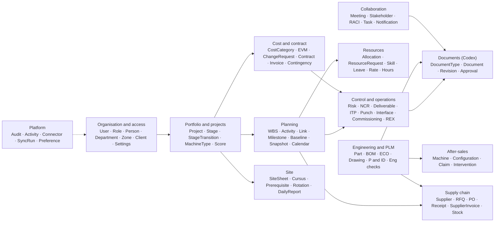

Most references converge on **Project** and **Activity**. Tasks, resource requests, risks, NCRs, POs, P&ID tags, site prerequisites, Lucca hours, ECO targets and meetings all point to one of them.

---

## 2. Enumerations (stable codes, labels EN / FR)

FR labels are the prototype's (`FR_DICT`). *(no FR)* means the dictionary has no entry. ⚠ marks a dictionary translation that is wrong for this context and must be curated (OPEN QUESTION X-12).

### 2.1 Organisation and portfolio

| Enum | Code → EN label / FR label | Source |
|---|---|---|
| `Role` | `director` Portfolio director / Directrice de portefeuille · `pm` Project manager / Chef de projet · `depthead` Department head (persona title "Head of engineering" / Responsable ingénierie) · `member` Team member (persona title "Structural engineer" / Ingénieur structure) · `englead` Engineering lead / Référent ingénierie · `quality` Quality manager / Responsable qualité · `procurement` Procurement & stock / Achats et stock · `client` Client (persona "Client — Port authority" / Client — Autorité portuaire) | `PERSONAS` 3747 |
| `LifecycleStage` | `initiative` Initiative · `aps` APS · `apd` APD · `etudes` Etudes (FR display "Études") · `approvisionnements` Approvisionnements · `fabrication_assemblage` Fabrication & Assemblage · `fat` FAT · `expedition` Expédition · `chantier` Chantier · `mise_en_service_sat` Mise Service & SAT (FR display "Mise en service & SAT") · `garantie` Garantie · `clos` Clos · `annule` Annulé. French in both languages; EN labels OPEN QUESTION X-12. Groups: *pipeline* = initiative, aps, apd; *execution* = etudes…mise_en_service_sat; *warranty* = garantie; *terminal* = clos, annule | `STATUSES` 3136, `STAGE_ORDER` 3137, `EXEC_STAGES` 3138, `PIPE_STAGES` 3139 |
| `LegacyStatus` (migration only) | Proposed → initiative · Approved → aps · Planning → apd · Active → fabrication_assemblage · On hold → approvisionnements · Closing → garantie · Closed → clos · Cancelled → annule | `STATUS_MAP_OLD` 3143 |
| `PipelineWindow` | `initiative` · `board` (Group board) · `aps` · `apd` | `PIPE_PLAN` 3665 |
| `Health` (derived) | `on_track` On track / Conforme · `at_risk` At risk / À risque · `off_track` Off track / Hors trajectoire | `healthOf` 3916 |
| `TransitionMode` | `auto` Auto · `forced` Forced / Forcé | `STAGE_HISTORY` 3142 |
| `MachineTypeCode` | `EMP`, `MEMU`, `SPUR`, `AUTRE`, `R&D` (store as `rnd`, label "R&D") + user-defined codes | `MACHINE_TYPES` 3166, `added.mtypes` |
| `Das` | `1`, `2`, `3`, `4` (business areas; labels not defined, OPEN QUESTION) | `DAS_LIST` 3165 |
| `Zone` | `euna` Europe & North America / Europe & Amérique du Nord · `afr` Africa / Afrique · `apac` Asia Pacific / Asie Pacifique | `ZONES` 3170 |
| `ScoreAxis` | `fit` Strategic fit / Alignement stratégique (0.25) · `margin` Margin / NPV / Marge / VAN (0.25) · `risk` Risk level / Niveau de risque (0.20) · `res` Resource fit / Adéquation ressources (0.15) · `client` Client priority / Priorité client (0.15) | `SCORE_AXES` 3539 |
| `Calendar` | `standard_5x8` Standard 5d · 8h · `standard_5x8_workshop` Standard 5d · 8h + Atelier · `site_6x10` Site 6d · 10h / Chantier 6j · 10h · `continuous_24h` 24h continuous *(no FR)* | `NP_TEMPLATES` 3179, `np.cal`, `AF.mtype` |

### 2.2 Planning, collaboration, tasks

| Enum | Code → EN label / FR label | Source |
|---|---|---|
| `ActivityLinkType` | `FS`, `SS`, `FF`, `SF` | `HACTS.p` 3196 |
| `ConstraintType` | observed `FNLT`, `SNET` (full list with CPM, OPEN QUESTION S-1) | `HACTS.c` |
| `ActivityProgress` (derived) | `not_started` Not started / Non démarré · `in_progress` In progress / En cours · `behind` Behind / En retard · `completed` Completed / Terminée | 05 §2.4.2 |
| `MilestoneStatus` | `on_track` On track / Conforme · `at_risk` At risk / À risque · `late` Late / En retard · `done` Done / Terminé | `HMILES` 3122 |
| `BaselineState` | `proposed` Proposed / Proposée · `current` Current / Actuel · `superseded` Superseded / Remplacée | `BASELINES` 3504 |
| `TaskStatus` | `todo` To do / À faire · `doing` In progress / En cours · `review` In review / En revue · `done` Done / Terminé | `STATUS_L` 3264 |
| `Priority` | `low` Low / Faible · `med` Medium / Moyen · `high` High / Élevé | `TODOS`, `REQUESTS` |
| `MeetingType` | `internal` Internal / Interne · `external` External / Externe | `MEETINGS` 3703 |
| `MeetingStatus` | `scheduled` Scheduled / Planifiée · `notes_in_progress` Notes in progress / Notes en cours · `minutes_sent` Minutes sent / CR envoyé | `MEETINGS` |
| `MeetingSeries` | Weekly site meeting, Steering committee, Engineering coordination, Supplier review, Kick-off, One-off | `AF.meetings` 3674 |
| `MeetingLineType` | `info`, `decision`, `action` | `MEETINGS.agenda.lines` |
| `ClientQuestionState` | `open` (Needs an answer) · `answered` (Answer ready) | `MTG_EXCHANGE` 3712 |
| `StakeholderType` | `client` Client · `internal` Internal / Interne · `supplier` Supplier / Fournisseur · `authority` Authority / Autorité · `third_party` Third party / Tiers | `STAKEHOLDERS` 3714 |
| `RaciCode` | `R`, `A`, `C`, `I` (deliverables add `B` = backup) | `RACI` 3715, `HLT_DELIVS.raci` |
| `WhatIfPriority` | `date` Protect date · `budget` Protect budget · `people` Protect people | `AUTO` 3463 |
| `WhatIfLever` | `delay` Delay non-critical activities · `contractor` Add contractor / temp (3 weeks) · `overtime` Authorise overtime (steel crew) · `split` Split steel structure activity · `move` Move 1 engineer from Westfield Solar | `LEVERS` 3462 |
| `NotificationKind` | `approval`, `alert`, `quality`, `delivery`, `eco`, `mention`, `request`, `invoice`, `task`, `sync` | `NOTIF_ICON` 3556 |

### 2.3 Cost, contract, change, risk

| Enum | Code → EN label / FR label | Source |
|---|---|---|
| `CostType` | `labor` Labor / Main-d’œuvre · `material` Material / Matériel · `equipment` Equipment / Équipement · `subcontract` Subcontract / Sous-traitance · `fees` Fees / Frais · `reserve` Reserve / Réservation ⚠ (should read "Réserve"/"Provision") | `HCAT_ROWS` 3192, `SRC_OF` 3302 |
| `ActualsSource` (per cost type) | labor "Timesheets × role rate" · material "Purchase orders + receipts" · equipment "Plant hire invoices" · subcontract "Certified payment claims" · fees "Direct invoices" · reserve "Drawn by change request" | `SRC_OF` 3302 |
| `OfferPointKind` | `order` (deposit) · `deliv` (delivery) · `acc` (acceptance) | `offerPoints` 3099 |
| `ChangeType` | `budget` Budget · `scope` Scope / Périmètre · `schedule` Schedule / Planning | `CR_TYPES` 3497 |
| `ChangeStatus` | `draft` Draft / Brouillon · `in_review` In review / En revue · `approved` Approved / Approuvé · `rejected` Rejected / Refusé | `HLT_CRS_X` 3498 |
| `ChangeStep` | `pm` Project manager · `director` Portfolio director · `client` Client / sponsor · `ccb` Change control board | `HLT_CRS_X.chain` |
| `StepDecision` | `pending` Pending / En attente · `ok` Approved · `rejected` Rejected · `na` n/a | idem |
| `RiskCategory` | `technical` Technical / Technique · `supplier_delivery` Supplier / delivery / Fournisseur / livraison · `hse` HSE (safety) *(no FR)* · `contractual_client` Contractual / client *(no FR)* · `financial_currency` Financial / currency *(no FR)* · `regulatory_permits` Regulatory / permits / Réglementaire / permis · `resources_skills` Resources / skills *(no FR)* — configurable list | `SETTINGS0.riskCats` 3467 |
| `RiskResponse` | `avoid` Avoid / Éviter · `mitigate` Mitigate / Atténuer · `transfer` Transfer / Transférer · `accept` Accept / Accepter | `RESPONSES` 3496 |
| `RiskStatus` / `RiskTrend` | `open` / `closed`; `up` / `flat` / `down` | `RISKS_HLT` 3487 |
| `RiskLevel` (derived) | `critical` (score ≥ 15) · `high` (≥ 8) · `medium` (≥ 4) · `low` | 07 §4.1 |
| `ContractType` | `lump_sum_epc` Lump sum (EPC) / Forfait (EPC) · `unit_rates` Unit rates / Bordereau de prix unitaires · `cost_plus` Cost plus / Régie · `framework` Framework agreement / Accord-cadre | `CTR_FIELDS` 4873 |
| `AmendmentStatus` | `draft` Draft / Brouillon · `sent_for_signature` Sent for signature / Envoyé pour signature · `awaiting_signature` Awaiting signature / En attente de signature · `signed` Signed / Signé | `AF.amendment` |
| `BondType` | `performance` Performance bond / Caution de bonne exécution · `advance_payment` Advance payment bond / Caution de restitution d’acompte · `retention` Retention bond / Caution de retenue de garantie · `warranty` Warranty bond / Caution de garantie · `parent_company` Parent company guarantee / Garantie maison mère | `AF.bond` |
| `BondState` | `valid` (until date) · `released` (on date) | `CONTRACTS.bonds` |
| `PaymentMilestoneStatus` | `planned` Planned / Planifié · `invoiced` Invoiced / Facturé · `paid` Paid / Payé | `CONTRACTS.milestones` |
| `CustomerInvoiceStatus` (derived) | `awaiting_payment` Awaiting payment / En attente de paiement · `overdue` Overdue / En retard · `paid` Paid / Payé | `ctrInvoices` 4896 |
| `BillingModel` (legacy) | free text, e.g. "Client · monthly progress", "Internal · capex" | `BILLING` 3541 |

### 2.4 Quality, operations, after-sales

| Enum | Code → EN label / FR label | Source |
|---|---|---|
| `NcrSeverity` | `minor` Minor / Mineure · `major` Major / Majeure · `critical` Critical / Critique | `NCR_SEV` 3505 |
| `NcrSource` | `site_inspection` Site inspection · `goods_receipt` Goods receipt · `survey` Survey · `workshop` Workshop / Atelier · `client` Client · `audit` Audit | `HLT_NCRS` 3507, `AF.quality` |
| `NcrStatus` | `open` Open / Ouverte · `containment` Containment / Confinement · `root_cause` Root cause / Cause racine · `corrective_action` Corrective action / Action corrective · `verification` Verification / Vérification · `closed` Closed / Clôturée | `NCR_FLOW` 3506 |
| `DeliverableType` | `drawings` Drawings / Plans · `calculation_notes` Calculation notes · `specifications` Specifications · `test_reports` Test & inspection reports · `certificates` Certificates (CE, lifting…) · `manuals_asbuilt` Manuals / as-built · `minutes` Meeting minutes / Comptes rendus de réunion · `client_acceptance` Client acceptance (PV de réception) — several *(no FR)*; configurable list | `DELIV_TYPES` 3513 |
| `DeliverableStatus` | `planned` Planned / Planifié · `in_progress` In progress / En cours · `internal_review` Internal review / Revue interne · `submitted` Submitted / Soumis · `accepted` Accepted / Accepté · `rejected` Rejected / Refusé | `DELIV_FLOW2` 3514 |
| `ItpPointType` | `hold` Hold / Point d’arrêt · `witness` Witness / Témoin · `review` Review / Revue · `surveillance` Surveillance | `ITP` 3717 |
| `ItpStage` | `workshop` Workshop / Atelier · `fat` FAT · `site` Site · `sat` SAT | idem |
| `ItpResult` | `planned` Planned / Planifié · `scheduled` Scheduled / Planifiée · `passed` Passed / Conforme · `failed` Failed / Non conforme | idem |
| `PunchCategory` | `A` A — blocking · `B` B — before SAT · `C` C — cosmetic | `AF.punch`, `PUNCH` 3718 |
| `PunchSource` | `site_walk` Site walk · `client_inspection` Client inspection · `itp` ITP (seed text "ITP I-03" links the inspection) · `sat` SAT | `AF.punch`, `PUNCH` |
| `PunchStatus` | `open` Open / Ouverte · `in_progress` In progress / En cours · `closed` Closed / Clôturée | `PUNCH` |
| `InterfaceStatus` | `open` Open · `late` Late / En retard (derived: open and need date < today) · `received` Received / Reçu · `frozen` Frozen / Gelé | `INTERFACES` 3719 |
| `KeystoneSide` | `process`, `mechanical`, `electrical`, `automation`, `site` | `AF.interfaces` |
| `CommissioningStep` | `mechanical_completion` Mechanical completion / Fin de montage · `pre_commissioning` Pre-commissioning / Pré-mise en service · `commissioning` Commissioning / Mise en service · `sat` SAT · `handover` Handover / Livraison ⚠ (should read "Transfert"/"Réception") | `COMMISSIONING.steps` 3721 |
| `CommissioningCellStatus` | `planned` · `in_progress` · `done` · `blocked` (+ date or blocking reference) | `COMMISSIONING.grid` |
| `HandoverItemStatus` | `ready` Ready / Prêt · `partial` Partial / Partiel · `draft` Draft / Brouillon · `missing` Missing / Manquant | `COMMISSIONING.dossier` |
| `LessonTheme` | `engineering`, `procurement`, `site`, `client`, `planning`, `quality`, `hse` | `AF.rex` |
| `LessonAppliesTo` | WBS template, ITP template, Purchasing procedure, Engineering gate checklist, Stakeholder & RACI template, Other (seed values may name a document, e.g. "Purchasing procedure PRO-QMS-021") | `AF.rex`, `LESSONS` 3732 |
| `LessonStatus` | `proposed` Proposed / Proposée · `validated` Validated / Validé · `applied` Applied / Appliqué | `LESSONS` |
| `ClosureItemStatus` | `not_started` Not started / Non démarré · `in_progress` In progress / En cours · `done` Done / Terminé | `CLOSURE` 3733 |
| `WarrantyStatus` | `in_warranty` In warranty / Sous garantie · `extended` Extended → date · `out_of_warranty` Out of warranty / Hors garantie | `FLEET` 3729 |
| `ClaimSeverity` | `minor`, `major`, `critical` | `CLAIMS` 3730 |
| `ClaimStatus` | `open` Open · `diagnosed` Diagnosed / Diagnostiquée · `intervention_planned` Intervention planned / Intervention planifiée · `closed` Closed | `CLAIMS` |
| `ClaimCoverage` | `warranty` Warranty / Garantie · `extended_warranty` Extended warranty / Garantie étendue · `chargeable` Chargeable / Facturable | `CLAIMS` |
| `InterventionStatus` | `planned` Planned · `done` Done | `INTERVENTIONS` 3731 |
| `ClientIssueStatus` | `open` Open · `in_progress` In progress · `closed` Closed | `CLIENT_ISSUES` 3544 |

### 2.5 Supply chain

| Enum | Code → EN label / FR label | Source |
|---|---|---|
| `PoStatus` | `draft` Draft / Brouillon · `awaiting_approval` Awaiting approval / En attente d’approbation · `ordered` Ordered / Commandé · `partially_received` Partially received / Partiellement reçu · `received` Received / Reçu · `cancelled` Cancelled / Annulé | `PO_FLOW` 3414 |
| `RfqStatus` | `draft` Draft · `open` Open · `comparing` Comparing / Comparaison · `awarded` Awarded / Attribuée | `RFQS` 3526 |
| `AwardRule` | `lowest_tco` Lowest total cost of ownership · `technical_first` Technical compliance first · `lowest_price` Lowest price · `pm_decides` PM decides | `RFQS` |
| `SupplierGrade` | `A`, `B`, `C` | `SUPPLIERS` 3538 |
| `SupplierInvoiceStatus` | `awaiting_receipt` Awaiting receipt / En attente de réception · `blocked` Blocked / Bloquée · `no_po` No PO / Sans commande · `approved_for_payment` Approved for payment / Approuvée pour paiement · `paid` Paid / Payé · `rejected` Rejected / Refusé | `INVOICES` 3531 |
| `Incoterm` | `DAP site`, `EXW`, `FCA`, `DDP` | `AF.procurement` |
| `ReceiptStatus` | `announced` Announced / Annoncée · `received` Received / Reçu · `qc_pending` QC pending / Contrôle en attente · `accepted` Accepted / Accepté · `partially_rejected` Partially rejected / Partiellement refusée · `rejected` Rejected / Refusé | `DELIV_FLOW` 3474 |
| `StockSource` | `x3` · `local` (changed in Keystone, not yet pushed) | `STOCK0` 3475 |
| `StockOperation` | `adjust` Adjust (count) / Ajuster (inventaire) · `transfer` Transfer / Transférer · `reserve` Reserve for project / Réserver pour le projet · `issue` Issue to activity / Sortir vers une activité · `return` Return to stock / Retour en stock · `scrap` Scrap / rework / Rebut / reprise · (`receipt`, system) | `STOCK_OPS` 3483, `MOVES0` 3484 |
| `LocationType` | `central_warehouse` Central warehouse / Entrepôt central · `workshop` Workshop / Atelier · `site_store` Site store / Magasin chantier · `consignment` Consignment at supplier / Consignation fournisseur · `quarantine` Quarantine (QC hold) / Quarantaine (blocage QC) | `SETTINGS0.locTypes` |
| `RequestStatus` | `pending` Pending review *(no FR)* · `approved` Approved · assigned *(FR partial "Approuvée · assigned")* · `reschedule` Reschedule proposed / Replanification proposée · `rejected` Rejected / Refusé · `withdrawn` Withdrawn *(no FR)* | `REQ_STATUS` 3282 |

### 2.6 Resources and HR

| Enum | Code → EN label / FR label | Source |
|---|---|---|
| `LeaveType` | `cp` CP (congés payés, 5 days/week) · `rtt` RTT (1 day) · `sick` Sick (2 days) · `training` Training (3 days) — labels *(no FR)* | `LEAVE_DAYS` 3460 |
| `RateMultiplierKey` | `ot` Overtime > 8 h/day (×1.25) · `sat` Saturday (×1.5) · `sun` Sunday / public holiday (×2) · `night` Night shift (×1.3) · `oncall` On-call (×0.35) | `MULTS` 3455 |
| `CostCenter` / `Grade` (Add role form) | Engineering, Site, Automation, Project management / Junior, Confirmed, Senior, Expert (meaning OPEN QUESTION R-4) | `AF.rates` |
| `LoadBand` (derived) | < 60 % · 60–89 % · 90–100 % · 101–115 % · > 115 % | `shade()` 3867 |

### 2.7 Engineering, PLM, documents

| Enum | Code → EN label / FR label | Source |
|---|---|---|
| `PartMakeBuy` | `manufactured` Manufactured / Fabriqué · `purchased` Purchased / Acheté | `PARTS` 3343 |
| `PartType` | Structural, Heavy equipment, Electrical, HVAC, Fire & safety, Architectural, Medical, Mechanical, Electronics, IT hardware, Assembly, Consumable, Software (13; the New part form uses a different "Family" list, OPEN QUESTION E-1) | `PARTS` |
| `PartStatus` | `validated` Validated / Validé · `not_validated` Not validated / Non validé · `outdated` Outdated / Périmé · `obsolete` Obsolete / Obsolète | `PARTS`, `STATUS_NOTE` 3405 |
| `WearSpare` | `PU` Wear part (PU) / Pièce d’usure (PU) · `PR` Spare part (PR) / Pièce de rechange (PR) | `WEAR_SPARE` 3341, `PU_LABEL` 3342 |
| `BomScope` | `keystone` Keystone · `client` Client · `overlay` Overlay / Surcouche | `AF.bom`, `PID_TAGS.scope` |
| `RevisionDiffKind` | `quantity` · `substitution` · `added` | `REV_DIFF` 3427 |
| `EcoType` | `rev` Part revision / Révision d’article · `sub` BOM substitution / Substitution nomenclature · `asm` Assembly structure / Structure d’assemblage · `sup` Supplier / make-buy / Fournisseur / fabriqué-acheté · `obs` Obsolescence notice / Avis d’obsolescence | `ECO_TYPES` 3430 |
| `EcoStatus` | `draft` Draft · `impact_analysis` Impact analysis / Analyse d’impact · `in_approval` In approval / En approbation · `released` Released / Diffusé · `rejected` Rejected | `ECO_FLOW` 3431 |
| `EcoApproverKey` | `englead`, `quality`, `pm` | `ECOS.appr` |
| `Interchangeability` | `yes` Interchangeable · `no` Not interchangeable / Non interchangeable · null (not assessed) | `ECOS.interch` |
| `EcoDisposition` | `update` Update / Mettre à jour · `pinned` Pin / Épinglée · `retrofit` Retrofit / Rétrofit (machines only) · `na` N/A | `ECOS.disp` |
| `InstalledPartState` (derived) | `latest` · `update_planned` · `decision_pending` · `retrofit_pending` · `pinned` | 09 §2 |
| `DrawingState` | `wip` WIP / En cours · `under_review` Under review / En revue · `released` Released / Diffusé · `obsolete` Obsolete / Obsolète | `DRAWINGS` 3439 |
| `PidTagKind` / `PlcType` / `PidRole` | `instrument` / `equipment`; `P` Process PLC · `S` Safety PLC · `L` Local; `sensor` · `actuator` · `ctrl` · `passive` | `PID_TAGS` 3585, `PLC_LABEL` 3584 |
| `PidTagStatus` (derived) | `client` · `unmapped` Unmapped / Non associé · `unknown_ref` · `not_in_bom` Not in BOM / Absent de la nomenclature · `part_not_validated` / `part_outdated` / `part_obsolete` · `linked` Linked / Lié | 09 §6.8 |
| `StepState` | `done`, `doing`, `todo` | `PID_STEPS` 3611 |
| `Discipline` | `process` Process · `meca` Mechanical / Mécanique · `elec` Electrical / Électricité · `auto` Automation / Automatisme | `ENG_DISC` 3736 |
| `Recipient` | disciplines + `client` Client · `achats` Purchasing / Achats · `site` Site | `ENG_RCP` 3737 |
| `CheckSeverity` / `CheckStatus` | `blocking` · `warning` · `info`; `open` · `in_progress` · `resolved` Resolved / Résolu · `sent_back` Sent back / Renvoyé | `ENG_CHECKS` 3741 |
| `OutputState` | `ready` Ready / Prêt · `partial` Partial / Partiel · `blocked` Blocked · `stale` Stale / Périmé ⚠ (same FR as Outdated) | `ENG_OUTPUTS` 3742 |
| `InputState` (derived) | `to_confirm` · `up_to_date` · `outdated` | 09 §8.5 |
| `DocumentStatus` | `draft` Draft / Brouillon · `frozen` Frozen / Gelé · `release_proposed` Release proposed / Diffusion proposée · `released` Released / Diffusé · `obsolete` Obsolete / Obsolète | `DOC_STATUSES` 3664 |
| `DocFamily` | `eng` Engineering / Ingénierie · `client` Client deliverables / Livrables client · `quality` Quality / Qualité · `purchasing` Purchasing / Achats · `site` Site · `contracts` Contracts & mail / Contrats & courriers · `photos` Photos & reports / Photos & rapports | `DOC_FAM` 3614 |
| `DocService` | `process`, `meca`, `elec`, `auto`, `quality`, `procurement` (Purchasing), `site`, `pm` (Project management / Gestion de projet) | `DOC_SVC` 3662 |
| `Confidentiality` | `internal` Internal / Interne · `client` Client · `supplier` Supplier / Fournisseur | `DOCS.conf` |
| `DocLinkKind` | `deliverable`, `article`, `purchase_order`, `punch_item`, `change_request` | `DOCS.links` |
| `DocSavedView` | `all` All documents · `bpe` BPE dossier (released) · `audit` Quality records 2026 (ISO audit) · `client` Shared with client · `pending` Awaiting approval · `obsolete` Obsolete withdrawn | `DOC_VIEWS` 3663 |
| `ApproverRole` | Author, Engineering lead, Project manager, Quality manager, Direction, Client, Quality (verification), HSE officer, Buyer, Site manager, Auditor | `DOC_TYPES` circuits 3615, `DOC_WHO` 3617 |

### 2.8 Site and platform

| Enum | Code → EN label / FR label | Source |
|---|---|---|
| `CursusVisa` / `CursusVaccination` / `CursusClearance` / `CursusVerdict` | `not_required` · `approved` · `pending`; `confirmed` · `pending`; `ok` · `pending` · `expiring` · `missing`; `go` GO · `go_with_reserve` GO with reserve / GO avec réserve · `no_go` NO GO | `SITE_DOCS` 3574 |
| `EquipmentSource` | `shipped` Expédié · `local_rental` Location locale · `client` Client (seed values are French) | `SITE_EQUIP` 3575 |
| `ConfirmStatus` | `pending` Pending / En attente · `confirmed` Confirmed / Confirmé · (`signed` Signed / Signé for prerequisites) | `SITE_EQUIP`, `SITE_PREREQ` 3576 |
| `CollisionKind` | `load`, `cert`, `doc`, `leave` | `SITE_COLLISIONS` 3578 |
| `HseStatus` | `pending`, `ready`, `signed` (+ free-text values in seed, e.g. "0 déclaré") | `SITE_HSE` 3582 |
| `SitePunchOwner` | `client`, `keystone` | `SITE_PUNCH` 3581 |
| `Weather` / `HseIncident` (daily report form) | Clear, Rain, Wind > 50 km/h, Storm / None, Near miss, First aid, Incident | `AF.site` |
| `ConnectorStatus` | `ok` OK · `warning` Warning / Alerte · `ready` Ready / Prêt | `CONNECTORS` 3570 |
| `ActivityKind` | `sync`, `stock`, `comment`, `change`, `snapshot`, `quality`, `request`, `delivery`, `invoice`, `eco`, `client` | `ACTIVITY` 3557 |
| `ConnectorDirection` / `Frequency` (Add connector) | Import, Export, Both / Real time, Hourly, Daily, Manual | `AF.plumbing` |

---

## 3. Entities

Notation:

- **Bold** field names are business keys.
- `→ X` is a foreign key to entity X.
- Fields marked *derived* are computed, not stored.
- "Seed" gives constant · prototype line · rows.
- "Spec" points to the module spec that describes the screens using the entity.

### 3.1 Organisation, identity and reference data

#### User
The person who signs in. In the prototype this is a persona switched through "View as".

| Field | Type | Notes |
|---|---|---|
| **email** | text | login identity (IdP subject stored separately) |
| displayName | text | "Marie Lefebvre" |
| initials | text *derived* | first letter of each word ("ML") |
| personId | → Person | the staff record. The client user links to a Person of the client organisation. |
| clientId | → Client | set for external client users only |
| isExternal | bool | client users |
| active | bool | |

Seed: `PERSONAS` · 3747 · 8. Spec 01 §3.1.

#### UserRole
| Field | Type | Notes |
|---|---|---|
| userId | → User | |
| role | `Role` | multi-valued (e.g. quality manager who is also head of the Quality department) |
| departmentId | → Department | scope for `depthead` approvals (OPEN QUESTION P-8) |

Seed: `PERSONAS` keys. Screen access per role is configuration in code, not data: the computed `ROLE_SCREENS` lists (3465–3466; counts pm 53, depthead 16, member 9, englead 26, quality 30, procurement 18, client 10; director all).

#### Person
A member of staff or an external contact who can own work. It unifies `PEOPLE`, `OWN`, `INIT_OF`, `DEPT_OF`, department heads, zone managers and the names cited in records.

| Field | Type | Notes |
|---|---|---|
| **fullName** | text | "Julien Wagner" |
| shortName | text | "J. Wagner" (used by `pm`, owners, organisers) |
| initials | text | `OWN` key, e.g. "JW" |
| jobTitle | text | `PEOPLE[i][1]` "Structural engineer" |
| departmentId | → Department | `DEPT_OF` |
| organisation | text / → Client | for client and third-party contacts (e.g. Nadia Bensaïd, Port authority) |
| isContractRole | bool | placeholder resources such as "Contract structural engineer" (resource requests) |
| email | text | |

Seed:

| Constant | Line | Rows |
|---|---|---|
| `PEOPLE` | 3123 | 8 |
| `OWN` | 3195 | 9 (adds Romain Aubert) |
| `DEPT_OF` | 3269 | 8 |
| `INIT_OF` | 3301 | 9 |
| `DEPTS` heads | 3268 | 5 |
| `ZONES` managers | 3170 | 3 |
| `ENG_DISC` leads | 3736 | 4 (adds Sami Haddad, Claire Morvan) |
| `DOC_WHO` | 3617 | 10 (adds L. Fabre) |

The seed also includes every distinct short name found in owners and organisers. Spec 06, 05 §Owner.

#### Department
| Field | Type | Notes |
|---|---|---|
| **name** | text | Engineering · Site operations · MEP · Quality · Controls & planning |
| headPersonId | → Person | Marion Kerviel, Olivier Blanc, Sophie Renard, Gabriel Comte, Ines Duarte |
| headTitle | text | "Head of engineering"… |

Seed: `DEPTS` · 3268 · 5. Spec 08 §6.

#### DepartmentCapacity
| Field | Type | Notes |
|---|---|---|
| departmentId | → Department | |
| periodStart, periodEnd | date | prototype: one 8-week window (w/c 28 Sep → 16 Nov 2026) |
| capacityH | numeric | `ROLES[i][1]`, e.g. 960 |
| demandH | numeric | `ROLES[i][2]`, e.g. 1110 (committed demand) |

Seed: `ROLES` · 3132 · 5 (also `capBase` 4507). Derived: unmet demand = Σ max(0, demand − capacity). Spec 06 §1, 03 §6.5.

#### Zone and Country
| Entity | Field | Type | Notes |
|---|---|---|---|
| Zone | **code** | `Zone` | euna, afr, apac |
| | label | text | |
| | managerPersonId | → Person | Olivier Castel, Aïcha Diallo, Sophie Nguyen |
| | boundsW, boundsN, boundsE, boundsS | numeric | map framing, e.g. euna [-135, 72, 45, 24] |
| Country | **name** | text | France, Morocco… |
| | zoneCode | → Zone | |
| City (optional) | name, countryName | text | used to resolve free-text sites (`zoneOfSite`) |

Seed: `ZONES` 3170 (3), `ZONE_BOUNDS` 3172 (3), `COUNTRY_ZONE` 3171 (22), `CITY_COUNTRY` 3174 (14). Spec 01 §7.2, 02 SCR-WORLDMAP-FRAME.

#### Client (organisation)
| Field | Type | Notes |
|---|---|---|
| **name** | text | Port authority, Infrastructure BU, Health trust, Finance, Energy BU, Transit BU, Logistics BU, Network BU, Retail BU |
| **code3** | text | HAV, NGD, CPL, KEY, WFE, RTM, LOG, TLN, SGP. New clients get the first 3 letters (`clientCode3`). |
| analyticCounter | int *derived* | next analytic number = count of projects of the client + 1 (`nextAnalytic`) |

Seed: `CLIENT_CODES` · 3167 · 9. Spec 01 §10.2.

#### ReferenceList / ReferenceValue (Settings)
| Field | Type | Notes |
|---|---|---|
| listKey | text | `skills`, `locations` (see StorageLocation), `costCats`, `statuses`, `riskCats`, `delivTypes`, `holidays`, `locTypes` |
| code | text | stable code |
| label | text | i18n key or literal |
| order | int | |
| active | bool | removal of in-use values (OPEN QUESTION A-14) |

Seed: `SETTINGS0` · 3467 (skills 10, locations 6, costCats 6, statuses 13, riskCats 7, delivTypes 8, holidays 11, locTypes 5). Spec 10 §1.

#### AppSetting
Key/value settings with history.

| Key | Value | Notes |
|---|---|---|
| `health.atRiskBelow` | 0.97 | `SETTINGS0.health.risk` |
| `health.offTrackBelow` | 0.90 | `SETTINGS0.health.off`; must be < at-risk |
| `company.defaultCurrency` | EUR | prop `currency` (OPEN QUESTION C-9) |
| `statusDate.policy` | weekly Friday | OPEN QUESTION S-4 |

#### UserPreference
| Field | Type | Notes |
|---|---|---|
| userId | → User | |
| locale | `fr` \| `en` | default `fr` (prototype) |
| navOpen | jsonb | `{[sectionKey]: bool, 'sub:<group>': bool}` (replaces `localStorage['keystone-nav-open']`) |
| lastProjectId | → Project | default HLT-026 in the prototype |
| projectScope | `mine` \| `all` | project switcher scope |
| zone | `Zone` \| null | `pfZone` |
| myWorkPersonId | → Person | managers viewing someone's My work (`state.person`) |

### 3.2 Portfolio and projects

#### Project
| Field | Type | Notes |
|---|---|---|
| **code** | text | "HLT-026" |
| number | text | "#026" (`PROJ_ID.id`, auto-increment, next "#045"). Null for the 11 `EXTRA` projects in the seed. |
| shortCode | text | 3-letter key used by BOM usage, ECOs, tasks and requests ("HLT"; `P3NAME`, `PROJ_NAMES`) |
| name | text | "Harbor Line Terminal Expansion" (translated to FR as a display label in the prototype; store one name) |
| clientId | → Client | |
| pmPersonId | → Person | "R. Aubert" |
| stage | `LifecycleStage` | `STAGE_OF` / `STATUS_MAP_OLD[legacy]` |
| das | `Das` | |
| machineTypeId | → MachineType | |
| analyticCode | text | "HAV004" — key shared with Lucca and Sage X3 |
| plannedStart, plannedFinish | date | seed "Jan 2026" / "Dec 2026" (month precision; finish "—" allowed) |
| currency | text | wizard choice, not stored by the prototype (OPEN QUESTION L-3) |
| calendarId | → Calendar | wizard `np.cal` |
| contingencyPct | numeric | wizard 5 / 10 / 15 % |
| bacKeur | keur | `budget` in the seed (4800). Should equal the current baseline BAC + approved CRs. |
| actualKeur | keur | seed `actual` (3360). *Derived* in the rebuild from cost actuals (OPEN QUESTION C-2). |
| progress | numeric 0–1 | seed `progress` (.64). *Derived* from the WBS. |
| spi | numeric | seed `spi` (.90). *Derived* from EVM at the data date. |
| isNew | bool | wizard-created, cleared at the first stage change |
| health | `Health` *derived* | m = min(budget × progress / actual, spi); < offTrack → off_track; < atRisk → at_risk |

Seed:

| Constant | Line | Rows |
|---|---|---|
| `PROJECTS` | 3105 | 6 |
| `META` | 3161 | 6 |
| `STAGE_OF` | 3162 | 6 |
| `EXTRA` | 3149 | 11 |
| `PROJ_ID` | 3168 | 6 |

Total: 17 projects. Six of them have planning data (`DEFS` 3284). Spec 03 §Data, 01 §15.

#### ProjectSite
| Field | Type | Notes |
|---|---|---|
| projectId | → Project | |
| city, country | text | "Le Havre", "France" |
| lat, lng | numeric | |
| zoneOverride | `Zone` | `GEO[code].zone` when present; otherwise derived from the country |

Seed: `GEO` · 3169 · 17. Spec 03 §3.

#### ProjectMember
| Field | Type | Notes |
|---|---|---|
| projectId | → Project | |
| personId | → Person | |
| projectRole | text | pm, team, client contact, planner… |

Seed: `DEFS[code].team` (HLT-026 = the 8 `PEOPLE`). Spec 06 §1 (Project resources).

#### LifecycleStage (reference)
| Field | Type | Notes |
|---|---|---|
| **code** | `LifecycleStage` | |
| order | int | 1–12 (`STAGE_ORDER`); `annule` is outside the order |
| group | text | pipeline / execution / warranty / terminal |
| description | text (FR) | `LIFE`, e.g. Chantier "Montage et raccordements sur site" |
| entryGate | text (FR) | `GATES`, e.g. FAT "Assemblage & câblage terminés"; Annulé "Décision direction" |

Seed: `STATUSES` 3136 (13), `LIFE` 3148 (13), `GATES` 3147 (12). Allowed transitions are a rule: the next stage in order, or `annule`; none from `clos` or `annule` (`TRANS` 3146).

#### StageDeliverableDef / StageDeliverableCheck
| Entity | Field | Type | Notes |
|---|---|---|---|
| StageDeliverableDef | stage | `LifecycleStage` | |
| | order | int | |
| | label | text (FR) | e.g. "Câblage & armoires terminés" |
| StageDeliverableCheck | projectId | → Project | |
| | stageDeliverableDefId | → StageDeliverableDef | |
| | done | bool | ticking the last one auto-advances the stage |
| | doneAt, doneBy | timestamptz, → User | |

Seed: `STAGE_DELIVS` 3140 (12 stages, 2–4 each), `STAGE_DONE_DEFAULT` 3141 (6 projects).

#### StageTransition
| Field | Type | Notes |
|---|---|---|
| projectId | → Project | |
| fromStage, toStage | `LifecycleStage` | |
| effectiveOn | date | prototype stamps "25 Sep 2026" |
| mode | `TransitionMode` | auto / forced |
| reason | text | mandatory when forced |
| missingDeliverables | text[] | snapshot of unticked deliverables at forcing time |
| requestedBy | → User | |
| validationStatus | pending / approved / rejected | forced moves only. The prototype is informational (OPEN QUESTION L-1). |
| validatedBy, validatedAt | → User, timestamptz | |

Seed: `STAGE_HISTORY` · 3142 · HLT-026 and RCF-019. Spec 01 §11, 03 §5.7.

#### PipelineStagePlan
| Field | Type | Notes |
|---|---|---|
| projectId | → Project | |
| window | `PipelineWindow` | initiative / board / aps / apd |
| startDate, endDate | date | seed month offsets from Jan 2026 (e.g. WSA-044 Initiative 3 → 3.8) |
| boardDecision | planned / pending / approved *derived* | from dates vs data date; alert when pending > 21 days |

Seed: `PIPE_PLAN` · 3665 · 5 projects × 6 windows. Spec 05 §3.

#### MachineType (+ phases, cost categories, ITP systems, REX references)
| Entity | Field | Type | Notes |
|---|---|---|---|
| MachineType | **code** | text | EMP, MEMU, SPUR, AUTRE, R&D, + custom |
| | label, description | text | descriptions authored in French (`NP_TEMPLATES.desc`) |
| | templateName | text | "Planning EMP" |
| | wbsSummary, activitiesSummary | text | "6 phases · 14 lots", "38 activités · 52 liens". A real template should hold the WBS and activities themselves (OPEN QUESTION A-2). |
| | defaultCalendar | `Calendar` | EMP "Standard 5d · 8h + Atelier", SPUR "Chantier 6d · 10h" |
| | depositPct, deliveryPct, acceptancePct | numeric | REX payment pattern (EMP 30/60/10; must total 100) |
| | active, isStandard | bool | |
| MachineTypePhase | machineTypeId, order, name | | e.g. EMP: "Études & approvisionnements longs" … "Réception & transfert" |
| MachineTypeCostCategory | machineTypeId, name, costType, budgetKeur | | e.g. EMP "Matière & structure" material 560 |
| MachineTypeItpSystem | machineTypeId, order, name | | EMP: Structure, Hoist mechanisms, Travel (gantry), Electrical HV/LV, Automation & safety, Anti-collision |
| RexReference | machineTypeId, analyticCode, projectName, year, patternText | | e.g. HAV001 "Terminal Ouest — Dunkerque" 2023 "29 % deposits · peak M8 · 8 % at SAT" |

Seed:

| Constant | Line | Rows |
|---|---|---|
| `MACHINE_TYPES` | 3166 | 5 |
| `NP_TEMPLATES` | 3179 | 6, including `blank` (a UI option, not a type) |
| `ITP_TEMPLATES` | 3716 | 5 |
| `REX_FIN` | 3101 | 5 |
| `added.mtypes`, `mtOv` | — | session state |

`NP_TEMPLATES_OLD` (3186) is legacy and must be ignored. Spec 09 §9, 01 §10.

#### PortfolioScore / ScoreWeight
| Entity | Field | Type | Notes |
|---|---|---|---|
| PortfolioScore | projectId | → Project | |
| | axis | `ScoreAxis` | |
| | score | int 1–5 | for `risk`, 5 = low risk |
| | scoredBy, scoredAt | → User, timestamptz | "Score a proposal" (3 axes in the form — OPEN QUESTION L-5) |
| ScoreWeight | axis | `ScoreAxis` | |
| | weight | numeric | default .25/.25/.20/.15/.15; user-editable (`pfWeights`). Scope (global vs per user) is open. |

Derived: score = 100 × Σ (s/5) × (w/Σw). Seed: `SCORES` 3540 (10 rows; 3 keyed by obsolete codes EWA-041, RBR-038, CER-045 → map to EWA-051, RBR-048, CER-047), `SCORE_AXES` 3539. Spec 03 §6.

#### ClientIssue
| Field | Type | Notes |
|---|---|---|
| projectId | → Project | global in the prototype (OPEN QUESTION L-6) |
| **number** | text | "CI-07" |
| title | text | |
| raisedOn | date | seed "Raised 12 Aug" |
| raisedBy | → User | client user |
| status | `ClientIssueStatus` | |
| response | text | |

Seed: `CLIENT_ISSUES` · 3544 · 3. Spec 03 §8.6.

### 3.3 Planning

#### Calendar / PublicHoliday
| Entity | Field | Type | Notes |
|---|---|---|---|
| Calendar | **code** | `Calendar` | |
| | workDaysPerWeek, hoursPerDay | int | 5×8, 6×10, 7×24 |
| | countryOrSet | text | holiday set (France 2026 vs "US federal" text — OPEN QUESTION S-2) |
| PublicHoliday | calendarId / set, date, name | | "11 Nov · Armistice" |

Seed: calendar strings in `NP_TEMPLATES` / `np.cal` / `AF.mtype`; `HOLIDAYS` 3461 (1 in the 8-week window); `SETTINGS0.holidays` (11). The prototype assigns "Site 6d · 10h" vs "Standard 5d · 8h" with a hard-coded rule (WBS 1.1 or A1230 = office). Spec 05 §0, 06 §4.

#### WbsNode
| Field | Type | Notes |
|---|---|---|
| projectId | → Project | |
| **code** | text | "1" (root), "1.1"…"1.8"; new WPs "1.9" |
| name | text | |
| level | int | 0 = project root, 1 = work package (the prototype has only these two levels) |
| parentId | → WbsNode | |
| sortOrder | int | `wbsOrd` |
| ownerPersonId | → Person | added WPs only (OPEN QUESTION S-6) |
| originalBudgetKeur | keur | WP budget (`HWPS[i][2]`) |
| approvedChangesKeur | keur *derived* | Σ approved CR allocations (`HWPS[i][3]`) |
| actualKeur, eacKeur | keur | `HWPS[i][4..5]`; roll-ups of activities in the rebuild |
| scope | text | added WPs (`AF.wp.desc`) |

Seed: `HACTS` rows with `lv` 0/1 (HLT: 1 root + 8 WPs), `HWPS` 3194 (9 rows incl. "—" unallocated contingency 150), generated `DEFS.pk` for 5 projects, `added.wps`.

#### Activity
| Field | Type | Notes |
|---|---|---|
| projectId | → Project | |
| wbsNodeId | → WbsNode | `w` |
| **code** | text | "A1250"; generated `'A'+idx+pkg+phase+'0'`, added `'A'+idx+'9'+NN` |
| name | text | `n` |
| durationDays | int | working days (`d`) |
| plannedStart, plannedFinish | date | `s` / `f` |
| actualStart, actualFinish | date | the " A" suffix in `s` / `f` |
| constraintType, constraintDate | `ConstraintType`, date | `c` "FNLT 18 Dec" |
| constraintViolated | bool *derived* | `viol` |
| totalFloatDays | int | `tf`; null when complete. Derived by CPM if S-1 is confirmed. |
| percentComplete | int 0–100 | `pc` (progress form / inline) |
| ownerPersonId | → Person | `o` (`OWN` initials) |
| budgetKeur, actualKeur, eacKeur | keur | `b` = [budget, actual, EAC] |
| packageName | text | `pkg` (generated projects) |
| critical | bool | `crit` (added activities; OPEN QUESTION S-1) |
| description | text | added activities |
| progressStatus | `ActivityProgress` *derived* | not_started / in_progress / behind (tf < 0 ∧ pc < 100) / completed |
| finishVarianceDays | int *derived* | `v` = baseline finish − forecast finish |

Seed: `HACTS` 3196 (30 rows, 21 activities for HLT), generated `ACTS` (31–36 per project; `ALL_BYID` 3340 = 145 activities), `added.acts`, overrides `wbsOv`/`wbsRm`. Spec 05 §2.

#### ActivityLink
| Field | Type | Notes |
|---|---|---|
| projectId | → Project | |
| predecessorId, successorId | → Activity | |
| type | `ActivityLinkType` | |
| lagDays | int | |
| isDriving | bool *derived* | from CPM (the prototype labels the first link "driving") |

Seed: `HACTS[].p` (e.g. A1250 ← A1240 FS 0, A1220 FS 10, A1230 FF 5); edited as text in the Structure view.

#### ActivityAssignment
| Field | Type | Notes |
|---|---|---|
| activityId | → Activity | |
| resource | → Person \| text | person, crew ("Steel erection crew"), equipment or material |
| detail | text | "Subcontractor · 6 ironworkers" |
| units | text | "6 × 10 h/d" |
| plannedQty, actualQty | numeric | "1,840 / 2,400 h" |

Seed: `A1250_RES` · 3227 · 4 (others are synthesised from the owner).

#### Milestone
| Field | Type | Notes |
|---|---|---|
| projectId | → Project | |
| name | text | "Permits approved" … "Handover" |
| baselineDate, forecastDate, actualDate | date | seed fractional months |
| status | `MilestoneStatus` | rule: done if forecast ≤ data date; late if slip > 0.4 month; at_risk if baseline < data date + 2 months; else on_track |
| sortOrder | int | |

Seed: `HMILES` 3122 (6), generated `MILES` (every second package). Spec 05 §1.

#### ScheduleBar (derived view)
`[name, owner, baselineStart, baselineEnd, forecastStart, forecastEnd, pct, critical]`. It is a roll-up of WBS level 1, not a table (OPEN QUESTION A-7). Seed `HTASKS` 3113 (8) is kept only as golden data. Spec 05 §1.

#### Baseline / BaselineActivity
| Entity | Field | Type | Notes |
|---|---|---|---|
| Baseline | projectId | → Project | |
| | **code** | text | BL0, BL1, BL2 |
| | name | text | "Proposal estimate", "Approved baseline", "Recovery re-baseline" |
| | setOn | date | BL2 "Pending CR-009" → null + changeRequestId |
| | bacKeur | keur | 4400 / 4600 / 4885 |
| | finishDate | date | |
| | state | `BaselineState` | |
| | changeRequestId | → ChangeRequest | BL2 ↔ CR-009 |
| | approverPersonId, reason, scope | | Re-baseline form fields: name, reason, approver, scope "Dates & budget / Dates only / Budget only" |
| BaselineActivity | baselineId, activityId, start, finish, budgetKeur | | snapshot rows (prototype keeps only BL1 finish `bl`) |

Seed: `BASELINES` · 3504 · 3. Spec 07 §2.2, 05 §1.

#### StatusSnapshot
| Field | Type | Notes |
|---|---|---|
| projectId | → Project | |
| **weekCode** | text | "W39" |
| statusDate | date | Friday (W27 = 3 Jul … W39 = 25 Sep 2026) |
| cpi, spi | numeric | |
| eacKeur | keur | |
| floatDays | int | critical-path float |
| riskEmvKeur | keur | Σ open risks EMV |
| milestoneSlipDays | int | |
| frozenAt | timestamptz | weekly job |

Seed: `HLT_SNAPS` 3486 (6 series × 13), `SNAP_WEEKS` 3485, `SNAP_DATES` 4566. Spec 04 §2.

#### WhatIfScenario / WhatIfLever
| Entity | Field | Type | Notes |
|---|---|---|---|
| WhatIfLever (reference) | **code**, label | `WhatIfLever` | |
| | floatDays, costKeur, peakPts, overPeople, sideEffect | int / text | static effects in the prototype (OPEN QUESTION S-7) |
| WhatIfScenario | projectId | → Project | HLT only in the prototype |
| | name, label | text | "A" / "B"; New scenario form: name, basis (Current plan / Baseline BL1 / Last approved scenario), horizon (3/6/12 months), hypotheses |
| | priority | `WhatIfPriority` | auto-level picks `AUTO[priority]` |
| | selected | bool | `chosen` |
| WhatIfScenarioLever | scenarioId, leverCode, enabled | | |

Seed: `LEVERS` 3462 (5), `AUTO` 3463 (3). Spec 05 §4.

### 3.4 Collaboration and personal work

#### Meeting (+ participants, agenda, lines, transcript)
| Entity | Field | Type | Notes |
|---|---|---|---|
| Meeting | projectId | → Project | |
| | **number** | text | "MTG-118" |
| | title, series | text | "Weekly site meeting #24", `MeetingSeries` |
| | type | `MeetingType` | |
| | startsAt | timestamptz | date + time |
| | durationMin | int | "45 min" |
| | location | text | "Site office · Le Havre", "Teams" |
| | organizerPersonId | → Person | short name in seed |
| | status | `MeetingStatus` | |
| | minutesDocumentId | → Document | MIN record created by "Send minutes" |
| | minutesSentAt | timestamptz | |
| | externalCalendarId | text | Outlook event id (OPEN QUESTION S-11) |
| MeetingParticipant | meetingId, personId \| name | | |
| | invited, present | bool | |
| | minutesReadAt | timestamptz | read receipts (`read`) |
| AgendaPoint | meetingId, order, title | | `agenda[].pt` |
| MeetingLine | agendaPointId, order | | |
| | type | `MeetingLineType` | |
| | text | text | |
| | ownerPersonId \| ownerName | | external owners allowed |
| | dueDate | date | |
| | done, doneAt | bool, timestamptz | `MTG_DONE`, `mtg.ov` |
| | taskId | → Task | created on Send minutes |
| | origin | manual / transcript | |
| MeetingTranscript | meetingId, rawText, source | | |
| | analysedAt, summary, appliedAt | | simulated analysis (OPEN QUESTION S-10) |

Seed: `MEETINGS` 3703 (6), `MTG_DONE` 3710 (2), `MTG_TRANSCRIPTS` 3711 (3), `added.meetings`. Spec 05 §5.

#### ClientQuestion
| Field | Type | Notes |
|---|---|---|
| projectId | → Project | |
| text | text | |
| askedBy | → Person | client contact |
| department | text | "Electrical" |
| ownerPersonId | → Person | |
| state | `ClientQuestionState` | |
| answer | text | |

Seed: `MTG_EXCHANGE` · 3712 · 5 (HLT 3, NDC 2).

#### Stakeholder / RaciMatrix
| Entity | Field | Type | Notes |
|---|---|---|---|
| Stakeholder | projectId | → Project | |
| | name, organisation, role | text | |
| | type | `StakeholderType` | |
| | influence, interest | int | always 0 in the seed (OPEN QUESTION S-13) |
| | attitude | text | |
| | contactEmail | text | |
| | ownerPersonId | → Person | relationship owner |
| | lastContactOn | date | stale if > 30 days |
| | notes | text | |
| RaciMatrix | projectId, columns text[] | | 6 columns: Project manager, Engineering lead, Client PM, Port HSE, Site manager, Quality |
| RaciRow | matrixId, order, label | | "Design release (BPE)" |
| RaciCell | rowId, columnIndex, code | `RaciCode` \| null | |

Seed: `STAKEHOLDERS` 3714 (HLT 8), `RACI` 3715 (HLT 7 rows), `added.stakeholders`. Spec 05 §6.

#### Task (+ checklist, comments, attachments, time entries)
| Entity | Field | Type | Notes |
|---|---|---|---|
| Task | **number** | text | "T-2314"; new tasks from approvals T-2341+ |
| | assigneePersonId | → Person | |
| | title, description | text | `DESC` |
| | projectId | → Project | 3-letter in seed |
| | activityId | → Activity | |
| | status | `TaskStatus` | |
| | priority | `Priority` | |
| | startDate, dueDate | date | seed working-day offsets from Mon 21 Sep 2026 |
| | estimateH | numeric | |
| | loggedH | numeric *derived* | Σ TimeEntry (seed `logged`) |
| | percentComplete | int | coupled with status (done ⇒ 100; leaving done from 100 ⇒ 75; 100 ⇒ done; > 0 on todo/done ⇒ doing) |
| | labels | text[] | ['QA','Site'], ['Meeting','MTG-118'] |
| | sourceRequestId | → ResourceRequest | `fresh` tasks |
| | sourceMeetingLineId | → MeetingLine | |
| | departmentId | → Department | `dept` |
| TaskChecklistItem | taskId, order, text, done | | `cl` = [done, total] *derived* |
| TaskComment | taskId, authorPersonId, postedAt, text, mentions | | @mentions not parsed today (OPEN QUESTION R-8) |
| TaskAttachment | taskId, name, meta, kind, storageRef | | `FILES` |
| TimeEntry | taskId, personId, workDate, hours, note | | `source` keystone / lucca; value = hours × rate (A-10) |

Seed:

| Constant | Line | Rows |
|---|---|---|
| `TODOS` | 3228 | 27 |
| `CHECKS` | 3257 | 3 tasks |
| `COMMENTS` | 3258 | 1 task |
| `FILES` | 3259 | 2 tasks |
| `ENTRIES` | 3260 | 2 tasks |
| `DESC` | 3261 | 1 |

Spec 10 §6–7.

#### Notification
| Field | Type | Notes |
|---|---|---|
| recipientUserId | → User | the prototype filters by role audience |
| kind | `NotificationKind` | |
| title, body | text | `title`, `sub` |
| occurredAt | timestamptz | "25 Sep 09:12" |
| readAt | timestamptz | `readNotifs` |
| targetRoute, targetParams | text, jsonb | e.g. changes + `{cr:'CR-008'}` |
| sourceEntityType, sourceEntityId | text | |
| channelsSent | text[] | in-app, teams, email (OPEN QUESTION X-6) |

Seed: `NOTIFS` · 3545 · 10, with audience roles expanded to the users holding them. Spec 01 §5.5.

#### ApprovalItem (derived, not stored)
`{kind, entityId, title, sub, submittedAt, submittedBy, canApprove, canReject, route}`. It is computed per user by module providers (routing table in 00 §7.8; spec 08 §7.5). Decisions are stored on the source entities: ChangeApprovalStep, EcoApproval, PurchaseOrder status, GoodsReceipt QC, Deliverable acceptance, NCR status, ResourceRequest, StageTransition validation, DocumentApproval.

### 3.5 Cost, change and contract

#### CostCategory
| Field | Type | Notes |
|---|---|---|
| projectId | → Project | |
| **code** | text | "C01"… |
| name | text | Labor, Materials, Equipment, Subcontractors, Permits & fees, Contingency (Settings `costCats`); project-specific names allowed |
| costType | `CostType` | |
| actualsSource | `ActualsSource` *derived* | from costType (`SRC_OF`) |
| budgetKeur, actualKeur, committedKeur, forecastKeur | keur | `HCATS` [name, budget, actual, committed, forecast] |

Seed: `HCAT_ROWS` 3192 + `HCATS` 3112 (HLT 6), `DEFS[].cats` (5 projects), wizard `np.cats`. Spec 04 §1.5.

#### OfferQuote / OfferPaymentPoint / CostStream / EvmPeriod
| Entity | Field | Type | Notes |
|---|---|---|---|
| OfferQuote | projectId | → Project | commercial-offer supplier quote |
| | system | text | "Structural steel — columns, beams, purlins" |
| | supplierId | → Supplier | "Keystone Steelworks" |
| | amountKeur | keur | 640 |
| | depositPct, deliveryPct, acceptancePct | numeric | "30 / 60 / 10" |
| | orderDate, deliveryDate, acceptanceDate | date | seed month indexes 2 / 5 / 8 |
| | leadWeeks | int | late flag ≥ 26 |
| OfferPaymentPoint *derived* | quoteId, date, kind (`OfferPointKind`), pct, amountKeur | | `offerPoints()` 3099 |
| CostStream | projectId, name, basis | | "Labor", 1850 |
| CostStreamPeriod | streamId, periodEnd, amountKeur | | monthly values |
| EvmPeriod | projectId, periodEnd (month) | | |
| | pvKeur, evKeur, acKeur | keur | cumulative; PV from payment points + streams; EV/AC up to the data date |

Derived (`evm` module): CPI = EV/AC, SPI = EV/PV, EAC = BAC/CPI, VAC = BAC − EAC, TCPI = (BAC − EV)/(BAC − AC). Reconciliation = original BL1 + approved CRs = BAC, plus pending CRs and contingency used.

Seed: `HLT_OFFER` 3097 (4), `HLT_STREAMS` 3098 (6), `HPV` 3100 (12), `HEV` 3102 (9), `HAC` 3103 (9), `HBAC` 3104, `HLT_PD.recon` 3308, generated PV/EV/AC (`projectData` 3310–3339). Spec 04 §1.8.

#### ChangeRequest / ChangeApprovalStep / ChangeRequestWbs
| Entity | Field | Type | Notes |
|---|---|---|---|
| ChangeRequest | projectId | → Project | |
| | **number** | text | "CR-008" (prototype numbering global, OPEN QUESTION Q-7) |
| | title | text | |
| | types | `ChangeType`[] | budget / scope / schedule (form offers Scope, Budget, Schedule, Scope + budget) |
| | amountKeur | keur (signed) | +85 |
| | scheduleDays | int (signed) | −12 (negative = gain on handover) |
| | status | `ChangeStatus` | draft → in_review (Submit) → approved / rejected **derived from steps** |
| | requestedByPersonId | → Person | "R. Aubert", or "Steering committee" |
| | requestedOn | date | |
| | justification | text | collected by the form, not stored by the prototype (OPEN QUESTION X-11) |
| | baselineId | → Baseline | BL1 / BL2 |
| ChangeApprovalStep | changeRequestId | → ChangeRequest | |
| | step | `ChangeStep` | pm, director, client, ccb |
| | decision | `StepDecision` | pending / ok / rejected / na |
| | decidedBy, decidedAt, comment | | CCB actor OPEN QUESTION P-6 |
| ChangeRequestWbs | changeRequestId, wbsNodeId, amountKeur | | WP allocation of approved changes (HWPS changes: 1.2 +120, 1.4 +65, 1.6 +15) |

Seed: `HLT_CRS_X` 3498 (5 — authoritative, see §7), `HCRS` 3193 (5, conflicting), `added.crs`, `crOv`. Spec 07 §2.2, 04 §1.5.

#### Contract / Amendment / Bond / PaymentMilestone / CustomerInvoice
| Entity | Field | Type | Notes |
|---|---|---|---|
| Contract | projectId | → Project | one per project (HLT only in the seed) |
| | **reference** | text | "CTR-HLT-001" (also a Codex document id → Document) |
| | clientId | → Client | |
| | signedOn | date | 14 Jan 2026 |
| | baseAmountKeur | keur | 5400 |
| | paymentTerms | text | "Net 45 days"; termsDays *derived* = first integer (OPEN QUESTION C-6) |
| | retentionPct, retentionNote | numeric, text | 5 %, "Released at final acceptance + 12 months" |
| | liquidatedDamages | text | "0.5 % per week · cap 10 %" |
| | warranty | text | "24 months from SAT" |
| | type | `ContractType` | |
| | governingLaw, scope | text | |
| | contractValueKeur | keur *derived* | base + Σ signed amendments |
| Amendment | contractId, label | | "Amendment 1" |
| | changeRequestId | → ChangeRequest | `cr` |
| | amountKeur | keur | |
| | status | `AmendmentStatus` | only signed counts in contract value |
| | signedOn | date | |
| | documentId | → Document | docRef |
| Bond | contractId, type (`BondType`), issuer, amountKeur | | |
| | validUntil, releasedOn | date | state *derived*: released excluded from "Guarantees in force" |
| PaymentMilestone | contractId, **number** | | "M3" |
| | label, sharePct | text, numeric | Σ share ≤ 100 % (OPEN QUESTION C-7) |
| | contractualDueDate | date | |
| | condition | text | |
| | status | `PaymentMilestoneStatus` | |
| | amountKeur | keur *derived* | round(contractValue × share / 100) |
| | late | bool *derived* | planned ∧ due < data date (Billing nav badge) |
| CustomerInvoice | paymentMilestoneId | → PaymentMilestone | 1:1 with an invoiced milestone |
| | **number** | text | "INV-2026-004" (next number `ctrNextInvNo`) |
| | issuedOn | date | |
| | dueOn | date *derived* | issuedOn + termsDays (calendar arithmetic) |
| | amountKeur | keur | |
| | paidOn | date | "Mark paid" |
| | note | text | |
| | status | `CustomerInvoiceStatus` *derived* | |

Seed: `CONTRACTS` · 3713 · HLT (5 milestones, 2 amendments, 2 bonds), `added.amendments`, `added.bonds`, `added.milestones`, `ctrOv`, `ctrInv`, `ctrInfo`. Legacy `BILLING` 3541 (6 projects `[model, value, [label, amount, status]]`) feeds the client portal and cash for projects without a contract: migrate to Contract + PaymentMilestone (OPEN QUESTION A-5). `CASH_M` 3542 plus hard-coded cash arrays: derived, not stored (C-10). Spec 04 §3–4, 03 §7.

#### ContingencyRegister / ContingencyDraw
| Entity | Field | Type | Notes |
|---|---|---|---|
| ContingencyRegister | projectId | → Project | |
| | initialKeur | keur | default round(BAC × 3 %) when absent |
| ContingencyDraw | registerId | → ContingencyRegister | |
| | drawnOn | date | |
| | amountKeur | keur | |
| | reason | text | |
| | linkedEntityType, linkedEntityId | text | CR / risk / NCR (free text "CR-004", "R-03", "NCR-026" in the seed; OPEN QUESTION C-4) |
| | approvedByPersonId | → Person | select: R. Aubert · Project manager, M. Lefebvre · Portfolio director |

Derived: drawn, remaining, open-risk exposure (Σ EMV of open risks). Seed: `CONTINGENCY` 3720 (HLT: initial 150, 3 draws), `added.draws`. Spec 04 §5.

### 3.6 Resources and HR

#### Allocation (weekly load)
| Field | Type | Notes |
|---|---|---|
| personId | → Person | |
| weekStart | date | Monday |
| loadPct | numeric | % of available hours (prototype: one total per week, not per project) |
| projectId | → Project | optional: needed for project-level loads (Project resources) |

Derived: `shade()` band, over-allocated if any week > 110 %, project demand = average % × 3.2 h. Seed: `PEOPLE[i][2]` (8 persons × 8 weeks from w/c 28 Sep 2026). Spec 06 §1.

#### ResourceRequest (+ events)
| Entity | Field | Type | Notes |
|---|---|---|---|
| ResourceRequest | **number** | text | "RQ-044"; new RQ-045+ |
| | projectId | → Project | |
| | requestedByPersonId | → Person | PM ("R. Aubert" hard-coded — OPEN QUESTION P-13) |
| | personId \| contractRole | → Person \| text | "Contract structural engineer" |
| | departmentId | → Department | `DEPT_OF[person]` or Engineering |
| | title, note | text | |
| | activityId | → Activity | dialog offers `NR_ACTS` (A1250, A1260, A1320, A1420, A1430) |
| | hours | numeric | |
| | startDate, dueDate | date | seed day offsets (week w/c 28 Sep / 5 Oct / 12 Oct; duration 2 days / 1 week / 2 weeks) |
| | priority | `Priority` | |
| | status | `RequestStatus` | |
| | sentOn | date | "Fri 25 Sep" |
| | proposedStart, proposedDue | date | reschedule proposal (+1 / +2 / +3 weeks) |
| | taskId | → Task | created on approval |
| RequestEvent | requestId, at, byPersonId, action, note | | decision trail (`response` text in the seed) |

Seed: `REQUESTS` · 3270 · 10. Spec 08 §5–6, 01 §12.

#### RateRole / RateMultiplier
| Entity | Field | Type | Notes |
|---|---|---|---|
| RateRole | **role** | text | "Project manager"… "Contractor — structural (external)" |
| | baseRateEur | eur/h | 92 … 118 |
| | isExternal | bool *derived* | /external/ |
| | costCenter, grade | text | Add role form (OPEN QUESTION R-4) |
| | effectiveFrom | date | versioning (OPEN QUESTION R-4) |
| RateMultiplier | **key** | `RateMultiplierKey` | |
| | label, factor | text, numeric | |

Visibility: director and pm only. Seed: `RATE_ROLES` 3454 (10), `MULTS` 3455 (5). Legacy `RATES` 3262 (8 job titles, different values) feeds only the Task cost note → drop or reconcile (OPEN QUESTION A-10). Spec 06 §2.

#### Skill / PersonSkill / Certification
| Entity | Field | Type | Notes |
|---|---|---|---|
| Skill | **name**, category, order | | 10 families (Structural … Software / IT) |
| PersonSkill | personId, skillId | | |
| | level | int 0–5 | 0 = none |
| Certification | personId, name | | |
| | expiresOn | date | Site collisions mention expiry (Lucca) |

Derived: experts (level ≥ 4) and able (≥ 3) per skill; single-expert flag. Seed: `SKILLS` 3456 (10), `SKILL_LV` 3457 (8 × 10), `CERTS` 3458 (5 people). Spec 06 §3.

#### LeaveEntry
| Field | Type | Notes |
|---|---|---|
| personId | → Person | |
| type | `LeaveType` | |
| startDate, endDate | date | the prototype stores a week index; days lost per week CP 5, RTT 1, Sick 2, Training 3 |
| status | text | approved in Lucca (read-only) |
| externalId | text | Lucca id |

Derived: available h/week = max(0, 5 − daysOff) × 7. Seed: `LEAVE` 3459 (8 people, week-indexed), `LEAVE_DAYS` 3460. Spec 06 §4.

#### HoursImport / HoursLine / UnassignedHours
| Entity | Field | Type | Notes |
|---|---|---|---|
| HoursImport | projectId, analyticCode, period | | "HAV004", September 2026 |
| | importedAt, source, matchingMode | | Lucca; "Resource × work package" / "Resource only" |
| HoursLine | importId, personId, wbsNodeId | | "1.3 · Foundations" |
| | plannedH, declaredH | numeric | variance flagged if declared > planned × 1.10 or < planned |
| UnassignedHours | importId, personId, hours, reason | | |
| | assignedWbsNodeId | → WbsNode | "Assign" (OPEN QUESTION R-6) |

Seed: `HOURS` 3735 (HLT: 10 lines, 2 unassigned, imported 29 Sep 2026). Variance valued at a flat 62 €/h in the prototype (A-10). Spec 06 §5.

### 3.7 Control, quality, operations and after-sales

#### Risk
| Field | Type | Notes |
|---|---|---|
| projectId | → Project | |
| **number** | text | "R-03"; added R-21+ (global numbering in the prototype) |
| title | text | |
| category | `RiskCategory` | |
| probability, impact | int 1–5 | editable in the drawer |
| ownerPersonId | → Person | |
| response | `RiskResponse` | |
| responsePlan | text | |
| activityId | → Activity | |
| emvKeur | keur | stored. Proposal: store costImpactKeur and derive EMV = cost × P/5 (OPEN QUESTION Q-1). |
| trigger | text | |
| status | `RiskStatus` | |
| trend | `RiskTrend` | since last review |
| score / level | int / `RiskLevel` *derived* | P × I; critical ≥ 15, high ≥ 8, medium ≥ 4 |
| costIfOccursKeur | keur *derived* | round(EMV / (P/5)) |

Seed: `RISKS_HLT` 3487 (8), `added.risks`, `riskOv`. Spec 07 §2.1.

#### Ncr
| Field | Type | Notes |
|---|---|---|
| projectId | → Project | |
| **number** | text | "NCR-029" |
| title | text | |
| severity | `NcrSeverity` | |
| source | `NcrSource` | |
| activityId | → Activity | |
| partId | → Part | |
| supplierId | → Supplier | goods-receipt NCRs feed the supplier rating |
| raisedByPersonId, raisedOn | → Person, date | |
| ownerPersonId | → Person | |
| status | `NcrStatus` | |
| rootCause, action | text | containment + corrective action (read-only today, OPEN QUESTION Q-2) |
| dueOn | date | overdue if < today and not closed |
| costKeur | keur | |
| deliverableId | → Deliverable | |
| isoClause | text | "8.7 Control of nonconforming outputs" |

Seed: `HLT_NCRS` 3507 (5), generated for other projects (NCR-040/041), `added.ncrs`, `ncrOv`. Spec 07 §2.3.a.

#### Deliverable / DeliverableRaci
| Entity | Field | Type | Notes |
|---|---|---|---|
| Deliverable | projectId | → Project | |
| | **number** | text | "D-021" |
| | title | text | |
| | type | `DeliverableType` | |
| | wbsNodeId | → WbsNode | |
| | dueOn | date | |
| | status | `DeliverableStatus` | |
| | revision | text | "C" / "—" |
| | acceptedOn, acceptedByPersonId, reviewComments | | the seed `acc` strings "12 Mar · N. Bensaïd" / "Accept by 2 Oct" mix acceptance and due info |
| | documentId | → Document | drop slot in the prototype |
| DeliverableRaci | deliverableId, role (R/A/C/I/B), personId | | |

Seed: `HLT_DELIVS` 3515 (10), generated D-110… for other projects. `DELIVERABLES` 3464 (4) is a client-home summary duplicating D-014…D-017: derive it. Spec 07 §2.3.b.

#### ItpPlan / ItpInspection
| Entity | Field | Type | Notes |
|---|---|---|---|
| ItpPlan | projectId | → Project | |
| | machineTypeId | → MachineType | template `tpl` |
| | customCount | int | items added beyond the template |
| ItpInspection | planId, **number** | | "I-03" |
| | system | text | from `MachineTypeItpSystem` |
| | name | text | "Paint thickness (DFT)" |
| | pointType | `ItpPointType` | |
| | stage | `ItpStage` | |
| | reference | text | "ISO 12944 · C5" |
| | plannedOn | date | |
| | result | `ItpResult` | read-only today (OPEN QUESTION Q-6) |
| | recordDocumentId | → Document | "REC-HLT-007" |

Seed: `ITP` 3717 (HLT 13 items), `ITP_TEMPLATES` 3716, `added.itp`. Spec 07 §2.4.

#### PunchItem
One entity for the ITP punch list and the Site punch list.

| Field | Type | Notes |
|---|---|---|
| projectId | → Project | |
| **number** | text | "P-04" |
| description | text | |
| location | text | "Structure · access" |
| category | `PunchCategory` | |
| source | `PunchSource` | |
| sourceInspectionId | → ItpInspection | "ITP I-03" |
| ncrId | → Ncr | Site punch |
| ownerPersonId \| ownerParty | | "L. Fabre" or Client / Keystone |
| dueOn | date | |
| status | `PunchStatus` | |

Seed: `PUNCH` 3718 (HLT 5), `SITE_PUNCH` 3581 (3, conflicting ids/statuses — §7), `added.punch`, `punchOv`. Spec 07 §2.4, 10 §3.6.

#### Interface
| Field | Type | Notes |
|---|---|---|
| projectId | → Project | |
| **number** | text | "IF-02" |
| title | text | |
| keystoneSide | `KeystoneSide` | |
| otherParty | text | "Client · port authority" |
| dataExpected | text | |
| neededBy | date | |
| providedOn | date | not stamped by "Mark received" today (OPEN QUESTION Q-4) |
| status | `InterfaceStatus` | late is derived |
| ownerPersonId | → Person | |

Seed: `INTERFACES` 3719 (HLT 7), `added.interfaces`, `ifcOv`. Spec 07 §2.5.

#### CommissioningSystem / CommissioningStepStatus / HandoverDossierItem
| Entity | Field | Type | Notes |
|---|---|---|---|
| CommissioningSystem | projectId, order, name | | Structure, Hoist mechanisms… |
| CommissioningStepStatus | systemId | → CommissioningSystem | |
| | step | `CommissioningStep` | |
| | status | `CommissioningCellStatus` | |
| | date | date | |
| | blockingRef | text / → Interface \| PunchItem | "Blocked · IF-02" |
| HandoverDossierItem | projectId, item | | "As-built drawings" |
| | documentTypeCode | → DocumentType | MAN |
| | documentId | → Document | MAN-HLT-015 |
| | status | `HandoverItemStatus` | |

Seed: `COMMISSIONING` 3721 (6 systems × 5 steps, 8 dossier items). Static today (OPEN QUESTION Q-5). Spec 07 §2.6.

#### LessonLearned / ClosureItem / SatisfactionScore
| Entity | Field | Type | Notes |
|---|---|---|---|
| LessonLearned | projectId, **number** | | "LL-01" |
| | theme | `LessonTheme` | |
| | whatHappened, impact, recommendation | text | |
| | appliesTo | `LessonAppliesTo` / text | |
| | status | `LessonStatus` | |
| ClosureItem | projectId, order, item | | "Final account agreed with client" |
| | ownerPersonId | → Person | |
| | status | `ClosureItemStatus` | |
| SatisfactionScore | projectId, criterion, score | numeric 0–5, 0.5 steps | Communication, Quality of deliverables, Schedule adherence, Change management, Site safety |

Seed: `LESSONS` 3732 (HLT 4), `CLOSURE` 3733 (HLT 10), `SATISFACTION` 3734 (HLT 5), `added.lessons`, `lessonOv`, `closureOv` (by row index). Spec 07 §2.7.

#### Machine / MachineConfiguration / MachinePartRevision
| Entity | Field | Type | Notes |
|---|---|---|---|
| Machine | **number** | text | "MCH-041" |
| | machineTypeId | → MachineType | |
| | name | text | "Gantry crane 45 t — quay 2" |
| | clientId | → Client | |
| | siteText | text | "Le Havre · quay 2"; zone derived via city/country |
| | deliveringProjectId | → Project | e.g. QFR-015 (closed project); "—" allowed |
| | deliveredOn, warrantyEnd | date | |
| | warrantyStatus | `WarrantyStatus` | ending < 90 days → alert *derived* |
| | extendedUntil | date | "Extended → 4 Jun 2027" |
| MachineConfiguration | machineId, generation | | "Gen 1" / "Gen 2" |
| MachinePartRevision | machineId, partId, revision | | as-maintained configuration |

Seed: `FLEET` 3729 (8), `AS_MAINT` 3722 (6 machines), `added.fleet`. Spec 07 §2.8, 09 §10.5.

#### WarrantyClaim / Intervention
| Entity | Field | Type | Notes |
|---|---|---|---|
| WarrantyClaim | **number** | text | "WC-013" |
| | machineId | → Machine | |
| | issue, description | text | |
| | severity | `ClaimSeverity` | |
| | reportedOn | date | |
| | status | `ClaimStatus` | |
| | coverage | `ClaimCoverage` | |
| | costKeur | keur | warranty cost (currency-aware display, OPEN QUESTION Q-8) |
| | ecoId | → Eco | |
| | ownerPersonId | → Person | |
| | nextStep | text | |
| Intervention | **number** | text | "IV-082" |
| | machineId | → Machine | |
| | claimId | → WarrantyClaim | parsed from type "Corrective · WC-014" |
| | scheduledOn | date | |
| | technicians | → Person[] | "T. Kerbrat + J. Wagner" |
| | type | text | Corrective, Diagnosis, Preventive (seed text "Corrective · WC-014", "Preventive · annual check") |
| | duration | text | "2 days" |
| | status | `InterventionStatus` | |

Seed: `CLAIMS` 3730 (8), `INTERVENTIONS` 3731 (6), `added.claims`. Spec 07 §2.9.

### 3.8 Supply chain

#### Supplier
| Field | Type | Notes |
|---|---|---|
| **name** | text | "Keystone Steelworks", "Halvorsen Cranes", "Nordvolt"… (also manufacturers of `PARTS.mfr`, 27 distinct) |
| onTimeDeliveryPct, qualityAcceptancePct, ncrRatePct | numeric | scorecard (static; derivation OPEN QUESTION SC-6) |
| grade | `SupplierGrade` | |
| openPoCount | int *derived* | |
| x3Code | text | Sage X3 supplier id |

Seed: `SUPPLIERS` 3538 (8) + suppliers referenced by POs, quotes, invoices and offer quotes. Spec 08 §1.4.4.

#### Rfq / RfqQuote
| Entity | Field | Type | Notes |
|---|---|---|---|
| Rfq | **number** | text | "RFQ-2026-031" |
| | projectId | → Project | optional |
| | title | text | |
| | partId, quantity | → Part, numeric | seed RFQ-031 title/part mismatch (OPEN QUESTION SC-7) |
| | replyDueOn | date | |
| | status | `RfqStatus` | |
| | awardRule | `AwardRule` | |
| | ownerPersonId | → Person | buyer |
| | incoterm | `Incoterm` | New RFQ form |
| | awardedQuoteId | → RfqQuote | `chosen` |
| | purchaseOrderId | → PurchaseOrder | draft PO created on award (OPEN QUESTION SC-1) |
| RfqQuote | rfqId, supplierId | | |
| | unitPriceEur, leadWeeks | eur, int | |
| | paymentTerms | text | "Net 45" |
| | grade, score | `SupplierGrade`, int 0–100 | |

Seed: `RFQS` 3526 (4 RFQs, 3 quotes each where present), `rfqOv`. Spec 08 §1.4.1.

#### PurchaseOrder / PoLine
| Entity | Field | Type | Notes |
|---|---|---|---|
| PurchaseOrder | **number** | text | "PO-1082"; drafts PO-11xx |
| | projectId | → Project | |
| | supplierId | → Supplier | |
| | status | `PoStatus` | |
| | orderedOn, expectedOn | date | "—" while draft; "To confirm" |
| | neededForActivityId | → Activity | `act` (late-delivery risk) |
| | approvedBy, approvedAt | → User, timestamptz | |
| | x3Ref | text | pushed to Sage X3 |
| | valueEur | eur *derived* | Σ line qty × unit price |
| PoLine | poId, partId | | |
| | orderedQty | numeric | |
| | receivedQty | numeric *derived* | Σ accepted receipt lines (OPEN QUESTION SC-3) |
| | unitPriceEur | eur | not in the prototype (uses `PARTS.price`) — OPEN QUESTION A-11 |

Seed: `HLT_POS` 3406 (6), `genPOs()` (generated per DEFS project), `draftPOs` (created from the BOM shortfall, one per supplier), `poOverrides`. Spec 08 §2.

#### GoodsReceipt / ReceiptLine / ReceiptAttachment
| Entity | Field | Type | Notes |
|---|---|---|---|
| GoodsReceipt | **number** | text | "BL-2026-0533" |
| | poId | → PurchaseOrder | |
| | supplierId | → Supplier | |
| | receivedOn | date | |
| | carrier | text | "DB Schenker" |
| | supplierDeliveryNote | text | "BX-55120" |
| | status | `ReceiptStatus` | |
| | qcByPersonId, qcResult, qcRemarks | | "Failed on 2 drums" |
| ReceiptLine | receiptId, partId | | |
| | orderedQty, deliveredQty, acceptedQty, rejectedQty | numeric | partial QC per line (OPEN QUESTION SC-3) |
| | putAwayLocationId | → StorageLocation | |
| ReceiptAttachment | receiptId, kind (note \| photo), fileName, storageRef | | `docs[]`, `photos` count |

Seed: `HLT_DELIV` 3468 (5), `genDeliv()` (generated), `delivOverrides`. Spec 08 §3.

#### SupplierInvoice
| Field | Type | Notes |
|---|---|---|
| **number** | text | "INV-HC-7781" |
| supplierId | → Supplier | |
| poId | → PurchaseOrder | "" = no PO |
| receiptId | → GoodsReceipt | |
| amountEur, poAmountEur, receiptAmountEur | eur | |
| invoiceDate, dueDate | date | |
| status | `SupplierInvoiceStatus` | derivation from the match (OPEN QUESTION SC-2) |
| matchResult | *derived* | PO ok / GR ok / GR partial / no PO (`match3`) |
| approvedAmountEur | eur | "Approve received part" = receipt amount |
| x3ApRef, pushedToApAt | text, timestamptz | |

Seed: `INVOICES` · 3531 · 6, `invOv`. Spec 08 §1.4.2.

#### StorageLocation / StockPosition / StockMovement
| Entity | Field | Type | Notes |
|---|---|---|---|
| StorageLocation | **name** | text | "Entrepôt central — Lyon", "Magasin chantier — Le Havre"… |
| | type | `LocationType` | |
| StockPosition | partId, locationId | | |
| | onHand, reserved | numeric | |
| | reservedForProjectId | → Project | `proj` 3-letter |
| | minQty | numeric | 0 = none; belowMin *derived* |
| | source | `StockSource` | x3 / local |
| | lastMovementOn | date | |
| | available, valueEur | *derived* | onHand − reserved; onHand × last purchase price |
| StockMovement | occurredAt | timestamptz | "25 Sep 14:10" |
| | type | `StockOperation` | |
| | partId, qty | | |
| | fromLocationId, toLocationId | → StorageLocation | free text "A → B" in the seed |
| | projectId, activityId | | issue / reserve |
| | personId | → Person | |
| | pushedToX3At | timestamptz | |

Seed: `SETTINGS0.locations` (6), `STOCK0` 3475 (18), `MOVES0` 3484 (5), `STOCK_OPS` 3483. Spec 08 §4.

### 3.9 Engineering and PLM

#### Part (+ equivalents, last price, project BOM line, spare list)
| Entity | Field | Type | Notes |
|---|---|---|---|
| Part | **ref** | text | "EL-VFD-200" |
| | name | text | |
| | makeBuy | `PartMakeBuy` | |
| | type | `PartType` | |
| | listPriceEur | eur | `price` |
| | manufacturer | → Supplier / text | `mfr` |
| | manufacturerRef | text | `mfrRef` (Keystone drawing no. for manufactured parts) |
| | hsCode | text | customs code ("n/a") |
| | exportRestriction | text | "None" or restriction text (dual-use, encryption, UN3480…) |
| | status | `PartStatus` | banner texts `STATUS_NOTE` |
| | revision | text | letter or "—" |
| | leadWeeks | int | |
| | wearSpare | `WearSpare` \| null | |
| PartEquivalent | partId, equivalentPartId | | `equiv[]` |
| PartLastPrice | partId, unitPriceEur, purchasedOn | | `LAST_PRICE` (15); `lastPrice(p)` falls back to the list price |
| ProjectBomLine | projectId, partId | | from `usage {p3: qty}` |
| | quantity | numeric | |
| | activityId | → Activity | Add article form |
| | scope | `BomScope` | |
| | note | text | |
| SpareListLine | systemPartId | → Part | assembly |
| | partId | → Part | |
| | kind | `WearSpare` | |
| | qtyPerSystem | numeric | recommended qty = qty × systems in project |
| | note | text | "24 months · 8 000 km travel" |

Seed: `PARTS` 3343 (54), `WEAR_SPARE` 3341 (25), `LAST_PRICE` 3428 (15), `SPARE_LISTS` 3399 (5 systems), `STATUS_NOTE` 3405. Spec 09 §1–3.

#### AssemblyLink / ProjectAssemblyRoot / RevisionDiff
| Entity | Field | Type | Notes |
|---|---|---|---|
| AssemblyLink | parentPartId, childPartId, quantity, order | | product structure (`TREE` node `{ref, q, c[]}`) |
| ProjectAssemblyRoot | projectId, rootPartId, quantity | | `TREES = {HLT: TREE}` (root ASM-RMG-250 × 2) |
| RevisionDiff | assemblyPartId, fromRev, toRev, date, ecoId | | B → C, 12 Sep 2026, ECO-2026-014 |
| RevisionDiffLine | diffId, path, name, qtyFrom, qtyTo, kind | | "ASM-DRV-700 / EL-VFD-200", `RevisionDiffKind` |

Seed: `TREE` 3421, `TREES` 3426 (HLT only), `REV_DIFF` 3427 (1). Spec 09 §1.6–1.8.

#### Eco (+ parts, projects, approvals, dispositions)
| Entity | Field | Type | Notes |
|---|---|---|---|
| Eco | **number** | text | "ECO-2026-015" |
| | title | text | |
| | type | `EcoType` | |
| | status | `EcoStatus` | released is automatic when all approvals are ok ∧ interchangeability set ∧ no pending disposition |
| | interchangeability | `Interchangeability` | |
| | fromRev, toRev | text | "B" → "C", "CD-200" → "CD-210", "SKF" → "FAG" |
| | reason, impact | text | New ECO form (reason list; impact Drawings only / + BOM / + purchasing) |
| | requestedByPersonId, requestedOn | | |
| | costEur | eur | |
| | scheduleDays | int | negative = gain |
| | stockImpact | text | "180 × FD-DET-OPT on PO-1082 …" |
| | locked | bool *derived* | all ok but dispositions pending |
| EcoPart | ecoId, partId | | `parts[]` |
| EcoProject | ecoId, projectId | | `projects[]` (3-letter) |
| EcoApproval | ecoId, approverKey (`EcoApproverKey`), decision (`StepDecision`), decidedBy, decidedAt | | one key per role (OPEN QUESTION P-7) |
| EcoDisposition | ecoId, targetType (project \| machine), targetId | | |
| | disposition | `EcoDisposition` \| null | null = pending |
| | note | text | `dnote` |
| | isAutomatic | bool | default: open-BOM project → update; machine on non-interchangeable ECO → pinned |
| EcoDocumentRef | ecoId, label, documentId | | `docs[]` |

Derived targets: projects using any ECO part (open BOM = stage ∈ initiative…etudes) and machines whose as-maintained configuration carries the part (`ecoTargets` 4187). Seed: `ECOS` 3432 (6), `ECO_TYPES`, `ECO_FLOW`, `ecoOverrides`. Spec 09 §4.

#### Drawing
| Field | Type | Notes |
|---|---|---|
| **number** | text | "DWG-AS-9000" |
| title | text | |
| partId | → Part | |
| revision | text | |
| state | `DrawingState` | mirrored from PDM |
| vaultPath | text | "Cranes/RMG-250/" |
| authorPersonId, date | | |
| ecoId | → Eco | |
| pdmId, previewRef, pdmUrl | text | sync contract (OPEN QUESTION E-7) |
| DrawingRevision | drawingId, revision, state, date | synthesised in the prototype |

Seed: `DRAWINGS` · 3439 · 13. Spec 09 §5.

#### PidSheet / PidTag / PidValidationStep
| Entity | Field | Type | Notes |
|---|---|---|---|
| PidSheet | projectId | → Project | |
| | documentId | → Document | PID-HLT-026 |
| | revision, date, sheets | | C, 12 Sep 2026, 4 (conflicts with Codex rev D — §7) |
| | authorPersonId, checkerPersonId | | Pauline Noguès, Antoine Girard |
| | status | `DrawingState` | "Under review" |
| PidTag | projectId, **tag** | | "LT-101" |
| | description | text | |
| | kind | `PidTagKind` | |
| | scope | `BomScope` | |
| | partId | → Part | mapping (`pidOv`) |
| | note | text | |
| | activityId | → Activity | |
| | plcType | `PlcType` | |
| | stateFeedback | text | PLC feedback warning |
| | role | `PidRole` | |
| | status | `PidTagStatus` *derived* | |
| PidValidationStep | projectId, order, label, state (`StepState`), date, who | | 5 steps up to "released for construction (rev D)" |

Seed: `PID` 3583 (1), `PID_TAGS` 3585 (24), `PID_STEPS` 3611 (5), `PLC_LABEL` 3584. Spec 09 §6.

#### Engineering register
| Entity | Field | Type | Notes |
|---|---|---|---|
| EngDiscipline | **code** | `Discipline` | |
| | label, icon | text | |
| | leadPersonId | → Person | Pauline Noguès, Julien Wagner, Sami Haddad, Claire Morvan |
| | tools | text | AutoCAD P&ID, SolidWorks 3DX, SeeElectrical, TIA Portal · EcoStruxure |
| EngDeliverable | = Document with `service` = discipline | | recipients in DocumentRecipient; status shared with Codex (§3.10) |
| EngInput | projectId, consumerDiscipline | | |
| | documentId \| externalDocRef | | "BOD-CLI-026" from client |
| | providerParty | text | `from` (client) |
| | revisionInUse | text | |
| | acknowledged | bool | |
| | state | `InputState` *derived* | latest provider revision rule (OPEN QUESTION E-5) |
| ConsistencyRule | **pair** | text | process-meca, process-elec, elec-auto, process-auto, meca-elec, revision |
| | label | text | |
| ConsistencyCheck | projectId, **number** | | "C-01" |
| | rulePair | → ConsistencyRule | |
| | severity | `CheckSeverity` | |
| | title, detail | text | |
| | ownerDiscipline | `Discipline` | |
| | status | `CheckStatus` | |
| | resolutionNote | text | |
| EngOutput | projectId, **number** | | "O-01" |
| | discipline | `Discipline` | |
| | name | text | "Instrument list" |
| | recipients | `Recipient`[] | |
| | source | text | |
| | state | `OutputState` | blocked → ready when the discipline has no open blocking check |
| | generatedAt, fileRef | | "Generated today · xlsx" |
| EngChangeLog | projectId, date, text, recipients | | `ENG_CHANGES` |
| ImportTool | label, discipline | | `ENG_TOOLS` |
| ColumnMapping | toolId, sourceColumn, targetField | | `ENG_MAP` (TAG → Tag … ADDR → I/O address) |
| ImportStaging / ImportDelta | importId, kind (+ \| ~), label, type | | `ENG_DELTAS` |

Gate "Plans & BOM frozen" (*derived*): ready when no open blocking check. Seed:

| Constant | Line | Rows |
|---|---|---|
| `ENG_DISC` | 3736 | 4 |
| `ENG_RCP` | 3737 | 7 |
| `ENG_DOCS` | 3738 | 13 |
| `ENG_INPUTS` | 3739 | 12 |
| `ENG_RULES` | 3740 | 6 |
| `ENG_CHECKS` | 3741 | 10 |
| `ENG_OUTPUTS` | 3742 | 6 |
| `ENG_CHANGES` | 3743 | 4 |
| `ENG_TOOLS` | 3744 | 4 |
| `ENG_MAP` | 3745 | 6 |
| `ENG_DELTAS` | 3746 | 4 |

Overrides: `engOv.inputs`, `engOv.checks`, `engOv.gen`. HLT-026 only (OPEN QUESTION E-6). Spec 09 §7–8.

### 3.10 Documents (Codex index)

#### DocumentType / ApprovalCircuitStep / ApproverAssignment
| Entity | Field | Type | Notes |
|---|---|---|---|
| DocumentType | **code** | text | 28 types (table below) |
| | label | text | |
| | family | `DocFamily` | |
| | retention | text | "Asset life", "10 years", "Superseded + 3 years", "Project + 5 years", "10 years after end", "5 years", "3 years" |
| | isoClause | text | "8.3 Design & development"… |
| | isClientDeliverable | bool | released docs need client acknowledgement |
| ApprovalCircuitStep | documentTypeId, order, approverRole (`ApproverRole`) | | circuit "Author → Engineering lead → Project manager" |
| ApproverAssignment | approverRole, personId, projectId? | | `DOC_WHO` (global in the prototype) |

Document types (`DOC_TYPES` 3615) — code · label · family · circuit · client deliverable:

| Code | Label | Family | Circuit | Client |
|---|---|---|---|---|
| PID | P&ID | eng | Author → Engineering lead → Project manager | yes |
| PFD | Process flow diagram | eng | Author → Engineering lead → Project manager | no |
| SCH | Electrical schematics | eng | Author → Engineering lead → Project manager | yes |
| GA | General arrangement | eng | Author → Engineering lead → Project manager | yes |
| LST | Technical list | eng | Author → Engineering lead | no |
| BOM | Bill of materials | eng | Author → Engineering lead | no |
| FDS | Functional specification | eng | Author → Engineering lead → Client | yes |
| VAR | PLC variable table | eng | Author → Engineering lead | no |
| HMI | HMI specification | eng | Author → Engineering lead → Client | yes |
| RPT | Test & inspection report | client | Author → Quality manager → Project manager | yes |
| MAN | Manual / as-built | client | Author → Engineering lead → Project manager | yes |
| PRO | Procedure | quality | Author → Quality manager → Direction | no |
| FRM | Form / template | quality | Author → Quality manager | no |
| REC | Quality record | quality | Author → Quality manager | no |
| NCR | Non-conformity report | quality | Author → Quality manager | no |
| AUD | Audit report | quality | Auditor → Quality manager → Direction | no |
| RFQ | Quotation | purchasing | Buyer | no |
| PO | Purchase order | purchasing | Buyer → Project manager | no |
| CER | Material certificate | purchasing | Buyer → Quality (verification) | no |
| COC | Certificate of conformity | purchasing | Buyer → Quality (verification) | yes |
| PER | Permit | site | Site manager → HSE officer | no |
| PV | Acceptance minutes (PV) | site | Site manager → Project manager → Client | yes |
| HSE | HSE plan | site | HSE officer → Project manager → Client | yes |
| CTR | Contract / amendment | contracts | Project manager → Direction | no |
| LET | Correspondence | contracts | Author | no |
| MIN | Meeting minutes | contracts | Author → Project manager | yes |
| PHO | Site photos | photos | Author | no |
| VIS | Visit report | photos | Author → Project manager | no |

#### Document (+ revision, approval, link, recipient, acknowledgement, download)
| Entity | Field | Type | Notes |
|---|---|---|---|
| Document | **number** | text | `TYPE-PROJ-SEQ` ("PID-HLT-026", "PRO-QMS-021") |
| | documentTypeId | → DocumentType | |
| | title | text | |
| | projectId | → Project \| null | null = company QMS (`proj:'QMS'`) |
| | service | `DocService` | `svc` |
| | currentRevision | text | letter |
| | status | `DocumentStatus` | shared with engineering screens (`engOv.docs`) |
| | date | date | "26 Sep" |
| | authorPersonId | → Person | |
| | confidentiality | `Confidentiality` | |
| | tags | text[] | activity ids, P&ID tags (" · " string in the seed) |
| | isNew | bool | deposits and minutes created in session |
| | codexId, codexUrl | text | deep link (OPEN QUESTION D-1) |
| DocumentRevision | documentId, revision, status, issuedOn, authorPersonId | | |
| | withdrawalNote | text | `engOv.obs` ("withdrawn automatically") |
| DocumentApproval | revisionId, stepOrder, approverRole, approverPersonId | | |
| | decision, decidedAt | | `engOv.appr` = count of approved steps |
| DocumentLink | documentId, kind (`DocLinkKind`), targetType, targetId | | `links` [['Deliverable','D-016']] |
| DocumentRecipient | documentId, recipient (`Recipient`) | | `to` "meca,elec,auto,client" |
| DocumentAcknowledgement | documentId, revision, clientUserId, acknowledgedAt | | `engOv.ack[id|rev]` |
| DocumentDownload | documentId, revision, personId, downloadedAt | | `engOv.dl` (synthesised log) |
| DepositRequest | documentTypeId, projectId, linkedPoId, linkedPartId, contextDocumentId, status, codexRef | | hand-off to Codex (`dv.dep`) |

Seed: `DOCS` 3618 (42: HLT-026 + QMS + 2 NDC-031), `DOC_SVC` 3662, `DOC_VIEWS` 3663, `DOC_STATUSES` 3664, `dv.newDocs`, `engOv`. Spec 10 §4–5.

### 3.11 Site (chantier)

| Entity | Fields | Notes | Seed |
|---|---|---|---|
| SiteSheet | projectId, siteName, country, timeZone, language, currency, clientContact, workingHours, holidaysText, accessRequirements, startOn, endOn, doneDays, planDays | one per project; HLT only today (OPEN QUESTION D-3). Values authored in French ("Lun–Sam 7h–19h…"). | `SITE` 3573 (1) |
| CursusClearance | projectId, personId, visa, vaccination, clearance (`hab`), clearanceNote, verdict, receivedAt, reminderSentAt | read-only from Cursus; reminder flag (`siteDocOv`) | `SITE_DOCS` 3574 (5) |
| SiteEquipment | projectId, name, source (`EquipmentSource`), status (`ConfirmStatus`), note | `siteEqOv` | `SITE_EQUIP` 3575 (8) |
| ClientPrerequisite | projectId, title, activityId, neededBy, status (pending / confirmed / signed), evidence (date · person) | late rule J-15 (OPEN QUESTION D-4); `siteOv` | `SITE_PREREQ` 3576 (6) |
| RotationEntry | projectId, personId, roleOnSite, fromOn, toOn, lodging, travel, rotationNo | header labels wrong in the prototype (X-16) | `SITE_ROTATION` 3577 (6) |
| SiteCollision | projectId, personId, description, kind (`CollisionKind`), proposedFix, resolvedAt | Resolve → what-if / leave / skills / readiness | `SITE_COLLISIONS` 3578 (4) |
| MissionCostLine | projectId, name, budgetKeur, actualKeur | travel, lodging, per diem, site uplift, local rental, transport & customs | `SITE_COSTS` 3579 (6) |
| DailyReport | projectId, reportDate, activityId / label, pct, text, ncrId, authorPersonId, weather, headcount, hseIncident | form fields from `AF.site` | `SITE_REPORTS` 3580 (2) |
| HseItem | projectId, title, status (`HseStatus`), date | permits / plans | `SITE_HSE` 3582 (5) |

Derived **Go chantier** = no prerequisite pending ∧ no Cursus `no_go` ∧ all equipment confirmed ∧ no open collision ∧ no HSE permit pending. Site punch → PunchItem (§3.7). Spec 10 §3.

### 3.12 Platform

| Entity | Fields | Notes | Seed |
|---|---|---|---|
| AuditEntry | occurredAt, actorUserId \| systemName, entityType, entityId, businessId, change (text), before / after (jsonb), area, reason | append-only, immutable; ISO 9001 export | `AUDIT` 3572 (8) |
| ActivityEvent | occurredAt, actor (person or system: Lucca, System, Sage X3), text, kind (`ActivityKind`), projectId, entityType / entityId | derived from audit + sync events | `ACTIVITY` 3557 (12) |
| Connector | **name**, dataScope, frequency, direction, status (`ConnectorStatus`), lastSyncAt, lastVolume, ownerPersonId, config (jsonb) | Cursus, Codex, Lucca, Sage X3, SolidWorks PDM, MS Project, Outlook / Exchange, Microsoft Teams, E-mail (SMTP) | `CONNECTORS` 3570 (9) |
| SyncRun | connectorId, startedAt, finishedAt, status, volume, errors (jsonb) | new | — |
| ImportFormat | name, description, icon, direction | MS Project XML, Excel / CSV, Primavera P6 XER, Export — MS Project XML, Export — Excel, Export — PDF | `IMPORTS` 3571 (6) |
| ImportJob | formatId, projectId, fileRef, mode, status, stagingRows (jsonb), appliedAt | engineering list imports, MSPDI, XER, P&ID tags | — |
| NumberSequence | entityType, scopeKey (global / projectId / year), nextValue, pattern | numbering service (OPEN QUESTION Q-7) | derived from max seed ids |
| SavedFilter (optional) | userId, screen, params (jsonb) | e.g. document vault views | `DOC_VIEWS` |

---

## 4. Relationship diagrams (ER)

Entity names are upper-snake versions of §3. Only keys and relationships are shown; fields are in §3.

### 4.1 Organisation and projects

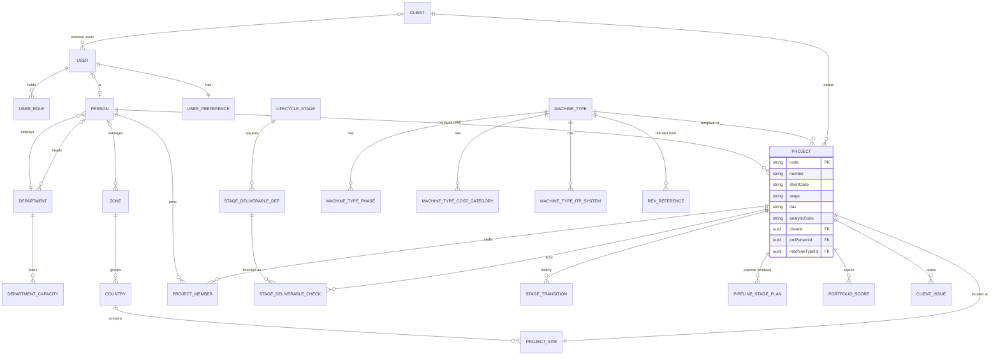

### 4.2 Planning, collaboration and personal work

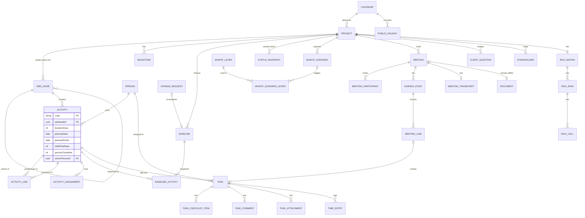

### 4.3 Cost, change and contract

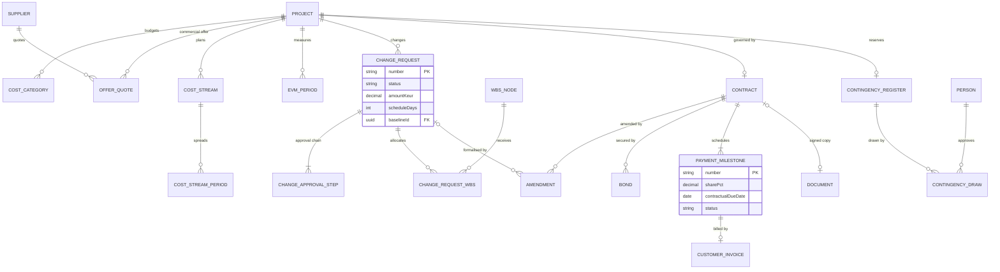

### 4.4 Resources and HR

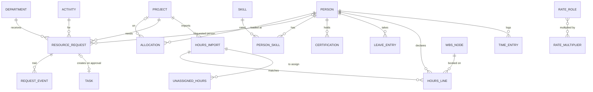

### 4.5 Control, quality and operations

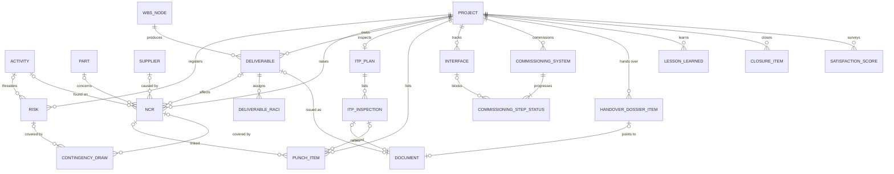

### 4.6 Installed base, after-sales and ECO effectivity

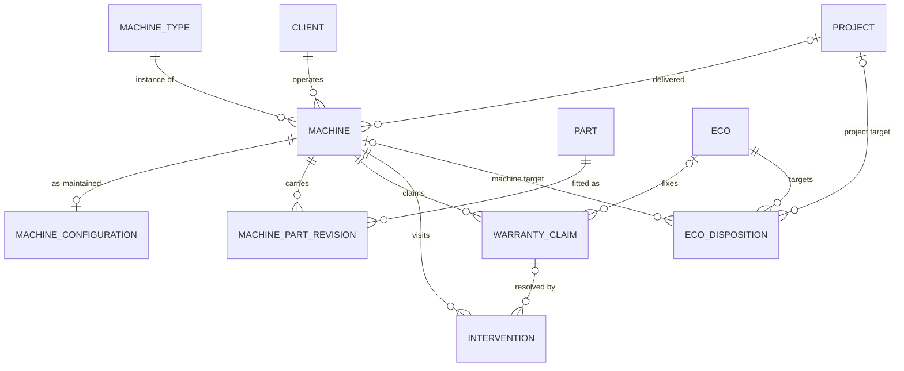

### 4.7 Supply chain

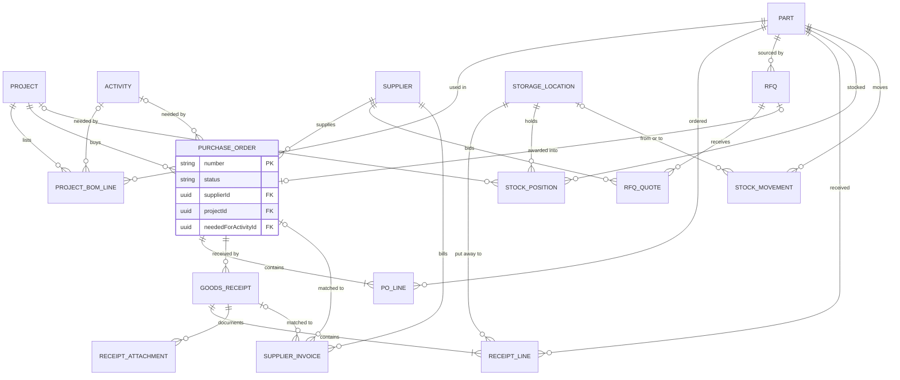

### 4.8 Engineering and PLM

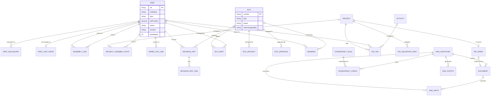

### 4.9 Documents and site

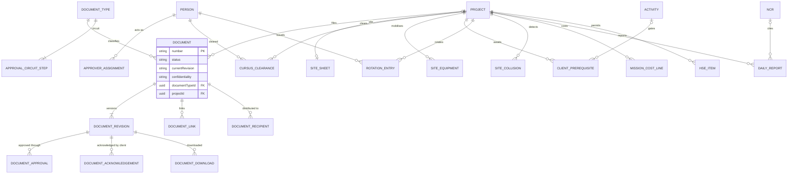

### 4.10 Platform

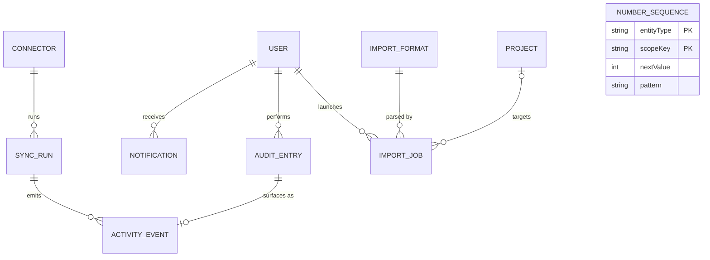

---

## 5. Derived values and formulas

These are computed in the domain layer (00 §8.8), never stored as truth.

| Value | Formula / rule | Prototype ref |
|---|---|---|
| Project health | m = min(budget × progress / actual, spi ‖ 1); null if no actual or progress; m < 0.90 → off_track; m < 0.97 → at_risk; else on_track (thresholds from Settings, A-13) | `healthOf` 3916; Overview 3793 |
| CPI, SPI, EAC, VAC, TCPI | EV/AC; EV/PV; BAC/CPI; BAC − EAC; (BAC − EV)/(BAC − AC) | 3784–3845 |
| PV curve | Σ offer payment points (deposit at order, delivery, acceptance, as % of each quote) + monthly cost streams, cumulated | `offerPoints` 3099, `HPV` 3100 |
| BAC reconciliation | BL1 original + approved CRs = BAC; pending CRs; contingency used | `HLT_PD.recon` 3308 |
| Project progress | budget-weighted roll-up of activity % complete | `planKpis` 4036–4046 |
| Activity status | not_started / in_progress / behind (tf < 0 ∧ pc < 100) / completed | 3993–4018 |
| Milestone status | done if forecast ≤ data date; late if slip > 0.4 month; at_risk if baseline < data date + 2 months; else on_track | `projectData` 3310–3339 |
| Board decision state | planned → pending (data date inside the window; alert > 21 d) → approved (window ended) | `pgRow` 4529–4548 |
| Risk score / level / cost if occurs | P × I; ≥ 15 critical, ≥ 8 high, ≥ 4 medium; round(EMV / (P/5)) | 4570–4590 |
| CR status | any step rejected → rejected; all non-n/a steps ok → approved; else in_review | 4593–4598 |
| Contract value | base + Σ signed amendments | 4869–4889 |
| Payment milestone amount / late | round(value × share/100); planned ∧ due < data date | 4878–4890 |
| Invoice due / overdue | issued + terms days (calendar arithmetic, not ms); overdue if due < today ∧ not paid | `ctrInvoices` 4896 |
| Retention | paid × retention % (basis OPEN QUESTION C-8) | 4890–4903 |
| Contingency | drawn = Σ draws; remaining = initial − drawn; exposure = Σ EMV of open risks | 4959–4967 |
| Prioritisation score | 100 × Σ (s_i/5) × (w_i/Σw) | 4499 |
| Capacity what-if | demand per €1M budget (Engineering 140 h, Site 90, MEP 60, C&P 70, Quality 40) vs department capacity | 4505–4512 |
| Load band | < 60 / 60–89 / 90–100 / 101–115 / > 115 %; over-allocated if any week > 110 % | `shade` 3867 |
| Availability from leave | max(0, 5 − daysOff) × 7 h per week (35 h basis) | 4398–4404 |
| Hours variance | declared − planned; flagged if declared > planned × 1.10 or < planned; valued at a rate (A-10) | 5008–5018 |
| Task % ⇄ status | done ⇒ 100; leave done from 100 ⇒ 75; 100 ⇒ done; > 0 on todo/done ⇒ doing; otherwise % = min(100, logged/est × 100) | 4085–4107, `TODOS` |
| Task due buckets | Overdue (due < today), Today, Next week, Later, Recently done | 4058–4083 |
| PO value | Σ line qty × unit price (A-11) | 4306–4337 |
| BOM shortfall → draft POs | purchased parts of the project BOM where Σ qty on the project's non-cancelled POs < BOM qty; need = BOM qty − ordered qty (stock is not considered); "Create draft POs" makes one Draft PO per manufacturer/supplier (ids PO-1100+) | `orderedQty`, `shortfall`, `createDrafts` 4327–4330 |
| 3-way match | PO amount vs receipt amount vs invoice amount: ok / receipt partial / no receipt / no PO | `match3` 4646–4676 |
| Stock available / value / below min | onHand − reserved; onHand × last purchase price; min > 0 ∧ onHand < min | 4469–4492 |
| ECO targets and release | projects using a part with open BOM (initiative…etudes) + machines carrying the part; released when all approvals ok ∧ interchangeability set ∧ no pending disposition | 4182–4199, 4339–4370 |
| Installed part state | latest / update_planned / decision_pending / retrofit_pending / pinned from ECO dispositions | `machineCfg`, `pinnedFor` 4182–4199 |
| P&ID tag status | client scope → client; no ref → unmapped; ref not in catalogue → unknown_ref; not in project BOM → not_in_bom; part status ≠ validated → part_*; else linked | 4762–4782 |
| Engineering input state / gate | provider latest revision vs revision in use; gate ready when no open blocking check | 4783–4816 |
| Document next approver | next circuit step after approvals count; person from `DOC_WHO` | 5040–5047 |
| Go chantier | no prerequisite pending ∧ no Cursus no_go ∧ all equipment confirmed ∧ no collision ∧ no HSE permit pending | 4739–4760 |
| Project number / analytic code | "#" + (max number + 1) padded 3; client code3 + (count of client projects + 1) padded 3 | `nextProjectId`, `nextAnalytic` 3176–3178 |
| New project budget | Σ category budgets × (1 + contingency %) | `npTotal` 3946–3969 |

---

## 6. Status machines

States use the enum codes of §2. Transition labels give the trigger, and the role where the prototype restricts it. "(intended)" marks transitions announced by the UI text but not implemented in the prototype. "(static)" marks statuses that are only seeded today.

### 6.1 Portfolio and lifecycle

**Project lifecycle** (`TRANS` 3146, `advance` 3922, `toggleDeliv` 3923). Each forward arrow is either *auto* (all stage deliverables ticked, or "Move to" with nothing missing) or *forced* (missing deliverables → Force dialog with mandatory reason). Every move to `annule` is forced.

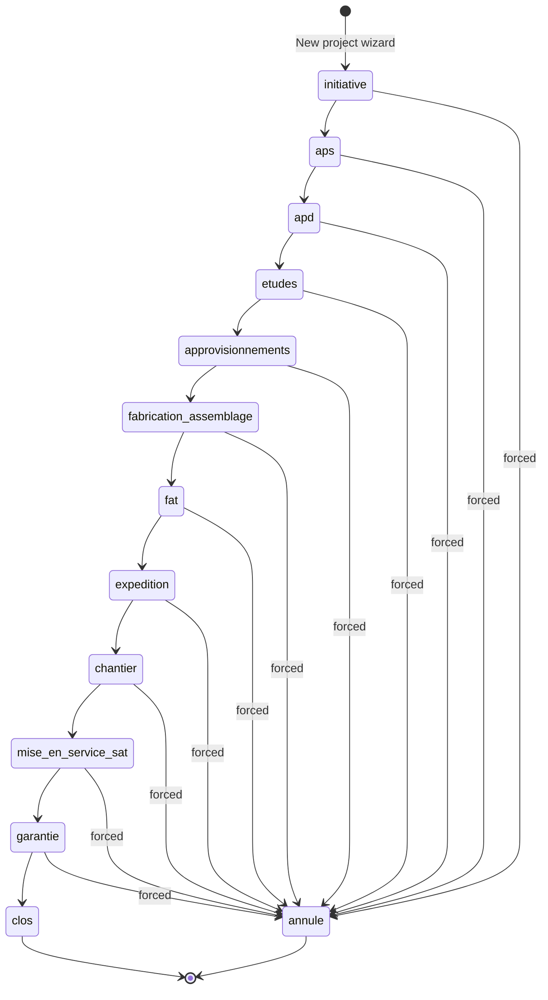

**Stage-move decision** (Projects › Move to, 01 §11):

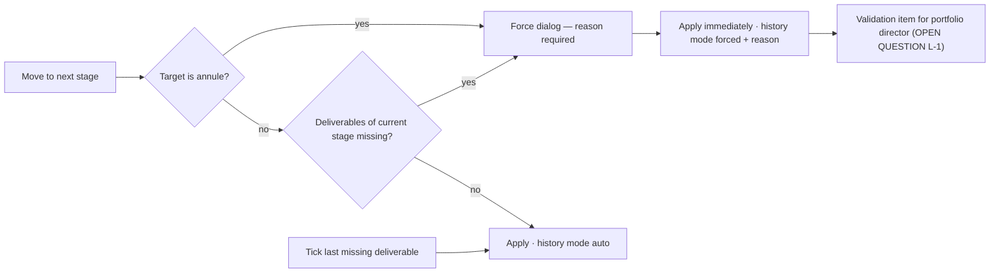

**Forced-transition validation** (proposed; the prototype shows an informational item only — OPEN QUESTION L-1):

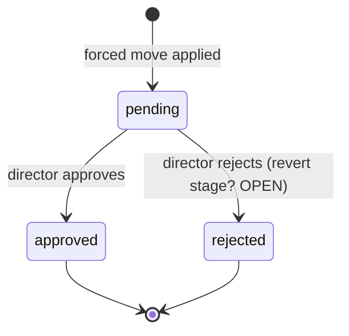

**Pipeline board window** (`PIPE_PLAN`, `pgRow` 4529–4548; derived from dates):

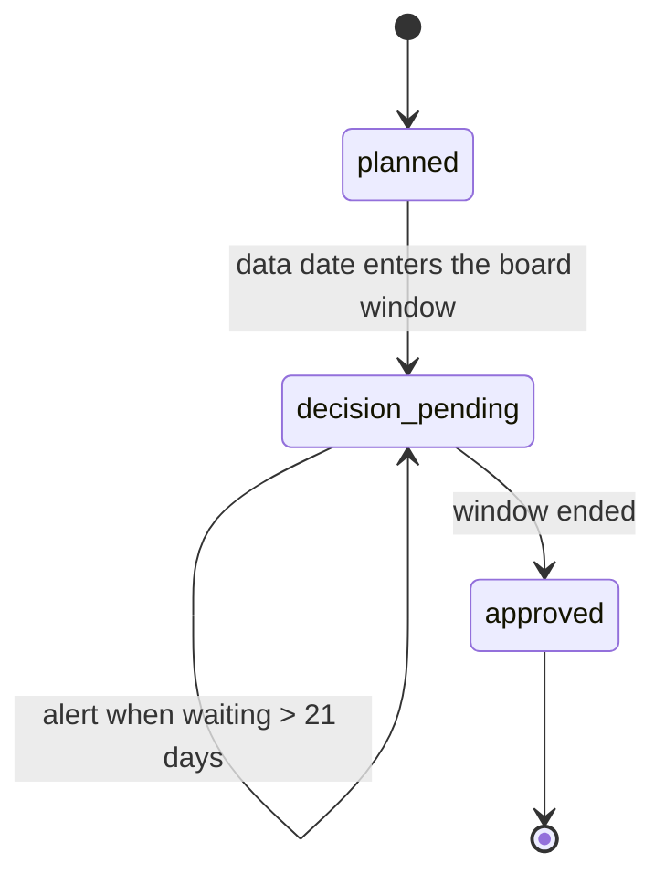

### 6.2 Planning and collaboration

**Activity progress** (derived, 05 §2.4.2):

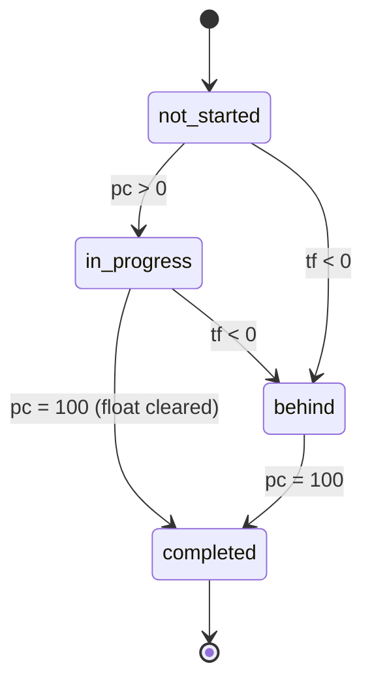

**Milestone** (derived at the data date):

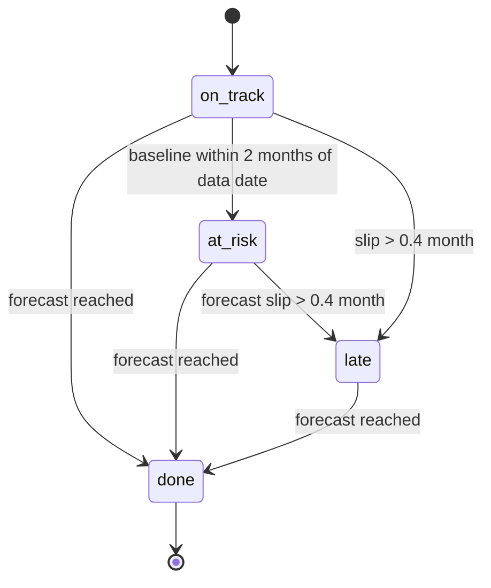

**Baseline** (`BASELINES`; static in the prototype):

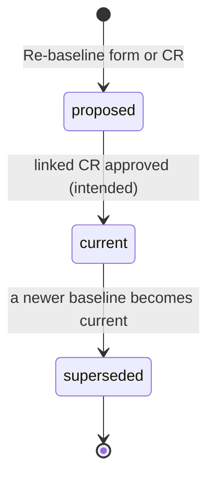

**Meeting** (05 §5):

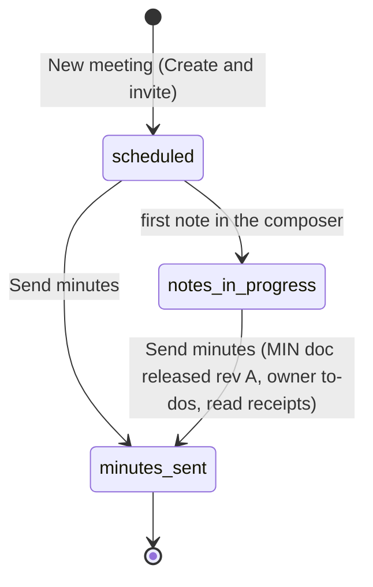

**Meeting action line**, **client question** and **transcript analysis**:

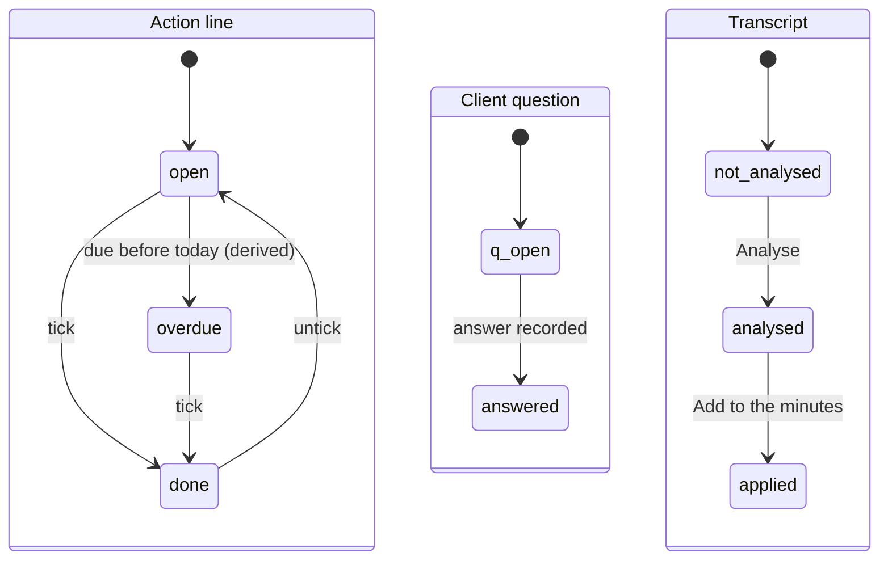

**What-if scenario** (05 §4):

```mermaid
stateDiagram-v2
  [*] --> draft : New scenario / levers toggled
  draft --> selected : Select scenario
  selected --> requests_created : create resource requests (intended)
  requests_created --> [*]
```

**Task** (10 §6–7) — any status can be chosen in the segmented control. Couplings: done ⇒ 100 %; 100 % ⇒ done; leaving done from 100 % ⇒ 75 %; > 0 % on todo/done ⇒ doing. The list toggle switches done ⇄ doing.

```mermaid
stateDiagram-v2
  [*] --> todo : created (manual, approved request, meeting action)
  todo --> doing
  doing --> review
  review --> done
  done --> doing : list toggle / pct below 100
  doing --> todo
  review --> doing
  todo --> done
```

**Notification**: `unread → read` (open row or "Mark all read"; per user).

### 6.3 Cost, change and contract

**Change request** (07 §2.2; status derived from steps once in review):

```mermaid
stateDiagram-v2
  [*] --> draft
  [*] --> in_review : New change request form (submits directly)
  draft --> in_review : Submit for review
  in_review --> approved : every non-na step ok
  in_review --> rejected : any step rejected
  approved --> [*]
  rejected --> [*]
```

**Change approval step** (pm, director, client, ccb — CCB actor OPEN QUESTION P-6; sequential or parallel OPEN):

```mermaid
stateDiagram-v2
  [*] --> pending
  [*] --> na : step not applicable
  pending --> ok : role approves (row, drawer, My approvals, client portal)
  pending --> rejected : role rejects
  ok --> [*]
  rejected --> [*]
  na --> [*]
```

**Payment milestone** and **customer invoice** (04 §7):

```mermaid
stateDiagram-v2
  state "Payment milestone" as PM {
    [*] --> planned
    planned --> invoiced : Issue invoice (number, date, note)
    invoiced --> paid : Mark paid
    planned --> planned : late flag when due before data date
  }
  state "Customer invoice (derived)" as CI {
    [*] --> awaiting_payment : invoice issued
    awaiting_payment --> overdue : due date passed
    awaiting_payment --> inv_paid : paid
    overdue --> inv_paid : paid
  }
```

**Amendment** (status chosen at creation; no transition UI — intended order shown) and **bond**:

```mermaid
stateDiagram-v2
  state "Amendment" as AM {
    [*] --> draft
    draft --> sent_for_signature
    sent_for_signature --> awaiting_signature
    awaiting_signature --> signed : adds to contract value
  }
  state "Bond" as BD {
    [*] --> valid
    valid --> released : release date reached or released
  }
```

**Contingency draw-down**: append-only record (with approver), no states. **Status report**: one-shot run, no state.

### 6.4 Risk, quality and operations

**Risk**: `open ⇄ closed` (drawer "Close risk" / "Reopen"). Level is derived.

**NCR** (`NCR_FLOW` 3506; any user advances one step; quality decides at verification):

```mermaid
stateDiagram-v2
  [*] --> open : New NCR
  open --> containment
  containment --> root_cause
  root_cause --> corrective_action
  corrective_action --> verification
  verification --> closed : quality approves (My approvals)
  verification --> corrective_action : quality rejects
  closed --> [*]
```

**Deliverable** (`DELIV_FLOW2` 3514; accept/reject by the client role only; rejection loop OPEN QUESTION Q-3):

```mermaid
stateDiagram-v2
  [*] --> planned
  planned --> in_progress : Start
  in_progress --> internal_review : To internal review
  internal_review --> submitted : Submit to client
  submitted --> accepted : client Accept (PV)
  submitted --> rejected : client Reject with comments
  rejected --> in_progress : resubmit (intended, OPEN)
  accepted --> [*]
```

**ITP inspection** (static; a failed result is expected to raise an NCR — OPEN QUESTION Q-6):

```mermaid
stateDiagram-v2
  [*] --> planned
  planned --> scheduled
  scheduled --> passed : result recorded (intended)
  scheduled --> failed : result recorded (intended)
  failed --> scheduled : re-inspection (intended)
  passed --> [*]
```

**Punch item** and **interface**:

```mermaid
stateDiagram-v2
  state "Punch item" as PI {
    [*] --> open
    open --> in_progress : Start
    in_progress --> closed : Close
    open --> closed : Close
  }
  state "Interface" as IF {
    [*] --> if_open
    if_open --> late : need date passed (derived)
    if_open --> received : Mark received
    late --> received : Mark received
    received --> frozen : Freeze
  }
```

**Commissioning cell** and **handover dossier item** (static; intended order):

```mermaid
stateDiagram-v2
  state "Commissioning step" as CS {
    [*] --> planned
    planned --> in_progress
    in_progress --> done
    planned --> blocked : interface or punch A blocking
    in_progress --> blocked
    blocked --> in_progress : blocker cleared
  }
  state "Handover item" as HI {
    [*] --> missing
    missing --> draft
    draft --> partial
    partial --> ready
  }
```

**Lesson learned** and **closure checklist item**:

```mermaid
stateDiagram-v2
  state "Lesson" as LL {
    [*] --> proposed : Add lesson
    proposed --> validated : Validate
    validated --> applied : Mark applied
  }
  state "Closure item (click cycles)" as CL {
    [*] --> not_started
    not_started --> in_progress
    in_progress --> done
    done --> not_started
  }
```

**Warranty claim**, **intervention** and **machine warranty** (static except creation):

```mermaid
stateDiagram-v2
  state "Warranty claim" as WC {
    [*] --> open : New claim
    open --> diagnosed
    diagnosed --> intervention_planned
    intervention_planned --> closed
  }
  state "Intervention" as IV {
    [*] --> iv_planned
    iv_planned --> iv_done
  }
  state "Machine warranty" as MW {
    [*] --> in_warranty : delivered
    in_warranty --> extended : extension signed
    in_warranty --> out_of_warranty : warranty end passed
    extended --> out_of_warranty : extension end passed
  }
```

**Client issue**: `open → in_progress → closed` (the UI only creates `open`).

### 6.5 Supply chain

**Purchase order** (`PO_FLOW` 3414):

```mermaid
stateDiagram-v2
  [*] --> draft : Create draft POs (BOM shortfall) / RFQ award (intended)
  draft --> awaiting_approval : Send for approval
  awaiting_approval --> ordered : Approve and order / inbox Approve (pm, director)
  awaiting_approval --> cancelled : inbox Reject
  ordered --> partially_received : receipt accepted, quantity short (intended)
  ordered --> received : all lines received (intended)
  partially_received --> received : remaining received (intended)
  received --> [*]
  cancelled --> [*]
```

**RFQ** (08 §1):

```mermaid
stateDiagram-v2
  [*] --> draft : New RFQ
  draft --> open : Send to suppliers
  open --> comparing : Compare quotes (needs 2 or more quotes)
  comparing --> awarded : Award (pm, procurement, director)
  awarded --> [*]
```

**Supplier invoice — 3-way match** (08 §1.4.3):

```mermaid
stateDiagram-v2
  [*] --> awaiting_receipt
  [*] --> blocked
  [*] --> no_po
  awaiting_receipt --> approved_for_payment : PO ok and receipt ok, Approve payment
  blocked --> approved_for_payment : Approve payment, or Approve received part (amount = receipt)
  awaiting_receipt --> rejected : Reject invoice
  blocked --> rejected : Reject invoice
  no_po --> rejected : Reject invoice
  approved_for_payment --> paid : paid in Sage X3 (sync)
  paid --> [*]
  rejected --> [*]
```

**Goods receipt** (`DELIV_FLOW` 3474):

```mermaid
stateDiagram-v2
  [*] --> announced : Announce a delivery
  announced --> qc_pending : Register receipt
  qc_pending --> accepted : Accept, to stock (quality, procurement)
  qc_pending --> rejected : Reject, to quarantine
  qc_pending --> partially_rejected : per-line QC (intended; seed only)
  received --> qc_pending : seed-only state
  accepted --> [*]
  rejected --> [*]
  partially_rejected --> [*]
```

**Stock position source**: `x3 → local` on any movement (adjust, transfer, reserve, issue, return, scrap); `local → x3` on push or "Import from X3" (which today discards local changes — OPEN QUESTION SC-5).

**Resource request** (`REQ_STATUS` 3282, 08 §5–6):

```mermaid
stateDiagram-v2
  [*] --> pending : Send request (PM)
  pending --> approved : dept head Approve (task created)
  pending --> rejected : dept head Confirm reject (reason)
  pending --> reschedule : dept head Send proposal (+1, +2, +3 weeks)
  pending --> withdrawn : PM Withdraw
  reschedule --> approved : PM Accept (dates = proposal)
  reschedule --> withdrawn : PM Withdraw
  rejected --> pending : PM Re-request
  approved --> [*]
  withdrawn --> [*]
```

### 6.6 Engineering, PLM and documents

**ECO** (`ECO_FLOW` 3431, 09 §11):

```mermaid
stateDiagram-v2
  [*] --> draft : New ECO / Raise ECO (intended)
  draft --> impact_analysis : Start impact analysis
  impact_analysis --> in_approval : Submit for approval (interchangeability set)
  in_approval --> released : englead, quality and pm ok AND no pending disposition (automatic)
  in_approval --> in_approval : locked while dispositions pending
  in_approval --> rejected : any approver rejects
  released --> [*]
  rejected --> [*]
```

**ECO disposition** per target, **interchangeability** and **installed-base part state**:

```mermaid
stateDiagram-v2
  state "Disposition (until released or rejected)" as DI {
    [*] --> pending_disposition
    pending_disposition --> update : open-BOM project default
    pending_disposition --> pinned : machine on non-interchangeable ECO default
    pending_disposition --> retrofit : machines only
    pending_disposition --> na
  }
  state "Interchangeability (draft, impact analysis)" as IC {
    [*] --> not_assessed
    not_assessed --> yes
    not_assessed --> no
  }
  state "Installed part" as IP {
    [*] --> decision_pending
    decision_pending --> update_planned
    decision_pending --> retrofit_pending
    decision_pending --> part_pinned
    update_planned --> latest : ECO released
    retrofit_pending --> latest : retrofit done
  }
```

**Part status**: validated / not_validated / outdated / obsolete. There is no UI transition; status is driven by qualification and ECOs (OPEN QUESTION E-1). **Machine type**: `active ⇄ inactive`.

**Drawing** (mirrored from PDM):

```mermaid
stateDiagram-v2
  [*] --> wip
  wip --> under_review
  under_review --> released
  under_review --> wip : rework
  released --> obsolete : superseded or withdrawn
```

**Document (Codex index) and engineering deliverable** (shared statuses, 10 §9, 09 §11):

```mermaid
stateDiagram-v2
  [*] --> draft : deposit in Codex / new revision
  draft --> frozen : Freeze (discipline screens)
  frozen --> release_proposed : Propose release (no open blocking check)
  release_proposed --> release_proposed : approve circuit step (next role per DOC_WHO)
  release_proposed --> released : last circuit step approved / Validate release (PM)
  released --> obsolete : newer revision released (withdrawal note)
  released --> draft : new revision deposited
  obsolete --> [*]
```

**Client acknowledgement** of a released client-deliverable document: `pending → acknowledged` (per document + revision, client portal).

**Engineering input**, **consistency check**, **output** and **gate**:

```mermaid
stateDiagram-v2
  state "Input" as IN {
    [*] --> to_confirm
    to_confirm --> up_to_date : Confirm
    up_to_date --> outdated : provider releases newer revision
    outdated --> to_confirm : import new revision (wizard)
  }
  state "Consistency check" as CC {
    [*] --> chk_open
    chk_open --> chk_in_progress
    chk_open --> resolved : Resolve here
    chk_in_progress --> resolved : Resolve here
    chk_open --> sent_back : Send back to tool
    chk_in_progress --> sent_back : Send back to tool
  }
  state "Output" as OU {
    [*] --> blocked
    blocked --> ready : discipline has no open blocking check
    ready --> stale : input changed
    stale --> ready : regenerate
    partial --> ready : complete
  }
  state "Gate Plans and BOM frozen" as GT {
    [*] --> gate_blocked
    gate_blocked --> ready_to_pass : no open blocking check
  }
```

**P&ID tag mapping and validation steps**:

```mermaid
stateDiagram-v2
  state "Tag mapping" as TG {
    [*] --> unmapped
    unmapped --> linked : map BOM reference (status then derived)
    linked --> unmapped : unlink
  }
  state "Validation step" as VS {
    [*] --> todo
    todo --> doing
    doing --> done
  }
```

### 6.7 Site, HR and platform

**Go chantier** (derived) and site items:

```mermaid
stateDiagram-v2
  state "Go chantier" as GO {
    [*] --> no_go
    no_go --> go : all five conditions met
    go --> no_go : any condition fails
  }
  state "Client prerequisite" as CP {
    [*] --> pending
    pending --> confirmed : Client confirms
    confirmed --> signed : Signed on site
  }
  state "Site equipment" as SE {
    [*] --> eq_pending
    eq_pending --> eq_confirmed : Confirm
  }
  state "Cursus reminder" as CR {
    [*] --> not_sent
    not_sent --> sent : Remind in Cursus
  }
  state "HSE item" as HS {
    [*] --> hse_pending
    hse_pending --> hse_ready
    hse_ready --> hse_signed
  }
```

The Cursus verdict (`go` / `go_with_reserve` / `no_go`) is read-only from Cursus. Collisions have no resolved state yet (OPEN QUESTION D-6).

**Hours import** (06 §5):

```mermaid
stateDiagram-v2
  state "Import" as IM {
    [*] --> not_imported
    not_imported --> imported : Import Lucca
  }
  state "Line" as LN {
    [*] --> matched : resource and WP planned
    [*] --> to_assign : declared without plan
    to_assign --> assigned : Assign to WP (intended)
  }
```

**Leave**: Lucca-owned. Requests and approvals happen in Lucca; Keystone shows approved absences only.

**Connector**: `ok / warning / ready`, set by the last sync run (display only in the prototype).

### 6.8 UI flows (not persisted)

```mermaid
stateDiagram-v2
  state "New project wizard" as NP {
    [*] --> basics
    basics --> structure : Next
    structure --> budget : Next
    budget --> schedule : Next
    structure --> basics : Back
    budget --> structure : Back
    schedule --> budget : Back
    schedule --> created : Create project (stage initiative)
  }
  state "Engineering import wizard" as EI {
    [*] --> source
    source --> mapping : column mapping
    mapping --> check : check and import
    check --> imported
  }
```

The generic add-form dialog (closed → open → valid/invalid → submitted or cancelled), the toast (4 s auto-hide), the drawers (row click toggles) and the map tooltip (hover → pinned → hidden) are specified in 01 §8–9 and 02.

---

## 7. Conflicts and de-duplication decisions

| # | Overlap or conflict in the prototype | Resolution in this model | Open question |
|---|---|---|---|
| 1 | Personas (`PERSONAS`, 8 users) vs resources (`PEOPLE`, 8 staff) vs owners (`OWN` initials) vs short names in records | One **Person** table plus **User** for those who log in; owners and organisers reference Person | P-13 |
| 2 | Two change-request datasets: `HCRS` (Budget: CR-005 Rejected, CR-007 "MEP routing rework…", CR-008 −18 d Pending) vs `HLT_CRS_X` (Change control: CR-007 "Yard drainage re-routing", CR-008 −12 d In review, CR-009 Draft). Contract amendments cite CR-004/CR-006 with other subjects and amounts. | One **ChangeRequest** entity. Seed from `HLT_CRS_X` (it carries the approval chain), add CR-005 from `HCRS`, and reconcile amounts and WBS allocations (`ChangeRequestWbs`). Budget reconciliation, WP changes, amendments and the client portal all read it. | A-4 |
| 3 | Billing: `BILLING` (client portal, cash fallback, margin) vs `CONTRACTS` (contract, billing, cash) | **Contract / PaymentMilestone / CustomerInvoice** are authoritative. `BILLING` rows of other projects are migrated into payment milestones. | A-5 |
| 4 | Punch lists: `PUNCH` (ITP) vs `SITE_PUNCH` (Site) with clashing ids and statuses | One **PunchItem** per project, with optional NCR and source inspection | A-6 |
| 5 | Deliverables: `HLT_DELIVS` (register) vs `DELIVERABLES` (client home summary) | **Deliverable** from `HLT_DELIVS`; the client home list is a query | — |
| 6 | Schedule bars `HTASKS` / milestones `HMILES` vs WBS `HACTS` | WBS and activities are the source; schedule bars are derived roll-ups; milestones are a project table (optionally linked to activities) | A-7 |
| 7 | Three rate sources: `RATE_ROLES`, `RATES`, flat 62 €/h | **RateRole** (+ multipliers, effective dates); `RATES` dropped after confirmation | A-10, R-4 |
| 8 | Part price: list price, `LAST_PRICE`, invoice and PO amounts | Part.listPriceEur + PartLastPrice + **PoLine.unitPriceEur** | A-11 |
| 9 | Engineering deliverables `ENG_DOCS` vs vault `DOCS` | One **Document** entity; engineering screens filter by `service` (discipline) and show `DocumentRecipient` | — |
| 10 | P&ID header `PID` (rev C, Under review) vs Codex `PID-HLT-026` (rev D, Released) | **PidSheet** references the Document; revision and status come from Codex | A-9 |
| 11 | Legacy portfolio statuses in `EXTRA` (Proposed, Approved, Planning, Active, On hold, Closing, Closed, Cancelled) | Migrated through `STATUS_MAP_OLD` into `LifecycleStage`; legacy values are never stored | L-7 (map legend) |
| 12 | `SCORES` keyed EWA-041, RBR-038, CER-045 while projects are EWA-051, RBR-048, CER-047 | Remap in the seed loader | L-5 |
| 13 | Machine-type data spread over `MACHINE_TYPES`, `NP_TEMPLATES`, `ITP_TEMPLATES`, `REX_FIN`, `mtOv`, `added.mtypes` | One **MachineType** aggregate (phases, cost categories, ITP systems, REX references, payment pattern) read by the wizard, ITP and budget | E-9 |
| 14 | Calendar labels "Site 6d · 10h" (screen) vs "Chantier 6d · 10h" (data, form) | One code `site_6x10` with EN/FR labels | E-9, S-2 |
| 15 | Holidays: `HOLIDAYS` (1 date) vs `SETTINGS0.holidays` (11 dates) vs wizard text "US federal" | **PublicHoliday** per calendar/country | S-2 |
| 16 | Department capacity in `ROLES` and `capBase` (duplicate) | **DepartmentCapacity** per period | R-1 |
| 17 | Health computed twice (unclamped Overview, clamped Projects/My projects) with hard-coded thresholds | One `health` function reading `AppSetting` thresholds | A-13 |
| 18 | Contingency "drawn" (Budget forecast 208 vs register 48) | ContingencyRegister + draws are the record; Budget reads them | A-8 |
| 19 | Role access: spec 07 OQ15 claims ops screens are director-only | The computed `ROLE_SCREENS` (line 3466 pushes extras) is authoritative — 01 §3.2 | resolved |
| 20 | Override maps keyed by id or row index, not by project (`riskOv`, `ncrOv`, `closureOv`…) | Per-record rows with `projectId`; no cross-project leakage | resolved |
| 21 | 3-letter project prefixes (`HLT`) used as keys by BOM usage, ECOs, tasks, requests, stock reservations | Resolve to `Project` via `shortCode` | — |
| 22 | Client issues are global (`CLIENT_ISSUES`) | **ClientIssue** scoped to the project | L-6 |
| 23 | Generated deliveries put stock at "Magasin chantier — Lyon", which is not a configured location | Add the location or remap in the seed | SC-5 |
| 24 | ITP doc reference "NCR-HLT-031" vs NCR ids "NCR-0nn" | Codex NCR documents (type NCR) and NCR records are distinct; link NCR record → Document | Q-6 |
| 25 | Task `pct` stored in the seed but recomputed in the UI | Store `percentComplete`; `loggedH` derived from TimeEntry | R-8 |
| 26 | Project name translated as data in FR ("Extension du terminal Harbor Line") | Store one name. Optional `nameFr` if the business wants bilingual names. | X-12 |
| 27 | `ALL_BYID` mixes activities of every project for lookups (P&ID, search) | Activity lookups always filter by project | — |

---

## 8. Seed mapping (prototype constants → entities)

Line numbers refer to `design/Keystone PM v8.dc.html`. Rows were counted by evaluating the constants block (3096–3750). Generated data comes from `projectData()` (3310–3339), `genPOs()` and `genDeliv()`; the seed loader should call equivalent generators once and persist the result, so the demo database reproduces the prototype figures (00 §8.8 golden values).

### 8.1 Organisation, portfolio, reference

| Constant | Line | Rows | Target entity / use |
|---|---|---|---|
| `PERSONAS` | 3747 | 8 | User, UserRole, Person |
| `ROLE_SCREENS` | 3465–3466 | 8 roles | role → screen access configuration (code) |
| `PEOPLE` | 3123 | 8 | Person (job title), Allocation (8 weeks) |
| `OWN` / `INIT_OF` | 3195 / 3301 | 9 / 9 | Person initials |
| `DEPTS` / `DEPT_OF` | 3268 / 3269 | 5 / 8 | Department, Person.departmentId |
| `ROLES` | 3132 | 5 | DepartmentCapacity |
| `ZONES` / `ZONE_BOUNDS` / `COUNTRY_ZONE` / `CITY_COUNTRY` | 3170–3174 | 3 / 3 / 22 / 14 | Zone, Country, City |
| `CLIENT_CODES` | 3167 | 9 | Client |
| `PROJECTS` / `META` / `STAGE_OF` | 3105 / 3161 / 3162 | 6 / 6 / 6 | Project (planned projects) |
| `EXTRA` | 3149 | 11 | Project (legacy statuses via `STATUS_MAP_OLD` 3143) |
| `PROJ_ID` | 3168 | 6 | Project.number, das, machineTypeId, analyticCode |
| `P3NAME` / `PROJ_NAMES` | 3748 / 3263 | 6 / 6 | Project.shortCode |
| `GEO` | 3169 | 17 | ProjectSite |
| `DAS_LIST` / `MACHINE_TYPES` | 3165 / 3166 | 4 / 5 | enums, MachineType |
| `STATUSES`, `STAGE_ORDER`, `EXEC_STAGES`, `PIPE_STAGES` | 3136–3139 | 13 / 12 / 7 / 3 | LifecycleStage |
| `STAGE_DELIVS` / `STAGE_DONE_DEFAULT` | 3140 / 3141 | 12 stages / 6 projects | StageDeliverableDef / StageDeliverableCheck |
| `STAGE_HISTORY` | 3142 | 2 projects | StageTransition |
| `TRANS` / `GATES` / `LIFE` | 3146–3148 | 13 / 12 / 13 | transition rule, LifecycleStage.entryGate / description |
| `PIPE_PLAN` / `PG_MONTHS`, `PG_NOW` | 3665 / 3671 | 5 projects / constants | PipelineStagePlan; time model |
| `NP_TEMPLATES` (`NP_TEMPLATES_OLD` ignored) | 3179 (3186) | 6 | MachineType template, phases, cost categories |
| `REX_FIN` | 3101 | 5 | MachineType payment pattern, RexReference |
| `ITP_TEMPLATES` | 3716 | 5 | MachineTypeItpSystem |
| `SCORE_AXES` / `SCORES` | 3539 / 3540 | 5 / 10 | ScoreWeight / PortfolioScore (remap 3 keys) |
| `SETTINGS0` | 3467 | 9 lists | ReferenceValue, StorageLocation, AppSetting (health) |
| `CLIENT_ISSUES` | 3544 | 3 | ClientIssue (HLT-026) |
| `CLIENT_DOCS` | 3543 | 5 | not rendered (L-9) — optional document categories |
| `DEFS` | 3284–3300 | 6 | generator input (team → ProjectMember; pk → WbsNode/Activity; cats → CostCategory; cont → ContingencyRegister) |

### 8.2 Planning, cost, contract

| Constant | Line | Rows | Target entity / use |
|---|---|---|---|
| `HACTS` | 3196 | 30 (1 root, 8 WPs, 21 activities) | WbsNode, Activity, ActivityLink (HLT-026) |
| generated `ACTS` | 3310–3339 | 31–36 per project (145 activities in `ALL_BYID` 3340) | WbsNode, Activity for NDC-031, RCF-019, ERP-202, WSA-044, MSR-012 |
| `A1250_RES` | 3227 | 4 | ActivityAssignment |
| `HTASKS` | 3113 | 8 | golden data for derived schedule bars |
| `HMILES` / generated `MILES` | 3122 | 6 / per project | Milestone |
| `BASELINES` | 3504 | 3 | Baseline |
| `HLT_SNAPS` / `SNAP_WEEKS` | 3486 / 3485 | 13 weeks × 6 series | StatusSnapshot |
| `LEVERS` / `AUTO` | 3462 / 3463 | 5 / 3 | WhatIfLever, auto-level rule |
| `HLT_OFFER` | 3097 | 4 | OfferQuote |
| `HLT_STREAMS` | 3098 | 6 | CostStream, CostStreamPeriod |
| `HPV`, `HEV`, `HAC`, `HBAC` | 3100–3104 | 12 / 9 / 9 / 1 | EvmPeriod, Project.bacKeur |
| `HLT_PD` (incl. `recon`, texts) | 3308 | 1 | golden values; reconciliation |
| `HCATS` / `HCAT_ROWS` | 3112 / 3192 | 6 / 6 | CostCategory |
| `HWPS` | 3194 | 9 | WbsNode budgets, ChangeRequestWbs |
| `HCRS` | 3193 | 5 | ChangeRequest (merge, §7 #2) |
| `HLT_CRS_X` / `CR_TYPES` | 3498 / 3497 | 5 / 3 | ChangeRequest, ChangeApprovalStep |
| `CONTRACTS` | 3713 | 1 (5 milestones, 2 amendments, 2 bonds) | Contract, PaymentMilestone, Amendment, Bond, CustomerInvoice (M1–M3) |
| `BILLING` / `CASH_M` | 3541 / 3542 | 6 / 6 | migrate to PaymentMilestone (A-5) / derived cash view |
| `CONTINGENCY` | 3720 | 1 (initial 150, 3 draws) | ContingencyRegister, ContingencyDraw |
| `MEETINGS` / `MTG_DONE` / `MTG_TRANSCRIPTS` / `MTG_EXCHANGE` | 3703 / 3710 / 3711 / 3712 | 6 / 2 / 3 / 5 | Meeting, MeetingParticipant, AgendaPoint, MeetingLine, MeetingTranscript, ClientQuestion |
| `STAKEHOLDERS` / `RACI` | 3714 / 3715 | 8 / 7 rows × 6 roles | Stakeholder, RaciMatrix/Row/Cell |
| `DELIVERABLES` | 3464 | 4 | derived (client home) |

### 8.3 Resources, tasks, HR

| Constant | Line | Rows | Target entity / use |
|---|---|---|---|
| `TODOS` | 3228 | 27 | Task |
| `CHECKS` / `COMMENTS` / `FILES` / `ENTRIES` / `DESC` | 3257–3261 | 3 / 1 / 2 / 2 / 1 tasks | TaskChecklistItem, TaskComment, TaskAttachment, TimeEntry, Task.description |
| `STATUS_L` / `TODAY` / `dayDate` | 3264–3266 | — | enum labels / time model |
| `REQUESTS` / `REQ_STATUS` / `NR_ACTS` | 3270 / 3282 / 3283 | 10 / 5 / 5 | ResourceRequest (+ RequestEvent from `response`) |
| `RATE_ROLES` / `MULTS` / `RATES` | 3454 / 3455 / 3262 | 10 / 5 / 8 | RateRole, RateMultiplier / legacy |
| `SKILLS` / `SKILL_LV` / `CERTS` | 3456–3458 | 10 / 8 / 5 | Skill, PersonSkill, Certification |
| `LEAVE` / `LEAVE_DAYS` / `HOLIDAYS` | 3459–3461 | 8 / 4 / 1 | LeaveEntry, PublicHoliday |
| `HOURS` | 3735 | 1 (10 lines, 2 unassigned) | HoursImport, HoursLine, UnassignedHours |

### 8.4 Control, operations, after-sales

| Constant | Line | Rows | Target entity / use |
|---|---|---|---|
| `RISKS_HLT` / `RESPONSES` | 3487 / 3496 | 8 / 4 | Risk |
| `HLT_NCRS` / `NCR_SEV` / `NCR_FLOW` | 3507 / 3505 / 3506 | 5 / 3 / 6 | Ncr |
| `HLT_DELIVS` / `DELIV_TYPES` / `DELIV_FLOW2` | 3515 / 3513 / 3514 | 10 / 8 / 6 | Deliverable, DeliverableRaci |
| `ITP` | 3717 | 1 (13 items) | ItpPlan, ItpInspection |
| `PUNCH` / `SITE_PUNCH` | 3718 / 3581 | 5 / 3 | PunchItem (merged) |
| `INTERFACES` | 3719 | 7 | Interface |
| `COMMISSIONING` | 3721 | 6 systems × 5 steps, 8 dossier items | CommissioningSystem, CommissioningStepStatus, HandoverDossierItem |
| `LESSONS` / `CLOSURE` / `SATISFACTION` | 3732–3734 | 4 / 10 / 5 | LessonLearned, ClosureItem, SatisfactionScore |
| `FLEET` / `AS_MAINT` | 3729 / 3722 | 8 / 6 | Machine, MachineConfiguration, MachinePartRevision |
| `CLAIMS` / `INTERVENTIONS` | 3730 / 3731 | 8 / 6 | WarrantyClaim, Intervention |

### 8.5 Supply chain, engineering, documents, site, platform

| Constant | Line | Rows | Target entity / use |
|---|---|---|---|
| `SUPPLIERS` | 3538 | 8 | Supplier (+ manufacturers from `PARTS.mfr`, 27) |
| `RFQS` | 3526 | 4 | Rfq, RfqQuote |
| `HLT_POS` / `PO_FLOW` / generated `genPOs` | 3406 / 3414 | 6 / 6 / per project | PurchaseOrder, PoLine |
| `HLT_DELIV` / `DELIV_FLOW` / generated `genDeliv` | 3468 / 3474 | 5 / 6 / per project | GoodsReceipt, ReceiptLine, ReceiptAttachment |
| `INVOICES` | 3531 | 6 | SupplierInvoice |
| `STOCK0` / `MOVES0` / `STOCK_OPS` | 3475 / 3484 / 3483 | 18 / 5 / 6 | StockPosition, StockMovement |
| `PARTS` | 3343 | 54 | Part, PartEquivalent, ProjectBomLine (`usage`) |
| `WEAR_SPARE` / `PU_LABEL` / `STATUS_NOTE` | 3341 / 3342 / 3405 | 25 / 3 / 3 | Part.wearSpare, labels |
| `LAST_PRICE` | 3428 | 15 | PartLastPrice |
| `SPARE_LISTS` | 3399 | 5 systems | SpareListLine |
| `TREE` / `TREES` / `REV_DIFF` | 3421 / 3426 / 3427 | 1 / 1 / 1 | AssemblyLink, ProjectAssemblyRoot, RevisionDiff(+Line) |
| `ECOS` / `ECO_TYPES` / `ECO_FLOW` | 3432 / 3430 / 3431 | 6 / 5 / 5 | Eco, EcoPart, EcoProject, EcoApproval, EcoDisposition, EcoDocumentRef |
| `DRAWINGS` | 3439 | 13 | Drawing |
| `PID` / `PID_TAGS` / `PID_STEPS` / `PLC_LABEL` | 3583 / 3585 / 3611 / 3584 | 1 / 24 / 5 / 3 | PidSheet, PidTag, PidValidationStep |
| `ENG_DISC`, `ENG_RCP`, `ENG_DOCS`, `ENG_INPUTS`, `ENG_RULES`, `ENG_CHECKS`, `ENG_OUTPUTS`, `ENG_CHANGES`, `ENG_TOOLS`, `ENG_MAP`, `ENG_DELTAS` | 3736–3746 | 4, 7, 13, 12, 6, 10, 6, 4, 4, 6, 4 | EngDiscipline, Recipient enum, Document (derived), EngInput, ConsistencyRule, ConsistencyCheck, EngOutput, EngChangeLog, ImportTool, ColumnMapping, ImportDelta |
| `DOC_FAM` / `DOC_TYPES` / `DOC_TYPE` / `DOC_WHO` | 3614–3617 | 7 / 28 / 28 / 10 | DocFamily enum, DocumentType, ApprovalCircuitStep, ApproverAssignment |
| `DOCS` / `DOC_SVC` / `DOC_VIEWS` / `DOC_STATUSES` | 3618 / 3662–3664 | 42 / 8 / 6 / 5 | Document, DocumentRevision (current), DocumentLink, DocumentRecipient |
| `SITE`, `SITE_DOCS`, `SITE_EQUIP`, `SITE_PREREQ`, `SITE_ROTATION`, `SITE_COLLISIONS`, `SITE_COSTS`, `SITE_REPORTS`, `SITE_HSE` | 3573–3582 | 1, 5, 8, 6, 6, 4, 6, 2, 5 | SiteSheet, CursusClearance, SiteEquipment, ClientPrerequisite, RotationEntry, SiteCollision, MissionCostLine, DailyReport, HseItem |
| `NOTIFS` / `NOTIF_ICON` | 3545 / 3556 | 10 / 10 | Notification (expand audience roles to users) |
| `ACTIVITY` | 3557 | 12 | ActivityEvent |
| `AUDIT` | 3572 | 8 | AuditEntry |
| `CONNECTORS` / `IMPORTS` | 3570 / 3571 | 9 / 6 | Connector, ImportFormat |
| `AF` / `AF_RESULT` | 3674 / 3701 | 38 / 38 | form registry (code), not data |
| `TPL_KEYS`, `FR_DICT`, `FR_RULES`, `FR_MONTHS`, `FR_DAYS`, `SKIP_KEYS` | 3751–3757 | 1 059 / 2 786 / 284 / 12 / 15 / 82 | i18n catalogues (build-time), not data |
| `MO`, `LO`, `OK`, helpers (`dateOf`, `money`…) | 3096–3135, 3775 | — | formatting module, not data |
